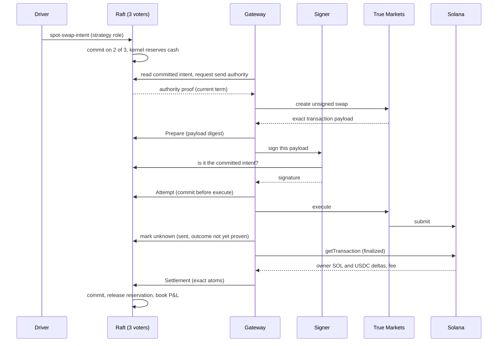
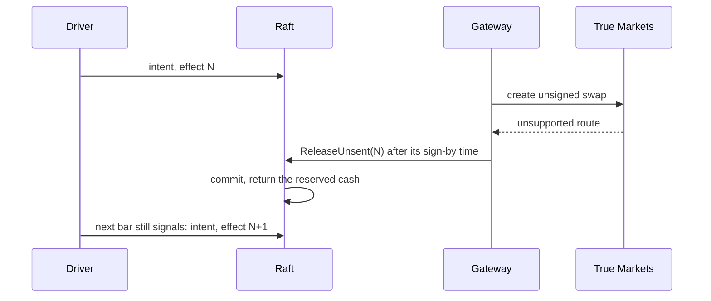
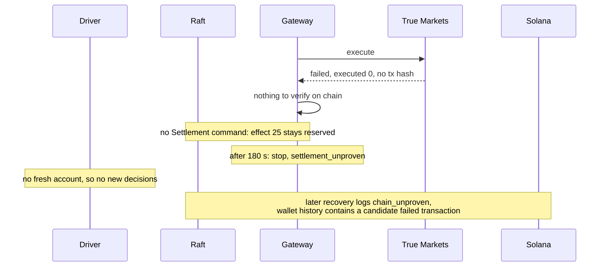
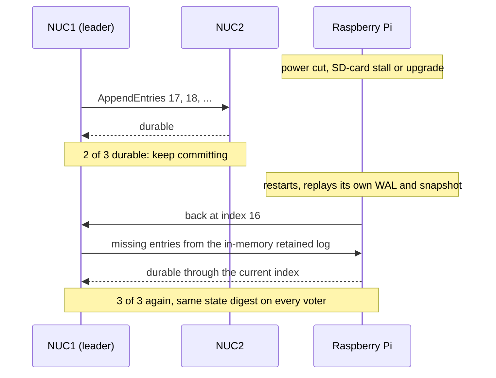
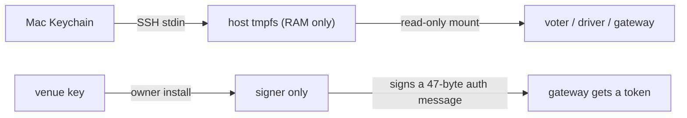
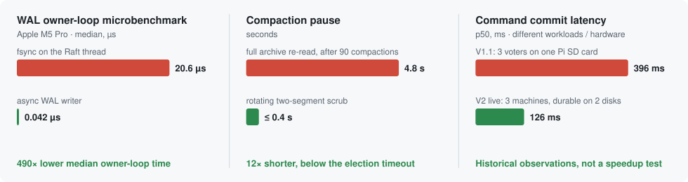

# Velocita

A replicated trading system built from scratch on home hardware: a deterministic C++20 trading kernel
replicated by Raft over Aeron across two NUC mini PCs and a Raspberry Pi 5, with a separate execution gateway
and a signer that holds the only venue key. It traded real money on Solana, unattended, and its ledger matched
the chain to the atom. **[Results →](RESULTS.md)** · **[The story, as a blog post →](https://vishaljha2121.github.io/VishalJhaPortfolio/blog/velocita-replicated-trading-on-a-raspberry-pi/)**

## At a glance

| | |
|---|---|
| Real money, unattended | **16 swaps** settled on Solana mainnet, **0** manual interventions |
| Ledger vs blockchain | **16 / 16** settlements equal to the wallet's on-chain change, to 10⁻⁹ SOL |
| Intent → majority commit in the 3-machine cluster | **p50 126 ms · p90 218 ms** (max 556 ms), durable on a majority of a cluster with two NUCs and a Raspberry Pi |
| Intent → transaction in a Solana block | **p50 2 s**, max 3 s, through the venue and the signer |
| Authoritative reducer microbenchmark (Apple M5 Pro) | **p50 125 ns · p99 167 ns**, in memory, excluding Raft, WAL and network |
| WAL owner-loop microbenchmark (Apple M5 Pro) | **42 ns** median with the writer off-thread versus **20.584 µs** inline; excludes waiting for durable commit |
| Voter restart | **4–7 s** to rejoin during a graceful rolling upgrade with trading halted ([scope](#crash-safety)); a surviving majority can still commit |
| Duplicate orders, unexplained balances | **0** across 17 h of paper trading and the live run |
| Tests | **206** configured CTest targets and **478** model Python tests; targeted mutation testing and selected native qualification suites ([scope](RESULTS.md#what-testing-found)) |

<sub>Commit latency: 25 applied live intents ([data](archive/evidence/benchmarks_2026-10-27/live-commit-latency.txt));
block inclusion: 16 successful swaps ([data](archive/evidence/live_run_2026-10-15/trades.json)), 2026-10-15/16.
Reducer figures: in memory; WAL figures: a storage microbenchmark on an Apple M5 Pro ([data](archive/evidence/benchmarks_2026-10-27)).</sub>

## The problem

An automated strategy that touches real money has to survive things a script ignores:

- **Crashes mid-send.** A process can die after an order leaves and before it records that it did. Restarting
  must neither lose the order nor send it twice.
- **An unreliable outside world.** Requests time out, venues answer late or ambiguously, and "failed" does not
  always mean "did not happen".
- **A strategy that should not be trusted.** Bugs in signal code must not be able to drain the account.
- **Cheap hardware.** Three small machines on a home network, any of which can stall, lose its disk or drop off.

The goal: run a real strategy against a real venue with $25, where every cent can be explained afterwards from
the record.

## The intuition

**Separate deciding from doing.** Money and decisions live in one deterministic state machine that three
machines replicate with Raft. Anything that touches the outside world runs in separate processes that may act
only on committed state, and must bring back evidence before the books change.

| Decision | Why |
|---|---|
| Deterministic kernel behind Raft ([ADR 0005](docs/adr/0005-reducer-behind-consensus.md)) | Every voter computes the same cents from the same log; the log is the audit trail |
| Raft over Aeron with storage outside the library, on a pinned fork ([0006](docs/adr/0006-asynchronous-durability-and-the-pinned-raft-fork.md)) | Upstream counted a leader's vote before its log was on disk; durability had to be exact |
| Integer atoms; the kernel owns cash, P&L and the loss limit ([0021](docs/adr/0021-the-kernel-owns-cash-pnl-and-the-loss-limit.md)) | No rounding to reconcile, and no limit a strategy can bypass |
| Callers have roles: strategy proposes, operator grants, gateway reports ([0016](docs/adr/0016-strategy-and-operator-callers-are-separate.md), [0020](docs/adr/0020-commands-are-authorized-by-caller-role.md)) | A compromised strategy can ask, never authorize |
| The gateway is a separate process with per-send authority ([0013](docs/adr/0013-request-correlated-execution-authority.md), [0017](docs/adr/0017-the-gateway-is-a-separate-process-reading-committed-state.md)) | A stale or deposed gateway cannot send |
| A signer holds the only key and checks the exact transaction ([0019](docs/adr/0019-live-execution-and-key-custody.md), [0029](docs/adr/0029-the-signer-authenticates-the-gateway-for-a-day.md)) | The gateway cannot sign anything the cluster did not commit |
| "Unknown" is a state; settle only from finalized chain evidence ([0025](docs/adr/0025-bounded-swap-verification-and-policy-bound-recovery.md), [0027](docs/adr/0027-unsent-effect-release-and-reviewed-baseline.md)) | A timeout or a venue's word never moves money |

All 29 decisions are in [`docs/adr`](docs/adr).

### Subsystems

| Subsystem | Role | Read more |
|---|---|---|
| Kernel | Pure `apply(state, command)` over one fixed-size struct: integer accounting, caller roles, risk limits, the swap lifecycle. No clocks, floats, heap or hash maps, so every voter computes the same bytes | [kernel.md](docs/guide/kernel.md) |
| Gateway | Single-threaded loop that reads committed state, journals each step, talks to the venue and the chain, and reports evidence back to Raft. Cannot sign | [gateway.md](docs/guide/gateway.md) |
| Signer | Only holder of the venue key. Re-reads Raft, decodes and verifies the exact transaction, gets its own authority proof, journals, then signs | [signer.md](docs/guide/signer.md) |
| Edge | Python driver: Binance 1 s bars → stochastic signals → at most one swap intent at a time, as the strategy caller | [edge.md](docs/guide/edge.md) |
| Raft and storage | willemt/raft on a pinned fork over Aeron UDP; asynchronous WAL, snapshots, archive and compaction | [storage.md](docs/guide/storage.md), [fix-durable-quorum.md](docs/guide/fix-durable-quorum.md) |

### The three machines


Any two voters form a quorum, so the cluster keeps committing if one machine fails. Every release that ran
live was built and tested natively on both CPU architectures.

### Happy path: one swap



### Negative paths

The venue refuses the route before anything is signed, so the effect is released and the signal re-sent:



The venue says "failed" but gives no transaction hash (effect 25 in the live run), so the money stays held:



### Crash safety

Any two of the three voters are a quorum, and "committed" means durable on two disks
([why that needed a Raft fix](docs/guide/fix-durable-quorum.md)). So a machine can drop out and come back
without anyone noticing in the books:



The diagram illustrates retained-log catch-up. The recorded operational checks were narrower.
During the 2026-10-15 upgrade the Pi's new container took minutes to start; NUC1
and NUC2 elected a leader in term 6 and converged at index 17 without it, and the Pi then recovered from its
own data at index 17 ([record](archive/evidence/automated_launch_2026-10-15/strategy-grant/deploy/PI_STARTUP.md)).
On 2026-10-16 every voter was stopped, backed up, upgraded and restarted in turn, Pi first and the leader
last: each was back in step within **4–7 seconds** with its data unchanged, and stopping the leader handed
leadership to the Pi ([record](archive/evidence/automated_launch_2026-10-15/effect25-recovery/rolling/README.md)).
These were graceful restarts while trading was halted; no entries committed while a voter was away.
The timings are not measurements of power-cut recovery or failover under trading load.
The paper run crossed a 20-second loss of one voter and an election burst with no unknown outcome.

Recovery checks WAL block checksums and snapshot structure. Swap totals are replay-validated while the
complete settlement history fits the 16-entry window; after eviction, validation checks the retained records
and bounds, not a reconstruction of lifetime totals ([details](docs/guide/kernel.md#snapshot-validation-and-its-limit)).
A commit index past the end of the log refuses recovery instead
of clamping; and pre-vote stops a returning voter from deposing a healthy leader. Limits: losing NUC1 keeps
the cluster up but stops trading, because the gateway and signer run there; and a voter that falls behind the
leader's last compaction (2,048+ entries, days at this system's rate) needs an operator repair from another
voter's archive: snapshot-install components exist, but the integrated online installer is not built.

### Atoms: money as integers

Every amount in Velocita is a whole number of the asset's smallest unit, an **atom**:

| Asset | Atom | One unit is | Type in the code |
|---|---|---|---|
| SOL (base) | lamport | 1,000,000,000 atoms | `swap::BaseAtoms` |
| USDC (quote) | micro-USDC | 1,000,000 atoms | `swap::QuoteAtoms` |

**Why.** Floating point rounds differently across compilers and CPUs, and one differing bit between the x86_64
NUCs and the aarch64 Pi would fork the replicas. Integers are bit-identical everywhere. Solana also stores
balances in exactly these units, so a settlement can be compared to the chain with `==` and no tolerance: that
is how 16 of 16 settlements matched "to the atom". `BaseAtoms` and `QuoteAtoms` are distinct `StrongId` types,
so adding lamports to USDC doesn't compile.

**Where and how it's used.**

| Place | In atoms |
|---|---|
| Strategy intent | buy debit (12,690,000 = $12.69), fee cap, minimum SOL to receive (110,400,000 lamports) |
| Kernel state | cash, SOL held, reservations, cost basis, fees, realized P&L (signed), the −10,000,000 loss stop |
| Signer check | fee = input ÷ 10,000 × 20 exactly, so input must be a multiple of 10,000 atoms (one cent); the driver rounds buys to whole cents |
| Settlement | SOL and USDC debits, credits and fee, copied from the finalized transaction's balance changes |
| Arithmetic | products such as amount × price widen to `__int128`; overflow is a refusal; cost removed on a sell rounds down, the same way on every voter |

Dollars appear only at the edges: the dashboards and reports convert atoms for display.

### Secrets and how they are shared

Voters and callers authenticate every message with 32-byte HMAC keys that are created in the owner's Keychain,
pushed over SSH into RAM-only tmpfs on each host, and mounted read-only into exactly the process that needs
them. Keys are derived per direction and per cluster incarnation, so a captured frame can't be reflected or
replayed into another cluster. The venue's P-256 key, which can move money, lives only in the signer, behind
its own Unix user and a network allowlist of the three voters; the gateway gets a short-lived token through
the signer and never sees the key.



Why this way, and what it doesn't protect: [secrets.md](docs/guide/secrets.md).

### Storage: databases and caches

No general-purpose database touches money. Each voter keeps a checksummed block WAL, atomically replaced Raft
metadata, a canonical snapshot with checksums and semantic validation, and immutable archive segments for
compacted history. The gateway and signer keep small journals written *before* every external act. SQLite holds
recorded market data and Prometheus holds metrics, both beside the money path. Every cache (the in-memory
log, the gateway's state copy, the driver's account file) can only make the system wait when stale, never act
on old data. Details: [storage.md](docs/guide/storage.md).

### Memory: budgets, atlas and arenas

The deterministic kernel uses fixed-size state: the whole replicated state is 78,512 of an
81,920-byte budget, and its canonical snapshot 61,586 of 65,536 bytes, each enforced by `static_assert`.
The retained log and WAL use arenas allocated once at start-up: a 16 MiB ring and 64 × 4 KiB WAL
blocks handed to a writer thread over lock-free queues. Kernel tables are fixed arrays scanned linearly.
Capacity limits cause refusal or backpressure. The surrounding node still allocates for proposals, peer
messages and persistence jobs; this is not an allocation-free or stall-free process. Details: [memory.md](docs/guide/memory.md) and the field-by-field
[memory atlas](docs/V2_MESSAGE_MEMORY_ATLAS.md).

### Debugging and operations

Components expose stop codes and evidence, though some codes still group several possible causes.

| Need | Tool |
|---|---|
| Is the cluster healthy? | each voter's Prometheus endpoint (ready, failed, term, leader, commit), `velocita-v2-status`, and a two-minute check script |
| What is the account right now? | the live observer publishes the gateway's validated snapshot every 5 s, as metrics and `strategy-settlements.json` |
| What happened over time? | Grafana: price with entry and exit markers, gateway and signer phases, settlement feed, election terms |
| Something needs attention | alert rules → Alertmanager → self-hosted ntfy push to a phone |
| Why did it stop? | typed stop causes in the driver, gateway and signer logs (`settlement unresolved stage=… code=…`, `TM route refused code=8`) |
| What really happened? | replay a voter's archived log through the kernel, read a finalized transaction's exact balance changes, capture the venue account history |
| Does the outside world look as expected? | one-request, read-only probes of the venue's API, its unsigned swaps, the route program's interface and the market-data feeds |
| Does the safety still hold? | process and continuous drills, power-cut tests, mutation harnesses that prove each mutant was rebuilt and killed |

Commands, a "what healthy looks like" table and symptom → cause → action: [debugging.md](docs/guide/debugging.md).

## How it was built

Nearly 400 commits over eight weeks, in small steps; read them in order with `git log --reverse`. Each V2
phase was accepted on the target hardware before the next began.

| Date (2026) | Step | Ref |
|---|---|---|
| Aug 26 | V1: Raft counter over Aeron on a Raspberry Pi 5, with WAL, replay and deduplication | [`v1.0.0`](https://github.com/vishaljha2121/Velocita/tree/v1.0.0) |
| Aug 27–29 | Leader-aware client routing and bounded recovery | [`v1.1-phase2`](https://github.com/vishaljha2121/Velocita/tree/v1.1-phase2) |
| Sep 1–7 | V2 contracts, deterministic kernel, authoritative decision evaluation | [`v2-phase3-accepted`](https://github.com/vishaljha2121/Velocita/tree/v2-phase3-accepted) |
| Sep 10 | Risk reservations, orders and a transactional outbox | [`v2-phase4-accepted`](https://github.com/vishaljha2121/Velocita/tree/v2-phase4-accepted) |
| Sep 11–15 | Venue simulator and execution gateway | [`v2-phase5-corrected-accepted`](https://github.com/vishaljha2121/Velocita/tree/v2-phase5-corrected-accepted) |
| Sep 16 | Kernel behind Raft; asynchronous durable WAL and snapshots | [`v2-phase7-complete`](https://github.com/vishaljha2121/Velocita/tree/v2-phase7-complete) |
| Sep 17 | Execution authority, fencing and emergency control | [`v2-phase8-mechanisms`](https://github.com/vishaljha2121/Velocita/tree/v2-phase8-mechanisms) |
| Sep 30–Oct 1 | Paper trading on the home cluster; pre-vote; full architecture review | [`v2-baseline-2026-10-01`](https://github.com/vishaljha2121/Velocita/tree/v2-baseline-2026-10-01) |
| Oct 7 | One-second stochastic strategy in paper | [`v2-paper-stochastic-2026-10-07`](https://github.com/vishaljha2121/Velocita/tree/v2-paper-stochastic-2026-10-07) |
| Oct 9–13 | Inspecting signer, swap runtime, finalized settlement | [`a890307`](https://github.com/vishaljha2121/Velocita/commit/a890307) |
| Oct 14 | First live swap from the cluster ($1) | [`6c54f3f`](https://github.com/vishaljha2121/Velocita/commit/6c54f3f) |
| Oct 15 | Unattended driver and the release that ran live | [`ba299ff`](https://github.com/vishaljha2121/Velocita/commit/ba299ff) |
| Oct 16 | Recovery for a venue-failed swap, qualified on both architectures | [`64e6f9f`](https://github.com/vishaljha2121/Velocita/commit/64e6f9f) |

### Progress, stage by stage



The commit latencies compare different hardware and workloads: V1.1 used three voters on one Pi at
5 commands/s; V2 used three physical machines and 25 sparse live intents. This is historical context,
not a controlled speedup measurement. The WAL microbenchmark is a separate Apple M5 Pro run.

| When | What was measured | Change | Result |
|---|---|---|---|
| Aug 29 | 3 voters on one Pi SD card: commit p50 396 ms, p99 828 ms at 5 cmd/s; leaderless at 20 cmd/s (~9 fsyncs per command) | V2 moved storage work to a writer and spread voters across machines | V2 live commit p50 126 ms; different topology and workload |
| Sep 15 | A power-cut sweep at every structurally distinct offset found a commit index past the log end, and 64 KiB written per 200-byte command | Refuse instead of clamping; 4 KiB blocks | Then the benchmark refused 4 of 5 records, fixed with a 64-block arena |
| Sep 15 | Upstream Raft counted the leader's vote before its entry was durable | [Durable-quorum fork](docs/guide/fix-durable-quorum.md) | Committed = on 2 of 3 disks |
| Oct 1 | Wi-Fi drops inflated terms: 49 → 191 in 6 hours | Pre-vote | A returning voter no longer deposes a healthy leader |
| Oct 3 | Compaction pause grew 0.8 s → 4.8 s; term 1 → 65 in 48 hours | Rotating two-segment scrub | Pauses 0.1–0.4 s, below the election timeout |
| Oct 7–8 | Paper: 17.2 h, 58 fills | – | 0 unknown outcomes across an election burst and a lost voter |
| Oct 9 | Gateway read state one entry stale and stopped itself | [Read fence](archive/evidence/gateway_stop_2026-10-09/README.md) | Stale readings discarded |
| Oct 15 | One failed read during an election stopped the gateway | [Bounded retry](docs/guide/fix-read-outage-retry.md) | Live run crossed term 6 → 8 without stopping |
| Oct 15–16 | Live: 25 intents, 16 swaps | – | 16 / 16 exact; commit p50 126 ms |
| Oct 16 | Venue reported a failure with no transaction hash | On-chain proof before "never executed" | Recovery logged `chain_unproven`; a candidate failed transaction was found later, but the published evidence does not prove the payload match |

Practices: test-first changes, an ADR per boundary, crash-injection and multi-process drills, mutation runs
that prove each mutant was rebuilt and killed, and native qualification on x86_64 and aarch64 before each
live deploy.

## What we observed

**In testing.** The tests found real defects before money did:
- With an asynchronous log, upstream Raft counted the leader's vote before its entry was on disk, so a leader
  crash could lose an acknowledged entry: [fixed with a pinned fork](docs/guide/fix-durable-quorum.md).
- A gateway could read state one entry stale from a leader whose disk lagged:
  [fixed with a read fence](archive/evidence/gateway_stop_2026-10-09/README.md).
- A single failed read during a leader election stopped the gateway for good:
  [fixed with a bounded retry](docs/guide/fix-read-outage-retry.md).
- V1 drills showed failover in 1.5 s and no commit without quorum ([results](docs/V1_FAILURE_DRILL_RESULTS.md)).

**In paper.** 17.2 hours, 29 round trips and $804 of volume through the full cluster, with every fill
reconciled and no unknown outcome across an election burst and a lost voter. The rule was flat before fees
(+$0.0036); replays over 7 and 30 days found negative aggregate returns before costs in those windows.

**Live.** 25 intents, 16 swaps and $202 of volume over three hours, unattended. The ledger matched the chain
on every settlement. It lost $0.95, with fees and execution-price differences dominating the reference-price movement, and stopped on an
order the venue reported without a hash.

**[Full results, round trips and evidence →](RESULTS.md)** · **[Read the story →](https://vishaljha2121.github.io/VishalJhaPortfolio/blog/velocita-replicated-trading-on-a-raspberry-pi/)**

## Build

Requires CMake 3.30+, a C++20 compiler, OpenSSL 3 and Git. Aeron and willemt/raft are fetched at pinned commits.

```bash
cmake -S . -B build -DCMAKE_BUILD_TYPE=Release
cmake --build build --parallel
ctest --test-dir build --output-on-failure    # 182 tests; 206 with the swap runtime and VELOCITA_TEST_* options
cd model && PYTHONPATH=src python3 -m unittest discover -s tests    # 478 tests
```

| Path | Contents |
|---|---|
| [`src/`](src), [`include/`](include) | Kernel, Raft node, storage, gateway, signer, venue adapters (C++20, ~52k lines) |
| [`tests/`](tests) | Unit, property, crash-injection and multi-process tests; mutation harnesses |
| [`model/`](model) | Python strategy research and the live driver |
| [`deploy/`](deploy) | Containers, systemd units, monitoring and alerting, install tooling |
| [`docs/`](docs) | ADRs, architecture contracts, design reviews, runbooks |
| [`archive/`](archive) | Qualification, deployment and live-run evidence, kept as written |

## Limits

- One operator, one venue, one pair; the three machines share a house and a network.
- The last recorded recovery left effect 25 reserved. Exact linkage to the candidate chain transaction and an admitted settlement remain unproven in the published evidence.
- A personal engineering project, not financial software.

## License

[MIT](LICENSE). Aeron (Apache 2.0) and willemt/raft (BSD) are fetched at build time under their own licenses.

Development was AI-assisted: Claude and Codex sessions wrote code and documents under my direction and review.
Their handoff notes are in [`archive/handoffs`](archive/handoffs).
