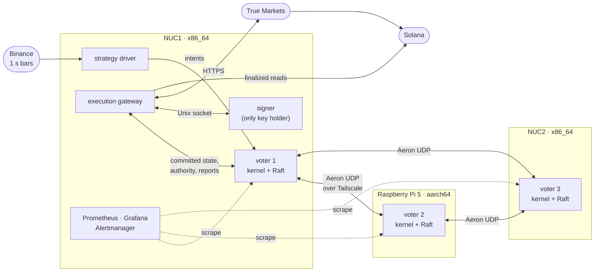
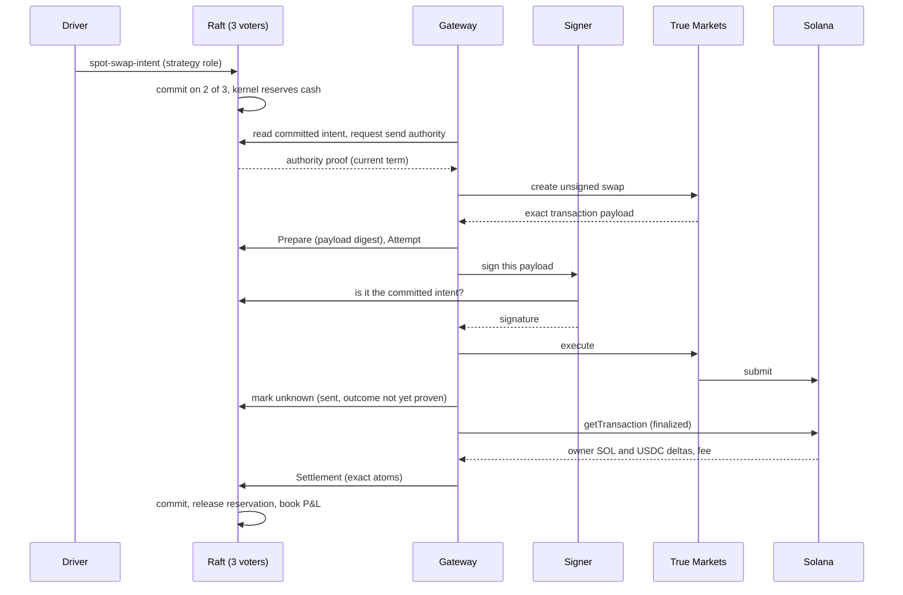
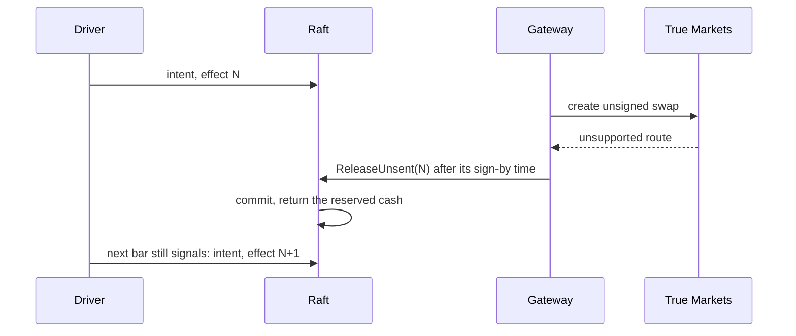
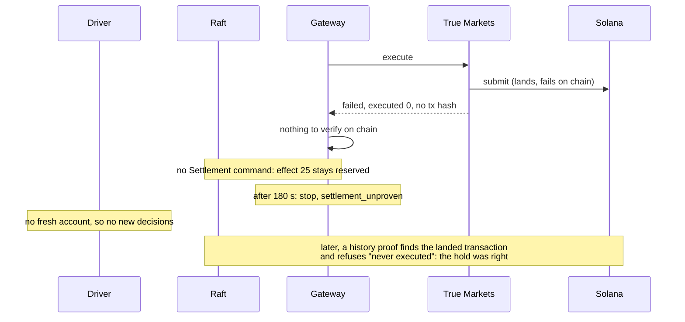
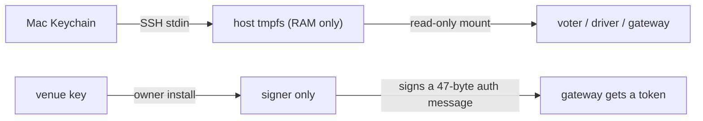

# Velocita

A replicated trading system built from scratch on home hardware: a deterministic C++20 trading kernel
replicated by Raft over Aeron across two NUC mini PCs and a Raspberry Pi 5, with a separate execution gateway
and a signer that holds the only venue key. It traded real money on Solana, unattended, and its ledger matched
the chain to the atom. **[Results →](RESULTS.md)**

## The problem

An automated strategy that touches real money has to survive things a script ignores:

- **Crashes mid-send.** A process can die after an order leaves and before it records that it did. Restarting
  must neither lose the order nor send it twice.
- **An unreliable outside world.** Requests time out, venues answer late or ambiguously, and "failed" does not
  always mean "did not happen".
- **A strategy that should not be trusted.** Bugs in signal code must not be able to drain the account.
- **Cheap hardware.** Three small machines on a home network, any of which can stall, lose its disk or drop off.

The goal: run a real strategy against a real venue with $25, where every cent can be explained afterwards from
the record.

## The intuition

**Separate deciding from doing.** Money and decisions live in one deterministic state machine that three
machines replicate with Raft. Anything that touches the outside world runs in separate processes that may act
only on committed state, and must bring back evidence before the books change.

| Decision | Why |
|---|---|
| Deterministic kernel behind Raft ([ADR 0005](docs/adr/0005-reducer-behind-consensus.md)) | Every voter computes the same cents from the same log; the log is the audit trail |
| Raft over Aeron with storage outside the library, on a pinned fork ([0006](docs/adr/0006-asynchronous-durability-and-the-pinned-raft-fork.md)) | Upstream counted a leader's vote before its log was on disk; durability had to be exact |
| Integer atoms; the kernel owns cash, P&L and the loss limit ([0021](docs/adr/0021-the-kernel-owns-cash-pnl-and-the-loss-limit.md)) | No rounding to reconcile, and no limit a strategy can bypass |
| Callers have roles: strategy proposes, operator grants, gateway reports ([0016](docs/adr/0016-strategy-and-operator-callers-are-separate.md), [0020](docs/adr/0020-commands-are-authorized-by-caller-role.md)) | A compromised strategy can ask, never authorize |
| The gateway is a separate process with per-send authority ([0013](docs/adr/0013-request-correlated-execution-authority.md), [0017](docs/adr/0017-the-gateway-is-a-separate-process-reading-committed-state.md)) | A stale or deposed gateway cannot send |
| A signer holds the only key and checks the exact transaction ([0019](docs/adr/0019-live-execution-and-key-custody.md), [0029](docs/adr/0029-the-signer-authenticates-the-gateway-for-a-day.md)) | The gateway cannot sign anything the cluster did not commit |
| "Unknown" is a state; settle only from finalized chain evidence ([0025](docs/adr/0025-bounded-swap-verification-and-policy-bound-recovery.md), [0027](docs/adr/0027-unsent-effect-release-and-reviewed-baseline.md)) | A timeout or a venue's word never moves money |

All 29 decisions are in [`docs/adr`](docs/adr).

### Subsystems

| Subsystem | Role | Read more |
|---|---|---|
| Kernel | Pure `apply(state, command)` over one fixed-size struct: integer accounting, caller roles, risk limits, the swap lifecycle. No clocks, floats, heap or hash maps, so every voter computes the same bytes | [kernel.md](docs/guide/kernel.md) |
| Gateway | Single-threaded loop that reads committed state, journals each step, talks to the venue and the chain, and reports evidence back to Raft. Cannot sign | [gateway.md](docs/guide/gateway.md) |
| Signer | Only holder of the venue key. Re-reads Raft, decodes and verifies the exact transaction, gets its own authority proof, journals, then signs | [signer.md](docs/guide/signer.md) |
| Edge | Python driver: Binance 1 s bars → stochastic signals → at most one swap intent at a time, as the strategy caller | [edge.md](docs/guide/edge.md) |
| Raft and storage | willemt/raft on a pinned fork over Aeron UDP; asynchronous WAL, snapshots, archive and compaction | [storage.md](docs/guide/storage.md), [fix-durable-quorum.md](docs/guide/fix-durable-quorum.md) |

### The three machines



Any two voters form a quorum, so the cluster keeps committing if one machine fails. Every release that ran
live was built and tested natively on both CPU architectures.

### Happy path: one swap



### Negative paths

The venue refuses the route before anything is signed, so the effect is released and the signal re-sent:



The venue says "failed" but gives no transaction hash (effect 25 in the live run), so the money stays held:



### Secrets and how they are shared

Voters and callers authenticate every message with 32-byte HMAC keys that are created in the owner's Keychain,
pushed over SSH into RAM-only tmpfs on each host, and mounted read-only into exactly the process that needs
them. Keys are derived per direction and per cluster incarnation, so a captured frame can't be reflected or
replayed into another cluster. The venue's P-256 key, which can move money, lives only in the signer, behind
its own Unix user and a network allowlist of the three voters; the gateway gets a short-lived token through
the signer and never sees the key.



Why this way, and what it doesn't protect: [secrets.md](docs/guide/secrets.md).

### Storage: databases and caches

No general-purpose database touches money. Each voter keeps a checksummed block WAL, atomically replaced Raft
metadata, a canonical snapshot that is replayed before it is trusted, and immutable archive segments for
compacted history. The gateway and signer keep small journals written *before* every external act. SQLite holds
recorded market data and Prometheus holds metrics, both beside the money path. Every cache (the in-memory
log, the gateway's state copy, the driver's account file) can only make the system wait when stale, never act
on old data. Details: [storage.md](docs/guide/storage.md).

### Memory: budgets, atlas and arenas

Every long-lived object has a size fixed at compile time: the whole replicated state is 78,512 of an
81,920-byte budget, and its canonical snapshot 61,586 of 65,536 bytes, each enforced by `static_assert`.
Memory comes from arenas allocated once at start-up: a 16 MiB ring for the retained log, 64 × 4 KiB WAL
blocks handed to a writer thread over lock-free queues, and fixed tables scanned linearly. Full means a typed
refusal, never an allocation or a stall. Details: [memory.md](docs/guide/memory.md) and the field-by-field
[memory atlas](docs/V2_MESSAGE_MEMORY_ATLAS.md).

## How it was built

Nearly 400 commits over eight weeks, in small steps; read them in order with `git log --reverse`. Each V2
phase was accepted on the target hardware before the next began.

| Date (2026) | Step | Ref |
|---|---|---|
| Aug 26 | V1: Raft counter over Aeron on a Raspberry Pi 5, with WAL, replay and deduplication | [`v1.0.0`](https://github.com/vishaljha2121/Velocita/tree/v1.0.0) |
| Aug 27–29 | Leader-aware client routing and bounded recovery | [`v1.1-phase2`](https://github.com/vishaljha2121/Velocita/tree/v1.1-phase2) |
| Sep 1–7 | V2 contracts, deterministic kernel, authoritative decision evaluation | [`v2-phase3-accepted`](https://github.com/vishaljha2121/Velocita/tree/v2-phase3-accepted) |
| Sep 10 | Risk reservations, orders and a transactional outbox | [`v2-phase4-accepted`](https://github.com/vishaljha2121/Velocita/tree/v2-phase4-accepted) |
| Sep 11–15 | Venue simulator and execution gateway | [`v2-phase5-corrected-accepted`](https://github.com/vishaljha2121/Velocita/tree/v2-phase5-corrected-accepted) |
| Sep 16 | Kernel behind Raft; asynchronous durable WAL and snapshots | [`v2-phase7-complete`](https://github.com/vishaljha2121/Velocita/tree/v2-phase7-complete) |
| Sep 17 | Execution authority, fencing and emergency control | [`v2-phase8-mechanisms`](https://github.com/vishaljha2121/Velocita/tree/v2-phase8-mechanisms) |
| Sep 30–Oct 1 | Paper trading on the home cluster; pre-vote; full architecture review | [`v2-baseline-2026-10-01`](https://github.com/vishaljha2121/Velocita/tree/v2-baseline-2026-10-01) |
| Oct 7 | One-second stochastic strategy in paper | [`v2-paper-stochastic-2026-10-07`](https://github.com/vishaljha2121/Velocita/tree/v2-paper-stochastic-2026-10-07) |
| Oct 9–13 | Inspecting signer, swap runtime, finalized settlement | [`a890307`](https://github.com/vishaljha2121/Velocita/commit/a890307) |
| Oct 14 | First live swap from the cluster ($1) | [`6c54f3f`](https://github.com/vishaljha2121/Velocita/commit/6c54f3f) |
| Oct 15 | Unattended driver and the release that ran live | [`ba299ff`](https://github.com/vishaljha2121/Velocita/commit/ba299ff) |
| Oct 16 | Recovery for a venue-failed swap, qualified on both architectures | [`64e6f9f`](https://github.com/vishaljha2121/Velocita/commit/64e6f9f) |

Practices: test-first changes, an ADR per boundary, crash-injection and multi-process drills, mutation runs
that prove each mutant was rebuilt and killed, and native qualification on x86_64 and aarch64 before each
live deploy.

## What we observed

**In testing.** The tests found real defects before money did:
- With an asynchronous log, upstream Raft counted the leader's vote before its entry was on disk, so a leader
  crash could lose an acknowledged entry: [fixed with a pinned fork](docs/guide/fix-durable-quorum.md).
- A gateway could read state one entry stale from a leader whose disk lagged:
  [fixed with a read fence](archive/evidence/gateway_stop_2026-10-09/README.md).
- A single failed read during a leader election stopped the gateway for good:
  [fixed with a bounded retry](docs/guide/fix-read-outage-retry.md).
- V1 drills showed failover in 1.5 s and no commit without quorum ([results](docs/V1_FAILURE_DRILL_RESULTS.md)).

**In paper.** 17.2 hours, 29 round trips and $804 of volume through the full cluster, with every fill
reconciled and no unknown outcome across an election burst and a lost voter. The rule was flat before fees
(+$0.0036); replays over 7 and 30 days confirmed it has no edge before costs.

**Live.** 25 intents, 16 swaps and $202 of volume over three hours, unattended. The ledger matched the chain
on every settlement. It lost $0.95, almost all of it the venue's spread and fee, and stopped correctly on an
order the venue reported without a hash.

**[Full results, round trips and evidence →](RESULTS.md)**

## Build

Requires CMake 3.30+, a C++20 compiler, OpenSSL 3 and Git. Aeron and willemt/raft are fetched at pinned commits.

```bash
cmake -S . -B build -DCMAKE_BUILD_TYPE=Release
cmake --build build --parallel
ctest --test-dir build --output-on-failure    # 182 tests; 206 with the swap runtime and VELOCITA_TEST_* options
cd model && PYTHONPATH=src python3 -m unittest discover -s tests    # 478 tests
```

| Path | Contents |
|---|---|
| [`src/`](src), [`include/`](include) | Kernel, Raft node, storage, gateway, signer, venue adapters (C++20, ~52k lines) |
| [`tests/`](tests) | Unit, property, crash-injection and multi-process tests; mutation harnesses |
| [`model/`](model) | Python strategy research and the live driver |
| [`deploy/`](deploy) | Containers, systemd units, monitoring and alerting, install tooling |
| [`docs/`](docs) | ADRs, architecture contracts, design reviews, runbooks |
| [`archive/`](archive) | Qualification, deployment and live-run evidence, kept as written |

## Limits

- One operator, one venue, one pair; the three machines share a house and a network.
- Effect 25 is still reserved: settling a landed-and-failed swap from the transaction the proof finds is designed, not built.
- A personal engineering project, not financial software.

Development was AI-assisted: Claude and Codex sessions wrote code and documents under my direction and review.
Their handoff notes are in [`archive/handoffs`](archive/handoffs).
