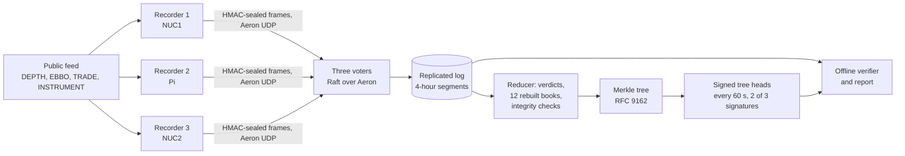

# Velocita Tape

A verifiable recording of a public exchange's market-data feed, made by three independent machines, ordered by
Raft, and sealed in a signed Merkle log that anyone can check offline.

Three recorders (two NUC mini PCs and a Raspberry Pi 5) each hold their own connection to the public, no-login
WebSocket feed of the twelve tokenized-stock books in True Markets' Orderbook Arena. Every frame they receive goes
into one replicated log. Each machine rebuilds every order book from that log, bit for bit identically, and the
cluster signs the log's Merkle root every minute. The result is a tape that answers questions a single client
cannot: did every subscriber get the same data, how fast, was the book a client rebuilt actually correct, and did
the trades match the book?

It never trades. It reads only documented no-login channels, holds no venue credentials, and a build check proves
no tape binary links any order-entry or signing code.

## Why

An exchange sends its order book as a stream: a snapshot, then changes. Every client folds those changes into its
own copy, and a client that misses or misapplies one message has a wrong book with no error on the screen. The
exchange sees only what it sent; one client sees only what it received. Nobody can show whether the feed was
complete, correct, timely, live and the same for everyone. This project measures those five things from outside,
from three vantage points at once, and makes every number checkable.

## How it works



- **Recorders** keep every frame byte for byte, detect sequence gaps and resubscribe, and submit to all three
  voters.
- **Voters** order everything through Raft. A pure, deterministic reducer gives each update a **verdict**
  (identical at 3, 2 or 1 recorders, or divergent), rebuilds each book in integer units, and runs integrity
  checks (crossed books, trades outside the book, snapshots that disagree with updates) that only observe.
- **Proof:** every log entry is a leaf in an RFC 9162 Merkle tree; the voters sign tree heads with Ed25519 keys
  born on their own machines. Segments rotate every 4 hours, and each segment's first entry names the previous
  segment's last signed head, so the segments form one chain.
- **Verifier** (`velocita-tape-verify`) needs only the log, the heads and the public keys: no network, no trust in
  the cluster.
- **Report** (`tools/tape-report.py`) turns verified segments into a feed-quality report, aggregates only.

Design records: [ADR 0030](docs/adr/0030-the-verifiable-tape-is-a-separate-raft-group.md) (the locked design),
[guarantees](docs/tape/GUARANTEES.md), [decision log](docs/tape/DECISIONS.md) (D-01 to D-64, every choice with its
reason), [runbook](docs/tape/RUNBOOK.md), [test map](docs/tape/TEST_MAP.md).

## Results

The first report covers 13.8 recorded hours on 2026-11-12, two linked segments, all three recorders. Full write-up:
[FINDINGS-2026-11-12-report.md](docs/tape/FINDINGS-2026-11-12-report.md).

### The feed

| Measure | Result |
|---|---|
| Update verdicts | 289,636 |
| Identical at all three recorders | 91.0% overall; **98.7 to 100% in every hour without an incident on our side** |
| Divergent (different bytes for the same message) | **0** |
| Arrival spread between the first and last recorder | p50 19 ms, p90 43 ms, p99 289 ms (clock error bound 3.9 ms) |
| DEPTH update cadence | median about 1.0 s on ten books, 2.0 s on two, matching the documented 1 s batching |
| Quiet-book silences over 30 s | hundreds per quiet book, up to 31 minutes off-hours |

The last row matters to anyone building on the feed: the docs treat about 30 seconds of silence as a dead
connection, so a client without heartbeats would keep dropping healthy connections on quiet books.

### Hour by hour

Selected hours; the full hourly table is in the findings.

| Hour (UTC) | Recorded min | Updates | Identical at 3 of 3 | Note |
|---|---|---|---|---|
| 00:00 to 03:59 | 137 | 39,806 | 44 to 66% | First night: our resend floods and a recorder subscription bug, both since fixed |
| 05:00 | 60 | 16,898 | 100.0% | |
| 09:00 to 13:59 | 300 | 118,583 | 100.0% every hour | |
| 06:00, 08:00, 14:00 | 134 | 46,308 | 83 to 89% | Hours in which the network watchdog stopped the tape |
| 18:00 | 43 | 21,846 | 99.0% | |

### The rebuilt books

All twelve books stayed valid on every machine, and the rebuilt best bid and offer agree with the exchange's own
EBBO channel (at most five mismatches per book over the whole run). During US market hours spreads are very tight
(0.03 to 4.4 bp mean) on very small size (median top of book 0.005 to 0.22 shares); off-hours they are 8 to 17 bp.

### Trade consistency

For each of the 221 trades, the checker asks whether the book changed the way the trade implies: within 3 s before
to 10 s after the print, a DEPTH change on the resting side at the trade price removes at least the trade's size.

| Class | Trades |
|---|---|
| Consistent (within 3 s) | 187 (85%) |
| Late (within 10 s) | 4 |
| Unexplained | 30 (12 of them overnight, before the recorder fix) |

The matching DEPTH change usually arrives about a millisecond **before** the trade print, so the two appear to be
published in the same batch, DEPTH first. Most remaining unexplained trades printed at a price that never appeared
as a level on the published book while other levels on that side shrank, which raises a question for the venue
rather than a conclusion: is a trade price per fill, or one price per taker order?

### What running it taught us

The tape ran on home Wi-Fi with Tailscale between machines, and that exposed real problems that a localhost test
never did: Raft resends that grew with the square of the round-trip time, Aeron amplifying packet loss into
megabyte-per-second floods, a log that outgrew memory, and a recorder whose back-to-back unsubscribe and subscribe
raced the feed's one-request-at-a-time rule. Each is fixed, tested and recorded (D-40 to D-58): per-follower byte
budgets, backed-off probes, an Aeron MTU that fits the tunnel, 4-hour segments, a queued control channel, and a
per-host watchdog that stops the tape if it ever floods the network and restarts it once the link is quiet.

## Examples

These outputs are real, from the archived 16:00 UTC segment.

### Verify a segment offline

```sh
velocita-tape-verify --wal segment/wal.log --heads segment/heads --incarnation 1794499200 --head-every 60 \
    --previous-head previous-segment/heads/head-44460.json \
    --key head-1.pub.pem --key head-2.pub.pem --key head-3.pub.pem
```

```json
{
  "ok": true,
  "entries": 121569,
  "tree_size": 121569,
  "root": "6220035433496c15c2b39d0291a132f262ba5d6e24af9b66718c2c6ffbffbd64",
  "heads_verified": 75,
  "last_tick": 4543,
  "refused_ticks": 0,
  "tick_spacing_flags": 2,
  "symbols": 12,
  "previous_segment": {"incarnation": 68934737119228, "tick": 44460, "tree_size": 764733,
                       "root": "c516ba4ff6267aed09d25bcff0b1eb73acf4e455e85753b781cce5c527e10951", "linked": true}
}
```

It replays every entry through the same reducer the voters run, rebuilds the Merkle tree, checks all 75 signed
heads (two valid signatures each, and consistency between consecutive heads), and checks the link to the previous
segment. Change one byte anywhere and it fails with the index and the check that broke. The two tick-spacing flags
are the two times the tape was stopped; the verifier reports them rather than hiding them.

### Rebuild a book at any moment, with proof

```sh
velocita-tape-verify ... --book NVDAC-USDC --until-seq 173921
```

```json
{
  "symbol": "NVDAC-USDC", "found": true, "log_index": 111394,
  "hash": "7c06570573189dfdd477db1a50a857b4190d35bebc0ada8ea9ec3ea28ef45f21",
  "bids": [[163613000000, 39000000], [163572000000, 59000000], [163510000000, 89000000]],
  "asks": [[163807000000, 39000000], [163848000000, 59000000], [163910000000, 89000000]],
  "position": 173921,
  "inclusion": {"head_tick": 4500, "proof_hashes": 17, "verified": true}
}
```

Prices and sizes are integers in units of 1e-9 (163613000000 is 163.613). The book hash is the same on every
machine, and the inclusion proof ties this exact book state to signed head 4500.

### Produce the feed-quality report

```sh
python3 tools/tape-report.py --segments ARCHIVE_DIR --verify build/velocita-tape-verify \
    --key head-1.pub.pem --key head-2.pub.pem --key head-3.pub.pem --out report/
```

It verifies every segment and its link (excluding, with a reason, anything that fails), then writes
`summary.json` (byte-identical on a rerun) and a one-page `report.html`. An excerpt of `summary.json`:

```json
"completeness": {"share_3_of_3": 0.9098,
                 "updates": {"3/3": 263497, "2/3": 7339, "1/3": 18800, "divergent": 0, "closed": 289636}},
"timeliness": {"arrival_spread_ms": {"p50": 19, "p90": 43, "p99": 289, "max": 6709},
               "clock_error_bound_ms": 3.935},
"trades": {"count": 221, "class": {"consistent": 187, "late": 4, "unexplained": 30}}
```

### Run the whole tape on one machine

```sh
python3 tools/tape-local-run.py build ~/tape-run --seconds 90 --head-every 10 --unplug 2 --unplug-at 25 --unplug-for 20
python3 tools/tape-local-run.py build ~/tape-run --seconds 75 --head-every 10 --rotate-at 30
```

Each starts three voters and three recorders on localhost against the live public feed. The first unplugs machine
2 for 20 s and checks that the other two keep recording and that it catches up with an identical history; the
second rotates to a new segment partway through and verifies both segments and the link between them.

## Build and test

Needs CMake, Ninja, a C++20 compiler and OpenSSL 3. The recorder tests need Python with the `websockets` package.

```sh
cmake -S . -B build -G Ninja -DCMAKE_BUILD_TYPE=Release -DVELOCITA_BUILD_TAPE=ON \
    -DVELOCITA_TAPE_FIXTURE_PYTHON=/path/to/python-with-websockets
cmake --build build
ctest --test-dir build -R '^tape-'
```

Fourteen suites cover the tape: the reducer against an independent Python reference (including two real
connections replayed), the replica under restarts, slow and lossy links, the voters, the recorder against a
scripted feed that behaves like the real one, the submitter's budgets, the watchdog, rotation, the report, and
symbol checks proving the reducer is pure and no tape binary can trade. A mutation suite
(`tests/mutation_tape.py`) plants 34 bugs and every one is caught. [TEST_MAP.md](docs/tape/TEST_MAP.md) maps all 92
test cases in the ADR to these tests.

## Layout

| Path | What |
|---|---|
| `include/velocita/tape/`, `src/tape_*.cpp` | Frame scanner, entry codec, Merkle tree, reducer, WAL, replica, voter, recorder, WebSocket client, verifier |
| `tools/tape-report.py` | Feed-quality report and trade-consistency checker |
| `tools/tape-local-run.py` | Three voters and three recorders on one machine |
| `tools/tape-key-ceremony.sh`, `tape-ship.sh`, `tape-render-configs.py` | Keys, shipping source to hosts, host configs |
| `deploy/tape/` | Container image, systemd units, rotation, watchdog, Prometheus and Grafana |
| `tests/test_tape_*.py`, `tests/tape_*_tests.cpp` | Tests; `tests/tape_oracles/` is the independent reference |
| `docs/tape/` | Guarantees, decisions, plans, runbook, findings, test map |

## Built on Velocita

This repository starts from the orderbook baseline of
[Velocita](https://github.com/vishaljha2121/Velocita), a replicated trading system on the same three machines; the
tape reuses its Aeron runtime and its pinned Raft fork with the durable-quorum patch, and runs as a separate Raft
group with its own ports, keys and data. The trading code is still here and still documented in
[`docs/ORDERBOOK_BASELINE.md`](docs/ORDERBOOK_BASELINE.md); the tape never links it.

## Data and scope

Recorded feed data stays on the recording machines and is never committed; reports carry aggregates only. All
three recorders sit on one home network, so results describe delivery to one location, and only the no-login feed
tier is measured. Raw-feed redistribution is out of scope.
