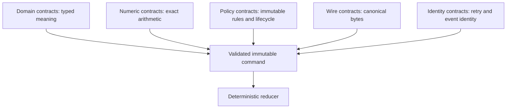
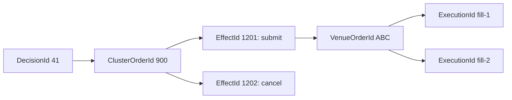
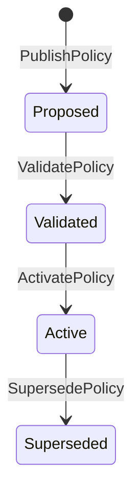
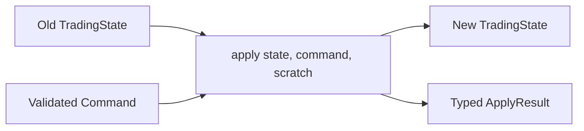
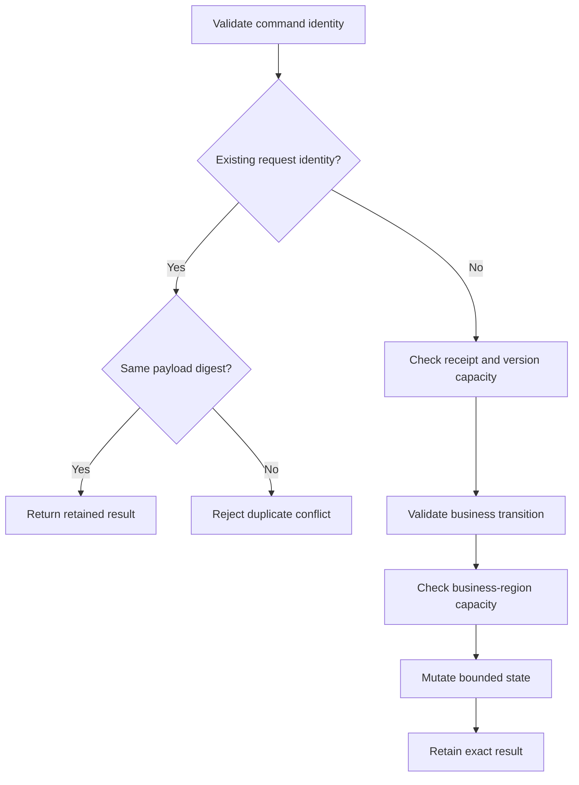
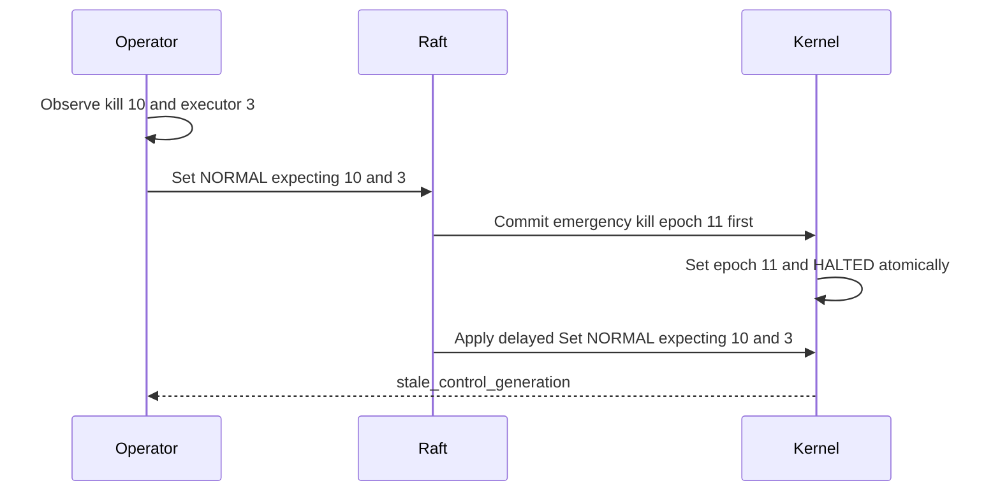
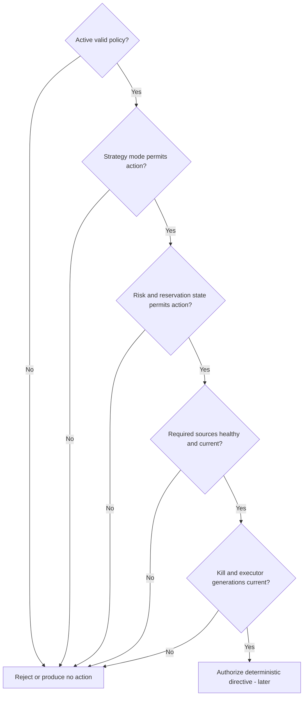
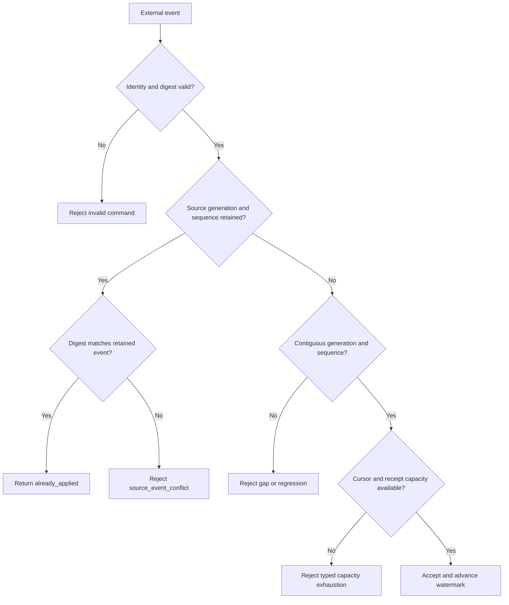
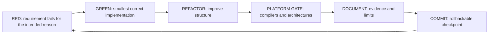

# V2 checkpoint technical guide

Date: 2026-09-03

Purpose: explain what V2 currently contains, why each part exists, how the C++
implementation works, what remains experimental, and what must be validated on
the Raspberry Pi.

This document is educational material, not a production-readiness claim.

## Viewing this guide in Neovim

Open the file:

```bash
nvim docs/V2_CHECKPOINT_TECHNICAL_GUIDE.md
```

Inside Neovim:

```text
Space m r    toggle rendered headings, tables, and code blocks in the buffer
Space m p    toggle the browser preview with rendered Mermaid diagrams
```

The plain-text diagrams remain as fallbacks when the browser preview is off.

## 1. Executive summary

V2 is intended to become a replicated Decision and Order Management System
(OMS) with a separate, fenced execution process.

The target architecture is:

```text
external market and venue evidence
                 |
                 v
       decode and validate contracts
                 |
                 v
       replicated Decision/OMS kernel
       - policies
       - control authority
       - later: risk, orders, positions
       - later: committed execution outbox
                 |
                 v
        single authorized executor
                 |
                 v
               venue
```



```mermaid
graph LR
    Evidence[External market and venue evidence]
    Contracts[Decode and validate contracts]
    Kernel[Replicated Decision and OMS kernel]
    State[Authoritative replicated state]
    Outbox[Committed execution outbox - later]
    Executor[Single fenced executor - later]
    Venue[Trading venue - later]

    Evidence --> Contracts
    Contracts --> Kernel
    Kernel --> State
    State --> Outbox
    Outbox --> Executor
    Executor --> Venue
```

The Raft cluster will own authoritative decisions and economic state. The
executor will deliver committed effects but will not invent trades.

What exists today:

```text
V2 domain and wire contracts       implemented; Pi acceptance pending
Policy lifecycle kernel            implemented and committed
Request idempotency                implemented and committed
Control authority                  implemented and committed
Source admission                   host and ARM64-container green; Pi pending
Decision evaluation                not implemented
Risk and reservations              not implemented
Orders, fills, and positions       not implemented
Committed outbox                   not implemented
V2 Raft/storage integration        not implemented
Exchange execution                 not implemented
```

| Capability | Current state | Authority implication |
|---|---|---|
| Domain and wire contracts | Implemented; Pi acceptance pending | Defines data, but cannot trade |
| Policy lifecycle | Implemented and committed | Can record activation, but cannot evaluate a trade |
| Request idempotency | Implemented and committed | Makes logical-command retries deterministic |
| Control authority | Implemented and committed | Fences modes and generations; reopening is incomplete |
| Source admission | Host and ARM64-container green; Pi pending | Tracks evidence identity; no economic side effect |
| Decisions, risk, orders, outbox | Not implemented | No V2 order can be produced or executed |

Nothing in V2 can currently place an order.

## 2. Vocabulary

### 2.1 Contract

A contract is an enforceable promise between components. It defines:

- which data is allowed;
- what every field means;
- how identity and ordering work;
- which state transitions are legal;
- how invalid input is rejected;
- how retries behave; and
- how information is encoded and decoded.

A comment saying "the value should increase" is not sufficient. A strong
contract combines types, validation, transition logic, typed errors, and tests.

### 2.2 Invariant

An invariant is a fact that must remain true after every command.

Example contract:

```text
AdvanceKillEpoch requires new_epoch > current_epoch.
```

Resulting invariant:

```text
kill_epoch never decreases.
```

### 2.3 Authority

Authority means permission to change authoritative state or cause an external
effect. It is different from user authentication.

Examples:

- an active policy has authority to participate in decisions;
- the current executor generation has authority to deliver committed effects;
- `halted` mode removes trading authority;
- a Raft follower does not have authority to originate committed state.

### 2.4 Fencing token

A fencing token is a monotonically increasing value. A component may act only
when it carries the current value.

Old processes can restart, delayed messages can arrive, and network partitions
can heal. An increasing token allows the receiver to identify stale authority.

## 3. The V2 contract layers



### 3.1 Domain contracts

Important concepts receive distinct C++ types:

```cpp
PolicyId
PolicyVersion
AccountId
InstrumentId
DecisionId
ClusterOrderId
EffectId
KillEpoch
ExecutorGeneration
SourceGeneration
SourceSequence
PriceTicks
QuantityLots
```

The integer-backed identities use a template similar to:

```cpp
template <typename Tag, std::integral Rep = std::uint64_t>
class StrongId {
public:
    explicit constexpr StrongId(Rep value) noexcept;
    [[nodiscard]] constexpr Rep value() const noexcept;

private:
    Rep value_{};
};
```

Aliases use different tags:

```cpp
struct KillEpochTag;
struct ExecutorGenerationTag;

using KillEpoch = StrongId<KillEpochTag>;
using ExecutorGeneration = StrongId<ExecutorGenerationTag>;
```

Both may contain a `std::uint64_t`, but they are different C++ types. The
compiler rejects accidental cross-domain assignment:

```cpp
KillEpoch kill{7};
ExecutorGeneration executor{7};

kill = executor;  // Does not compile.
```

Why this matters: identifiers, versions, prices, and quantities often have the
same primitive representation but different meanings. Strong types move many
mistakes from production into compilation.

Relevant file:

```text
include/velocita/v2/domain.hpp
```

#### 3.1.1 What an `EffectId` identifies

An **effect** is one committed instruction that is allowed to cross the boundary
from our replicated OMS into an external venue. Examples are:

- submit this order;
- cancel this order; or
- replace this order.

`EffectId` is the stable identity of that individual instruction.

It is deliberately not any of the following:

| Identity | What it names |
|---|---|
| `DecisionId` | One accepted strategy/policy evaluation |
| `ClusterOrderId` | One logical order owned by our replicated OMS |
| `EffectId` | One external instruction concerning that order |
| `VenueOrderId` | The venue's identity for an accepted order |
| `ExecutionId` | A venue execution or fill event |

One decision can create an order. One order can then create several effects over
its lifetime:



The identity rule is:

```text
same logical external instruction, including a retry -> same EffectId
new external instruction                            -> new EffectId
```

Suppose the executor sends `EffectId{1201}`, loses the connection, and cannot
tell whether the venue accepted the submit. It must not invent `EffectId{1202}`
and blindly send another logical order. It retains `EffectId{1201}`, marks the
outcome unknown, and reconciles venue state. This lets the outbox, executor, and
returned `VenueObservation` discuss the same action without confusing a retry
with new economic intent.

This is one building block for idempotent delivery. It does not magically make
an arbitrary venue exactly-once: the execution adapter must map the stable
identity into the venue's client-order/idempotency facility where available and
must reconcile ambiguous outcomes.

The architecture contract says the ID will be derived deterministically from
committed order identity plus an effect generation, rather than process-local
randomness. The present checkpoint defines, validates, serializes, and
deserializes the type. The future order/outbox reducer will own its actual
allocation rule; that reducer is not implemented yet. In the current contract,
zero means "not present" and causes validation to reject an `OrderEffect`.

#### 3.1.2 What a C++ template is

A template is a compile-time recipe for producing types or functions. It is not
a runtime object and it is not inheritance. Consider the actual V2 declaration:

```cpp
template <typename Tag, std::integral Rep = std::uint64_t>
class StrongId {
public:
    using rep_type = Rep;

    constexpr StrongId() noexcept = default;
    explicit constexpr StrongId(Rep value) noexcept : value_(value) {}

    [[nodiscard]] constexpr Rep value() const noexcept { return value_; }
    constexpr auto operator<=>(const StrongId&) const noexcept = default;

private:
    Rep value_{};
};
```

Read its first line in pieces:

| Syntax | Meaning |
|---|---|
| `template <...>` | Declare a compile-time recipe |
| `typename Tag` | The caller must supply a type called `Tag` |
| `std::integral Rep` | `Rep` must satisfy the standard integral concept |
| `= std::uint64_t` | If omitted, `Rep` defaults to unsigned 64-bit storage |
| `StrongId<Tag, Rep>` | Both arguments participate in the resulting C++ type |

The compiler instantiates the recipe when a specialization is used. Conceptually:

```cpp
using CallerId = StrongId<CallerIdTag>;
// Means StrongId<CallerIdTag, std::uint64_t>.

using SmallId = StrongId<SomeTag, std::uint32_t>;
// Same recipe, but a different tag and representation.
```

These are different concrete types even though both may ultimately store an
integer:

```cpp
StrongId<CallerIdTag, std::uint64_t>
StrongId<EffectIdTag, std::uint64_t>
```

The template removes repetitive wrapper code while preserving semantic type
safety. Without it, we would have to hand-write nearly identical `CallerId`,
`EffectId`, `PolicyId`, and other classes.

Important details in the body:

- `explicit` prevents an integer from silently becoming an ID. Callers must
  write `EffectId{7}`, making the domain conversion visible.
- `value()` is the deliberate escape hatch used at serialization and storage
  boundaries to recover the underlying integer.
- `operator<=> = default` asks the compiler to generate comparisons between the
  same specialization. It does not enable comparison with another ID type.
- `constexpr` permits compile-time construction and tests where possible.
- `noexcept` documents and enforces that these tiny operations cannot throw.
- `Rep value_{}` value-initializes the integer to zero. Our contract interprets
  zero as an absent/invalid identity until explicitly populated.

Templates are compiled on use. There is no virtual dispatch, heap allocation,
or runtime template lookup here. A `StrongId<EffectIdTag>` normally has the
same storage cost as its `std::uint64_t` member.

#### 3.1.3 How the tag types work

These declarations are intentional even though they appear empty and have no
definitions:

```cpp
struct CallerIdTag;
struct EffectIdTag;

using CallerId = StrongId<CallerIdTag>;
using EffectId = StrongId<EffectIdTag>;
```

`struct EffectIdTag;` is a forward declaration. It tells the compiler that
`EffectIdTag` is a distinct type. We never construct it or ask for its size, so
a complete definition is unnecessary.

Here the tag is a **phantom type**: it exists to participate in the template's
type identity but occupies no field in `StrongId`. The runtime object contains
only `value_`.

The `using` declaration does not independently create a new type. It gives a
readable name to a template specialization. Safety comes from the fact that the
specializations themselves differ:

```cpp
using CallerId = StrongId<CallerIdTag>;  // specialization A
using EffectId = StrongId<EffectIdTag>;  // specialization B

CallerId caller{7};
EffectId effect{7};

// effect = caller;       // compile error: different specializations
// effect == caller;      // compile error: no cross-type comparison
```

The numeric bits can both equal seven while their meanings remain incompatible.
This is compile-time dimensional analysis for domain identity.

Tags also protect fixed-point values:

```cpp
struct MoneyMicrosTag;
struct FeeMicrosTag;

using MoneyMicros = FixedPoint<MoneyMicrosTag, 1'000'000>;
using FeeMicros = FixedPoint<FeeMicrosTag, 1'000'000>;
```

Although both use signed integers and the same scale, money and fees remain
different types. Likewise, the `Scale` non-type template argument becomes part
of the type: `FixedPoint<UsdcTag, 1'000'000>` and
`FixedPoint<UsdcTag, 100>` are different specializations. Conversion between
scales must therefore go through the explicit checked `rescale` operation.

This use of `Tag` is unrelated to Git tags, Podman image tags, HTML tags, or an
`enum`. It is solely a zero-runtime-cost C++ technique for making illegal domain
combinations fail during compilation.

The compile-time assertions in `tests/v2_contract_tests.cpp` prove the intended
properties. For example:

```cpp
static_assert(!std::is_constructible_v<EffectId, CallerId>);
static_assert(!std::is_assignable_v<EffectId&, CallerId>);
```

If a later refactor accidentally makes those identities interchangeable, the
test executable will fail to compile. That is stronger than discovering the
mistake from a runtime test—or from a live order.

### 3.2 Numeric contracts

Authoritative price, quantity, fee, and feature values use checked scaled
integers instead of floating point.

Examples:

```text
price ticks
quantity lots
fee micros
feature micros
```

Floating point is useful for model training, but it is dangerous as the final
representation of replicated financial state:

- many decimal fractions cannot be represented exactly in binary;
- equality and boundary comparisons become difficult to audit;
- rounding can depend on expression ordering and compiler optimization;
- deterministic replay becomes harder.

The V2 contract therefore requires:

- a declared scale;
- checked overflow;
- explicit rounding rules; and
- deterministic integer comparisons.

Models may use floating point outside the kernel. Their deployed thresholds
must be converted into the pinned fixed-point representation.

### 3.3 Policy artifact contract

A policy artifact is an immutable, versioned collection of decision rules. It
contains concepts such as:

```text
policy ID and version
account and instrument scope
feature schema
model digest
artifact digest
validity interval
risk-policy version
bounded rules
```

Identity and digest solve different problems:

```text
PolicyId + PolicyVersion    identifies the logical artifact
artifact digest             proves its exact content
```

Two different payloads must never claim the same policy identity.

The lifecycle is:

```text
PROPOSED -> VALIDATED -> ACTIVE -> SUPERSEDED
```



The transitions are separate because publishing data is not the same decision
as authorizing it for trading.

```text
PublishPolicy       introduce an immutable candidate
ValidatePolicy      prove that its contract is acceptable
ActivatePolicy      grant decision authority
SupersedePolicy     remove its active authority
```

The current kernel stores and transitions policies. It does not yet evaluate a
market frame against an active policy.

Relevant file:

```text
include/velocita/v2/contracts.hpp
```

### 3.4 Wire contracts

A wire contract defines the bytes exchanged across processes and persisted in
versioned formats.

Conceptually, the V2 envelope contains:

```text
magic | schema version | message kind | flags | payload length
caller ID | request sequence | correlation ID
source ID | source generation | source sequence
event time | receive time | payload | digest/checksum
```

We do not send or persist raw C++ object memory:

```cpp
send(socket, &object, sizeof(object));  // Forbidden design.
```

Raw object layout may contain:

- padding;
- native byte order;
- compiler-dependent alignment;
- ABI-specific enum layout;
- uninitialized bytes;
- pointers or container implementation details.

The V2 codec writes each field explicitly with:

- fixed widths;
- declared byte order;
- bounded lengths;
- declared enum values;
- schema versions;
- rejection of unknown mandatory flags; and
- rejection of undeclared trailing bytes.

This is what allows the same golden corpus to be checked on macOS, Linux ARM64,
the Pi, and later x86-64 Linux.

Relevant files:

```text
include/velocita/v2/wire.hpp
src/v2_wire.cpp
src/v2_payload.cpp
```

### 3.5 Command identity contract

A replicated command currently has this identity:

```text
CallerId + RequestSequence + payload digest
```

The reducer handles three cases:

```text
new caller and request sequence
    -> evaluate the command

same caller and request sequence, same digest
    -> return the retained original result

same caller and request sequence, different digest
    -> duplicate conflict
```

| Request observation | Reducer outcome | Business mutation |
|---|---|---:|
| New caller/sequence | Evaluate normally | Depends on command |
| Same caller/sequence and digest | Return retained original result | No |
| Same caller/sequence, different digest | `duplicate_conflict` | No |

The digest prevents one request sequence from naming different payloads.

Retaining the original `ApplyResult` provides deterministic idempotency:

```text
same request identity -> same historical result
```

This is stronger than retaining only a "seen" bit.

## 4. The policy kernel

The policy kernel is the small authoritative state-machine core of the future
Decision/OMS.

Its central interface is:

```cpp
ApplyResult apply(
    TradingState& state,
    const Command& command,
    ApplyScratch& scratch) noexcept;
```

Conceptually:

```text
old TradingState + one Command
                |
                v
new TradingState + one ApplyResult
```



"Kernel" here does not mean the Linux kernel. It means the minimal core around
which transport, Raft, storage, metrics, and execution will be assembled.

### 4.1 Why it is a pure reducer

Raft guarantees that voters agree on the order of committed commands. Our
reducer must guarantee that applying those commands produces the same result
on every voter.

The reducer therefore performs no:

- clock read;
- randomness;
- network I/O;
- filesystem I/O;
- exchange call;
- environment lookup;
- lock acquisition; or
- unbounded container growth.

If `apply()` depended on local observations, this could happen:

```text
same committed command
+ different local time/network/filesystem state
= different voter state
```

That would violate replicated state-machine correctness.

### 4.2 Closed commands with `std::variant`

`CommandBody` is a closed `std::variant` of allowed command types.

Examples include:

```cpp
PublishPolicy
ValidatePolicy
ActivatePolicy
SupersedePolicy
SetStrategyMode
AdvanceKillEpoch
SetExecutorGeneration
```

This is preferable to a loosely typed bag of optional fields. Each command has
one concrete shape.

Dispatch uses named type checks:

```cpp
if (const auto* body = std::get_if<SetStrategyMode>(&command.body)) {
    return apply_set_strategy_mode(state, *body, next_version);
}
```

An earlier implementation used numeric variant indexes such as `case 4`.
Named type checks were chosen because reordering the variant must not silently
change dispatch behaviour.

### 4.3 Fixed-capacity state

The reducer currently uses bounded `std::array` regions:

```cpp
std::array<PolicyRecord, kMaxPolicies>
std::array<RequestReceipt, kMaxRequestReceipts>
```

Unlike `std::vector`, `std::array`:

- never reallocates;
- never grows implicitly;
- has fixed ownership;
- has compile-time capacity; and
- avoids allocator latency inside `apply()`.

Fixed capacity does not automatically provide safety. Exhaustion must be an
explicit typed result, for example:

```text
policy_capacity_exceeded
receipt_capacity_exceeded
```

Silently overwriting an old receipt would destroy idempotency.

The test-scale capacities are not production sizing decisions. Production
retention must be derived from request rate and recovery/reconciliation time.

### 4.4 Mutation ordering

The reducer follows an order resembling:

```text
1. Validate command identity.
2. Find an exact or conflicting request duplicate.
3. Prove request-receipt capacity.
4. Prove state-version capacity.
5. Validate the business transition.
6. Prove the relevant business-region capacity.
7. Mutate business state.
8. Store the result receipt.
```



All possible failures are checked before business mutation. The remaining
assignments are required to be non-throwing.

This provides function-level atomicity without an in-memory rollback journal.
It does not provide crash durability; Raft commit, WAL replay, and snapshots
will provide that later.

### 4.5 `ApplyResult`

`ApplyResult` is a typed outcome. It can carry:

```cpp
ApplyCode code;
ContractError contract_error;
PolicyId policy_id;
PolicyVersion policy_version;
PolicyLifecycle policy_lifecycle;
std::uint64_t state_version;
StrategyMode strategy_mode;
KillEpoch kill_epoch;
ExecutorGeneration executor_generation;
```

Typed results are machine-readable and testable:

```cpp
if (result.code == ApplyCode::stale_control_generation) {
    // Do not treat this as a transport retry.
}
```

Expected business rejection does not use C++ exceptions. A stale generation,
invalid policy transition, or full bounded table is part of the protocol.

### 4.6 Why rejected commands may consume receipts

A validly identified business rejection is retained and advances the state
version once.

Suppose a command is rejected because a policy does not exist. If the rejection
were not retained, retrying the same request after that policy was created
could produce a different answer.

Retention gives us:

```text
same request identity -> same outcome forever within retention horizon
```

Malformed commands without a valid identity cannot be retained reliably and
are rejected before this process.

## 5. Policy lifecycle inside the kernel

The current lifecycle is:

```text
PROPOSED -> VALIDATED -> ACTIVE -> SUPERSEDED
```

| Transition request | Required current state | Outcome |
|---|---|---|
| Publish | Identity/version absent | `PROPOSED` |
| Validate | `PROPOSED` | `VALIDATED` |
| Activate | `VALIDATED`, with no active policy in scope | `ACTIVE` |
| Supersede | `ACTIVE` | `SUPERSEDED` |
| Illegal transition | Anything else | Typed rejection; no policy mutation |

The reducer enforces:

- immutable policy identity;
- monotonic versions within a policy family;
- validation before activation;
- one active policy per account/instrument scope;
- typed invalid-transition rejection;
- capacity checking before mutation; and
- exact request-result retention.

Example:

```text
Publish policy 7/version 1      -> PROPOSED
Activate immediately           -> invalid transition
Validate policy 7/version 1    -> VALIDATED
Activate policy 7/version 1    -> ACTIVE
Activate another policy for
the same account/instrument     -> active scope conflict
```

An active policy does not by itself authorize trading. Control authority, risk
state, source health, and later reconciliation state must also permit action.

## 6. Control authority

Control authority answers:

```text
Is trading currently allowed?
Which categories of action are allowed?
Which execution generation is allowed to act?
Which emergency-control generation is current?
```

It is operational authority, not login or user authentication.

The replicated state contains:

```cpp
StrategyMode strategy_mode;
KillEpoch kill_epoch;
ExecutorGeneration executor_generation;
```

Boot state is fail-safe:

```text
strategy mode       = halted
kill epoch          = 0
executor generation = 0
```

```mermaid
graph TD
    Boot[Boot or empty recovery state]
    Halted[HALTED]
    Normal[NORMAL]
    NoRisk[NO NEW RISK]
    Cancel[CANCEL ONLY]
    Reduce[REDUCE ONLY]
    Kill[Advance kill epoch]
    Promote[Advance executor generation]

    Boot --> Halted
    Halted --> Normal: matched generations and explicit command
    Halted --> NoRisk: matched generations and explicit command
    Normal --> Kill
    NoRisk --> Kill
    Cancel --> Kill
    Reduce --> Kill
    Kill --> Halted
    Normal --> Promote
    Reduce --> Promote
    Promote --> NoRisk
    Cancel --> Promote
    Promote --> Cancel: cancel-only is preserved
    Halted --> Promote
    Promote --> Halted: halted is preserved
```

An empty or partially recovered system must not start trading automatically.

### 6.1 Strategy modes

```text
normal        policy-approved trading may operate normally
no_new_risk   no new exposure may be created
cancel_only   only cancellation activity is authorized
reduce_only   exposure may be reduced but not increased
halted        trading authority is stopped
```

These are authoritative modes, not dashboard labels.

The later decision and order reducers will check the current mode before
creating directives or effects.

| Mode | New risk | Risk reduction | Cancellation | Intended use |
|---|---:|---:|---:|---|
| `normal` | Allowed by policy/risk | Yes | Yes | Normal operation |
| `no_new_risk` | No | Later contract must define exact actions | Yes | Stabilization after failover |
| `cancel_only` | No | Only through cancellation | Yes | Emergency cleanup |
| `reduce_only` | No increase | Yes | Yes | Controlled exposure reduction |
| `halted` | No | No trading action | No trading action | Fail-safe stop |

The table describes intended future authorization. The order/effect reducer
that enforces these rows has not been implemented yet.

### 6.2 Kill epoch

A kill epoch is a monotonically increasing emergency fencing token.

```cpp
AdvanceKillEpoch{KillEpoch{8}}
```

It is accepted only when:

```text
new kill epoch > current kill epoch
```

One successful reducer transition performs:

```text
kill_epoch = new value
strategy_mode = halted
```

Every voter observes the new epoch and halted state together.

Why not use a boolean `killed`?

```text
boolean: true/false only describes current appearance
epoch:   records which generation of emergency authority is current
```

A delayed command created under epoch 7 cannot reopen trading after epoch 8.

### 6.3 Executor generation

The executor is the process allowed to deliver already-committed effects to a
venue.

When executor A is replaced by executor B:

```text
executor generation 4 -> executor generation 5
```

Any old process or queued effect carrying generation 4 is stale. The execution
gateway must reject it.

This prevents a previously dead executor from waking up and acting alongside
its replacement.

When the generation advances, the current reducer:

- keeps `halted` as `halted`;
- keeps `cancel_only` as `cancel_only`; and
- converts other modes to `no_new_risk`.

Cancellation authority is preserved because cancelling outstanding orders may
be the safest recovery action.

### 6.4 Generation-fenced strategy-mode changes

A mode command includes the authority state observed by its creator:

```cpp
SetStrategyMode{
    target_mode,
    expected_kill_epoch,
    expected_executor_generation
}
```

The mode changes only if both generations still match replicated state. This
is compare-and-set semantics.

Example:

```text
1. Operator reads kill epoch 10 and executor generation 3.
2. Operator constructs "set normal, expected 10/3".
3. An emergency kill advances the epoch to 11.
4. The delayed set-normal command reaches Raft.
5. The reducer rejects it as stale.
```

Without expected generations, step 5 could reopen trading after the kill.



### 6.5 Policy authority versus control authority

Policy lifecycle answers:

```text
Which exact rule artifact is active for this account and instrument?
```

Control authority answers:

```text
Is the system permitted to act, and under which safety generations?
```

A future trading decision will require all relevant conditions:

```text
active policy
AND acceptable strategy mode
AND current risk state
AND healthy source evidence
AND current kill epoch
AND current executor generation
```

For example:

```text
policy = ACTIVE
strategy mode = HALTED
result = no trading authority
```



### 6.6 Current control-authority limitation

A command carrying the current kill and executor generations can currently
restore `normal` mode.

We have not yet required replicated proof that:

- venue positions were reconciled;
- open orders were reconciled;
- the venue session is healthy;
- risk state is current; and
- the promoted executor has caught up.

Therefore fencing exists, but safe automatic reopening is incomplete. V2 must
not be treated as production trading authority yet.

## 7. Source admission

Source admission decides whether an external fact may enter authoritative
state.

External facts will include:

- market-data updates;
- order acknowledgements;
- order rejections;
- fills;
- cancellations;
- reconciliation results;
- venue position snapshots; and
- externally supplied risk observations.

External sources can duplicate, replay, reorder, skip, or contradict messages.
Source admission prevents transport behaviour from becoming incorrect economic
state.

### 7.1 Source identity

The experimental identity is:

```text
SourceId + SourceGeneration + SourceSequence
```

The accepted payload is also identified by a digest:

```text
source ID     identifies the normalized feed
generation    identifies a logical feed session
sequence      orders events within that generation
event digest  proves the exact event content
```



Example:

```text
source       = normalized account-event feed
generation   = 14
sequence     = 921
digest       = SHA-256 of canonical event bytes
```

### 7.2 Current normalization rule

The current experiment requires:

```text
new source:
    generation = 1
    sequence = 1

same generation:
    next sequence = current sequence + 1

new generation:
    generation = current generation + 1
    sequence restarts at 1
```

Venue adapters would translate venue-native session and sequence behaviour into
this normalized internal contract.

This rule is not committed yet. It must be reviewed against the APIs we intend
to consume because venues differ substantially.

### 7.3 Exact duplicate

```text
retained: source 3, generation 14, sequence 921, digest A
input:    source 3, generation 14, sequence 921, digest A
```

Result:

```text
already_applied
```

The source cursor does not advance.

### 7.4 Conflicting duplicate

```text
retained: source 3, generation 14, sequence 921, digest A
input:    source 3, generation 14, sequence 921, digest B
```

Result:

```text
source_event_conflict
```

Two different facts are claiming the same authoritative identity. The system
must fail closed and reconcile rather than choose one arbitrarily.

### 7.5 Sequence gap

```text
current: generation 14, sequence 921
input:   generation 14, sequence 925
```

Events 922, 923, and 924 are missing. One could contain a fill or cancellation.

Result:

```text
source_sequence_gap
```

The source watermark does not advance.

### 7.6 Generation regression

```text
current generation: 15
unseen input:       generation 14
```

Result:

```text
source_generation_regression
```

An exact retained event from generation 14 can still be recognized as a
duplicate. A previously unseen old-generation event cannot silently enter
current state.

### 7.7 Request deduplication versus source admission

These are separate identity layers.

| Identity layer | Identity | Protects against |
|---|---|---|
| Request deduplication | `CallerId + RequestSequence + command digest` | Retrying one logical cluster command |
| Source admission | `SourceId + SourceGeneration + SourceSequence + event digest` | Replayed, reordered, or conflicting external facts |

Request deduplication asks:

```text
Did the same caller retry the same logical cluster command?
```

Its identity is:

```text
CallerId + RequestSequence
```

Source admission asks:

```text
Does this command contain an external fact already accepted earlier?
```

Its identity is:

```text
SourceId + SourceGeneration + SourceSequence
```

Example:

```text
request 500 contains exchange fill generation 14/sequence 921
request 500 times out
a new adapter process sends request 501 containing the same fill
```

Request identities 500 and 501 differ. Source admission still recognizes one
external fill.

Without this distinction, the position could be updated twice:

```text
real fill       +10
duplicate fill  +10
wrong position  +20
```

### 7.8 Why source-event receipts are retained

A source cursor tells us only the latest watermark:

```text
source 3 is at generation 14, sequence 921
```

It does not tell us which payload was accepted at sequence 920.

A retained event identity and digest distinguish:

```text
same identity + same digest       exact duplicate
same identity + different digest  conflicting duplicate
```

The retention horizon must eventually exceed the longest relevant:

- transport retry;
- source reconnect;
- Raft replay;
- snapshot restoration;
- delayed delivery; and
- exchange reconciliation interval.

The current experimental capacity of 128 event receipts is a test-scale bound,
not a production decision.

### 7.9 Current source-admission limitation

The current `RecordSourceEvent` experiment changes only source cursor and
receipt state. It has no order, fill, position, or risk side effect.

Later event-specific commands must combine:

```text
event validation
+ source admission
+ economic mutation
+ result receipt
```

as one deterministic reducer transition. We must not admit a fill in one
command and update its position in an unrelated later command.

## 8. TDD method used for V2

Every increment follows:

```text
RED -> GREEN -> REFACTOR -> PLATFORM GATE -> DOCUMENT -> COMMIT
```



### 8.1 RED

Write the required safety behaviour as a failing test.

A valid RED fails because the behaviour is absent. A failure caused by missing
Docker access, an unavailable dependency, or broken CMake configuration is not
evidence about the requirement.

### 8.2 GREEN

Implement the smallest behaviour that satisfies the test.

### 8.3 REFACTOR

Improve structure without changing tested behaviour.

One example was replacing numeric `std::variant` indexes with named
`std::get_if<T>` dispatch.

### 8.4 Platform gate

Run the tests across relevant configurations:

```text
macOS ARM64 with Apple Clang
optimized Release
ASan and UBSan
ARM64 Ubuntu with GCC
Raspberry Pi target hardware
later: NUC x86-64 Linux
```

Each configuration covers a different failure class.

### 8.5 Document and commit

Record:

- the exact invariant;
- the commit ID;
- source-content identity;
- tests and environment;
- limitations; and
- evidence location.

Then create a local Git checkpoint so that the increment is independently
reviewable and rollbackable.

## 9. Docker development environment

While the Pi was unavailable, the V2 gates ran through Colima and Docker using:

```text
native ARM64/aarch64 Linux
Ubuntu 26.04
GCC 15.2
4 CPUs
4 GiB memory
256 MiB /dev/shm
pinned Aeron commit
pinned willemt/raft commit
```

The repository is mounted read-only into the gate container. Build output is
stored in an isolated Docker volume.

This proves:

- ARM64 compilation;
- Linux compatibility;
- GCC compatibility in addition to Apple Clang;
- unit-test behaviour;
- sanitizer behaviour; and
- cross-platform codec agreement.

It does not prove:

- Pi scheduling behaviour;
- SD-card latency or durability;
- power stability;
- thermal behaviour;
- real Aeron tail latency;
- production throughput; or
- crash recovery on Pi storage.

Container results are development compatibility evidence, not target-hardware
acceptance evidence.

## 10. Git state and completed checkpoints

Current development branch:

```text
experiment/v2-phase2-kernel
```

Phase 2 remains experimental because Phase 1 has not yet passed its Raspberry
Pi gate.

Important local commits include:

```text
a6ee8df  Phase 1 contracts
c7d254a  Phase 1 macOS candidate evidence
ac10415  Phase 1 Pi acceptance gate script
fa938ff  native ARM64 Linux compatibility gate
e1bd0f0  Phase 1 ARM64 Linux candidate evidence
7bc9e42  bounded policy lifecycle and request dedup kernel
c783ab7  initial Phase 2 ARM64 development gate
9a63191  policy-kernel experiment evidence
6de06ec  monotonic V2 control authority
2849a52  extended ARM64 gate for control authority
8924b3c  control-authority evidence
```

V1 and V1.1 history and rollback points remain preserved. Nothing has been
pushed to GitHub.

## 11. Validation completed so far

### 11.1 Phase 1

Phase 1 contracts have passed macOS and native ARM64 Ubuntu container candidate
gates. Raspberry Pi acceptance is still pending.

### 11.2 Committed Phase 2 policy/control kernel

Latest committed ARM64 Linux evidence:

```text
~/.local/share/velocita/v2-phase2-container-gates/20260902T144010Z
```

Results:

```text
Release, legacy and V2 tests          8/8 pass
instrumented Release V2 tests         5/5 pass
ASan and UBSan Debug V2 tests         5/5 pass
```

| Gate configuration | Result | What it contributes |
|---|---:|---|
| Release, legacy and V2 | 8/8 pass | Optimized build plus regression coverage |
| Instrumented Release V2 | 5/5 pass | Behaviour with benchmark instrumentation enabled |
| ASan and UBSan Debug V2 | 5/5 pass | Memory and undefined-behaviour checks |

The source root recorded for that run is:

```text
8e4cba2743760eb71bb3ee7277d63183c2e706cc3bec5a6d449f0eec21291a72
```

### 11.3 Source-admission experiment

Current local status:

```text
TDD RED                               observed correctly
focused host test                     pass
full host regression                  9/9 pass
host Release kernel tests             3/3 pass
host ASan/UBSan kernel tests          3/3 pass
ARM64 Docker gate                     pass: 9/9, 6/6, 6/6
documentation                         complete
Git behavior commit                   33d27f6
Pi gate                               not run
```

Uncommitted implementation files currently include:

```text
CMakeLists.txt
include/velocita/v2/kernel.hpp
src/v2_kernel.cpp
tests/v2_kernel_source_tests.cpp
```

## 12. What must be validated on the Pi

### 12.1 Checkpoint A: Phase 1 contracts

Run the existing Phase 1 Pi gate against an exact committed revision.

Validate:

- golden wire bytes;
- fixed-point results;
- malformed-input behaviour;
- corpus digest;
- compiler and architecture identity; and
- clean test completion.

Passing this permits Phase 1 to move from candidate to accepted.

### 12.2 Checkpoint B: committed policy/control kernel

Run on the Pi:

- full tests;
- optimized Release tests;
- policy lifecycle tests;
- request-dedup tests;
- control-authority tests; and
- sanitizers where Pi memory permits.

This is not yet a system throughput benchmark. The V2 reducer has not been
integrated with Raft, Aeron, WAL, or snapshot storage.

Later reducer measurements should include:

```text
apply duration by command kind
allocation count after startup
TradingState memory size
capacity high-watermarks
deterministic replay digest
```

### 12.3 Checkpoint C: source admission

Before Pi validation:

```text
1. Review the normalization assumptions.
2. Run the ARM64 Docker gate.
3. Document the increment and its limitations.
4. Commit it locally.
5. Sync that exact commit to the Pi.
6. Run `deploy/run-v2-source-admission-pi-gate.sh` against that exact commit.
```

Target-hardware evidence should never be created from an uncommitted working
tree because we would not be able to reconstruct exactly what was tested.

## 13. What the NUC adds

The NUC gives us another physical machine and probably another architecture:

```text
Raspberry Pi   ARM64
NUC            likely x86-64
```

This is useful for:

- cross-architecture determinism;
- real inter-machine Aeron traffic;
- network-partition and latency testing;
- heavier sanitizer and fuzz workloads;
- independent Prometheus/Grafana hosting;
- isolating benchmark load from Raft voters; and
- later separating executor and cluster roles.

One Pi plus one NUC still provides only two physical failure domains.

| Placement | Logical voters | Physical failure domains | Failure consequence |
|---|---:|---:|---|
| Three voters on Pi | 3 | 1 | Pi loss removes the entire cluster |
| One voter on Pi, two on NUC | 3 | 2 | NUC loss removes quorum |
| One voter on each of three machines | 3 | 3 | Any one machine may fail while quorum remains |

This topology:

```text
Pi:   voter 1
NUC:  voter 2 and voter 3
```

contains three logical voters but loses quorum if the NUC fails. It is useful
for development but is not three-machine high availability.

We should inspect the NUC's CPU, architecture, Linux distribution, storage,
memory, network, power policy, and container runtime before assigning roles.

## 14. Important incomplete work

V2 does not yet implement:

- deterministic policy evaluation;
- decision records;
- order lifecycle;
- reservation conservation;
- risk limits;
- fill and position transitions;
- committed outbox effects;
- execution gateway fencing;
- reconciliation state;
- reconciliation-gated restoration of normal mode;
- canonical snapshot encoding;
- deterministic state digest;
- receipt expiry;
- V2 Raft integration;
- V2 WAL or snapshot persistence;
- exchange connectivity; or
- a trading strategy.

No production trading or performance claim should be made from the current V2
kernel.

## 15. Recommended reading order

Read the implementation in this order:

```text
1. include/velocita/v2/domain.hpp
   Strong IDs and checked fixed-point values.

2. include/velocita/v2/contracts.hpp
   Policy, decision, order-effect, and venue-observation data contracts.

3. include/velocita/v2/kernel.hpp
   Command alternatives, result codes, state regions, and capacities.

4. tests/v2_kernel_policy_tests.cpp
   Policy lifecycle and request-idempotency requirements.

5. tests/v2_kernel_control_tests.cpp
   Kill epoch, executor generation, and mode-fencing requirements.

6. src/v2_kernel.cpp
   Reducer mutation ordering and concrete transition implementation.

7. tests/v2_kernel_source_tests.cpp
   Current uncommitted source-admission experiment.

8. docs/V2_ARCHITECTURE_CONTRACTS.md
   Whole-system authority and failure contracts.

9. docs/V2_TDD_IMPLEMENTATION_AND_VALIDATION_PLAN.md
   Phase order, tests, gates, evidence, and rollback policy.
```

## 16. Mental model to retain

```text
Contracts
    define the exact language and rules shared by components.

Policy kernel
    deterministically applies committed commands to authoritative state.

Control authority
    fences whether trading is allowed and which execution generation may act.

Source admission
    proves external facts are ordered, non-conflicting, and applied once.
```

The next engineering checkpoint is not exchange execution. It is:

```text
review source-admission semantics
-> finish its ARM64 gate and Git checkpoint
-> validate Phase 1 and committed Phase 2 on the Pi
-> characterize the NUC
-> continue Phase 2 state-machine increments
```
