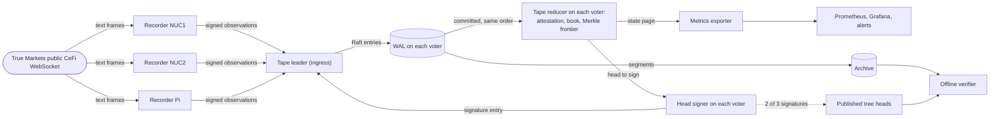
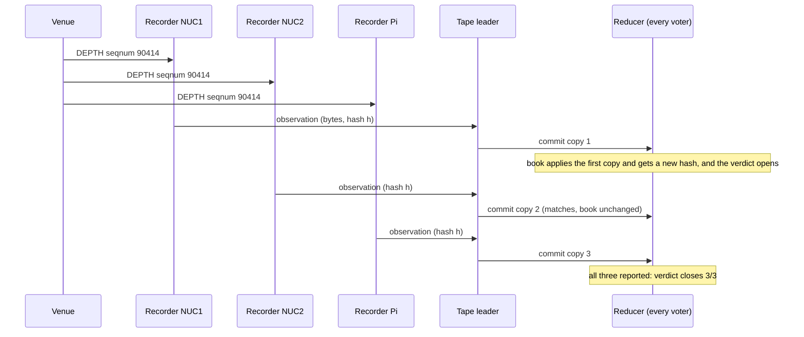
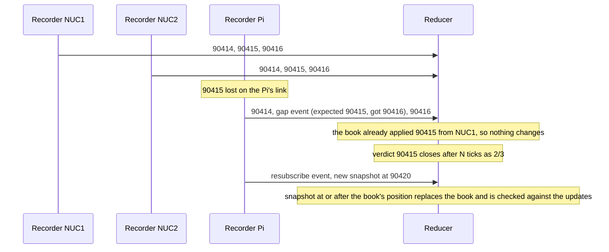

# 0030. The verifiable tape is a separate Raft group that records, attests and proves the public book

Date: 2026-11-11.
Status: **ACCEPTED 2026-11-11 — guarantees locked; nothing built.** Guarantees: [`docs/tape/GUARANTEES.md`](../tape/GUARANTEES.md).
A change to a locked guarantee needs an amendment to this ADR that names the guarantee ID and why it changed.

## Problem

The showcase project records True Markets' public CeFi orderbook feed on all three machines and must be
able to prove, later and to anyone, what the public book was at any `seqnum`. It must not trade. Five
choices decide its shape: where its state machine lives, how three recorders' observations reach the log,
when an agreement verdict stops waiting, whether the book waits for that verdict, and what the book does
when recorders disagree about the bytes of one message.

## Decision

- **A separate Raft group.** The tape runs as its own process and Raft group with its own incarnation,
  identity domain, keys, ports and data directories. It reuses the replication code (willemt/raft fork,
  Aeron transport, WAL, snapshots, archive, authenticated client protocol) but not the trading kernel,
  which stays unchanged. A command for one group is refused by the other.
- **Every recorder sends full observations** (option A). Each of the three recorders proposes, for every
  message it receives, the raw bytes, their SHA-256, the stream, `seqnum`, update kind and its UTC receive
  time. No recorder has a special role. Storage is about three times the minimum; it is measured on day
  one, and a later move to "first commit carries the payload, later ones carry the hash" changes only the
  recorder's send rule.
- **A verdict closes when all three have reported, or N ticks after the first report, whichever comes
  first.** The leader commits a numbered tick entry every T. Starting values: T = 1 s, N = 5. The reducer
  never reads a clock; ticks are its only notion of time.
- **The book does not wait for the verdict.** It applies the first committed copy of each message. The
  verdict is collected separately and becomes final at close.
- **Divergence marks the book unknown until the next snapshot.** If any copy of a message differs from the
  copy the book applied, the book for that stream becomes unknown from that log index until a snapshot
  restores it. No book hash is published while it is unknown.
- **Missing messages are waited for, but only for a bounded time.** If a later `seqnum` commits before an
  earlier one, the book holds the later messages in a fixed-size buffer for up to N ticks for any
  recorder to supply the missing one. Otherwise the book becomes unknown until the next snapshot.

## Consequences

- In normal running every verdict is a complete 3/3 and closes as soon as the slowest machine reports.
  With a machine down or a message missed, verdicts close after N ticks as 2/3 or 1/3, and the book is
  never held for longer than N ticks.
- Book hashes computed before a divergence was discovered stay on the tape as computed; the verdict entry
  records the later discovery. A consumer who needs certainty waits for the verdict to close.
- The tick is a new entry type to secure. The reducer cannot check tick spacing without a clock, so the
  offline verifier checks it from the ticks' recorded UTC times.

## Assumptions to verify on day one

- `seqnum` is one counter per channel and comparable across subscriptions, so a resubscription's snapshot
  can be placed relative to the book. The spec says only "current sequence number of the channel".
- The no-login feed numbers published messages consecutively. If batching skips numbers by design, the gap
  rule changes and this ADR is amended.
- Whether a DEPTH UPDATE carries changes or full replacement levels.
- The largest DEPTH snapshot message, which sets the entry size limit and the split rule.

Answered 2026-11-11 from a 15-minute capture of all twelve books (details in `docs/tape/DECISIONS.md`
D-02, D-03, D-15): `seqnum` is one counter per (channel, symbol), shared by every subscriber; a snapshot
carries the `seqnum` of the next update; consecutive updates step by exactly one; a DEPTH update carries only
the changed levels, each with its new total; the largest frame was 1,601 bytes. All four assumptions hold.

## Data flow

Recorded 2026-11-11. Names the data at each stage and who may change it.

| Stage | Data | Who may change it |
|---|---|---|
| Venue to recorder | WebSocket text frames on DEPTH, EBBO, TRADE, INSTRUMENT and HEARTBEAT | Nobody. The recorder reads only enough of each frame to find its stream, `seqnum` and update kind |
| Recorder | An observation: recorder id, session id, observation number, stream, `seqnum`, update kind, the frame's exact bytes, SHA-256, UTC and monotonic receive times, clock error. Held in a fixed-size ring | The recorder creates it; nothing edits it afterwards |
| Recorder to leader | An authenticated client request (HMAC, caller id, request sequence) carrying one observation, or one numbered part of an oversize one | Refused or committed; never altered |
| Raft log | Five entry types: `Observation`, `ObservationPart`, `RecorderEvent` (session start, gap, regression, overflow, dead connection, reconnect, resubscribe), `Tick`, `HeadSignature` | Append-only. Durable on two of three disks before it counts |
| Tape reducer | Per stream: book levels, state (valid, building, unknown), reorder buffer. Open verdicts table. Last tick number. The Merkle frontier: at most 64 node hashes, enough to append and compute the root without holding the whole tree | Only by applying committed entries, in log order, on every voter |
| Reducer outputs | One leaf per committed entry: log index, entry digest, the affected stream's resulting state and book hash, verdicts closed at this index, integrity flags, capacity events | Derived; recomputable by anyone from the log |
| Tree heads | At every K-th tick, each voter computes the head (tree size, root) from its frontier, signs it, and submits a `HeadSignature`. The head publisher verifies committed signatures and publishes a head once two are valid | Signatures are added, never removed |
| Exporter | Reads the reducer's state page; publishes metrics labelled `source="log"` or `source="local"` | Read-only |
| Archive and verifier | Archived log segments, published heads and the voters' public keys | Read-only |

## Happy paths

### HP-1. Start of recording

1. Each recorder starts a session, records a `RecorderEvent` (session start), connects, and subscribes to
   the twelve books with `SUBSCRIBE_NO_AUTH`, including HEARTBEAT.
2. For each stream the venue sends SNAPSHOT messages and then SNAPSHOT_COMPLETE. Each recorder proposes an
   observation for every frame.
3. The reducer applies the first committed copy of each snapshot message. The book is `building` and has no
   hash until SNAPSHOT_COMPLETE, then becomes `valid` with its first hash (BOOK-6, BOOK-7).
4. The other recorders' copies commit. Each verdict closes at the third copy as 3/3 (ATT-2).

### HP-2. One update, all three agree

### HP-3. A quiet book

No messages arrive for a stream. Each recorder receives a heartbeat after 10 s of silence and records it as
an observation, since every received frame is recorded (REC-2). Ticks keep committing. The book stays `valid`
with an unchanged hash, no verdict is open, and the silence metric grows.

### HP-4. Ticks and tree heads

The leader commits tick k every T. At each K-th tick, every voter computes the tree head over all leaves up
to that tick's index, signs it with its tape key, and submits a `HeadSignature`. The head publisher sees two
valid signatures and publishes the head; the third signature is added when it commits (PROOF-2, PROOF-3).

### HP-5. Offline verification

Someone with the archive, the published heads and the public keys runs the verifier on a laptop with no
network. It rebuilds every book, verdict and leaf, checks every head's signatures and consistency, and
exits zero (VER-1, VER-2).

## Failure paths

### FP-1. One recorder misses a message

The book is never affected, because another recorder supplied the message. The tape records the Pi's gap,
its resync and a 2/3 verdict, which is what the gap-rate and vantage metrics count.

### FP-2. All three miss a message (a feed-side gap)

No copy of 90415 commits, but 90416 does. The reducer holds 90416 and later messages for up to N ticks
(BOOK-5). Nobody supplies 90415, so the book becomes `unknown`. All three recorders saw the gap and
resubscribe (REC-3), and the first complete snapshot makes the book `valid` again. The unknown period is
recorded with its start and end indexes.

### FP-3. Recorders disagree about the bytes

NUC1's copy of 90415 is applied, then the Pi's copy commits with different bytes. The verdict is divergent
and both versions stay in the log (ATT-4). The book becomes `unknown` from the Pi's copy until a complete
snapshot that starts after it (BOOK-4). No recorder saw a gap, so recovery comes from the snapshot refresh
below (H-1).

### FP-4. A machine goes down, or the leader fails

1. The machine's voter and recorder stop together. The other two keep committing (RAFT-4).
2. If it was the leader, an election follows. No ticks commit during it, so open verdicts wait longer in
   wall time but not in ticks. Observations in flight are retried and commit once (ING-2). Tick numbering
   continues from the last committed tick (TICK-1).
3. Verdicts close after N ticks as 2/3. Tree heads still get two signatures.
4. On return, the voter catches up from the leader's retained log. Its recorder starts a new session and
   subscribes. Its book state equals the others', since it is rebuilt from the same log.

### FP-5. Two machines down, or a partition that leaves no majority

Nothing commits. Each surviving recorder keeps reading the socket and fills its ring (REC-5). When a
majority returns, each recorder records an overflow gap with the exact `seqnum` range it could not keep,
then resubscribes, because an overflow is a gap. The book reaches `unknown` through BOOK-5 and recovers at
the new snapshots. Ticks resume where they stopped.

### FP-6. The venue drops every connection

All three recorders hit the 30 s rule, record a dead-connection event and reconnect with backoff (REC-4).
The book stays `valid` as of its last `seqnum`. It is a record of what was published, not a live quote, and
the silence metric shows the outage. On reconnect, the new snapshots replace the books (BOOK-6).

## Error handling

Severity: **page** goes to the phone through the existing ntfy route; **ticket** appears on the dashboard
and in the daily summary.

| Error | Detected by | Immediate response | Recorded on the tape as | Alert | Recovery | Guarantees |
|---|---|---|---|---|---|---|
| One recorder's `seqnum` gap | Recorder | Resubscribe that stream | Gap event, resubscribe event | Ticket if above the gap-rate threshold | Automatic | REC-3, BOOK-6 |
| Feed-side gap (all recorders) | Reducer (BOOK-5) and every recorder | Hold up to N ticks, then `unknown`; all recorders resubscribe | Three gap events; unknown period | Ticket | Automatic, at the next snapshot | BOOK-5, REC-3 |
| Duplicate or lower `seqnum` | Recorder; reducer ignores later copies | None | Regression event; late or duplicate copies | None | None needed | REC-3, BOOK-3 |
| Divergent bytes | Reducer | Book `unknown` | Divergent verdict, both payloads | Page | Automatic at the next snapshot refresh (H-1); review the payloads | ATT-4, BOOK-4 |
| Malformed frame or unknown schema | Recorder records it; reducer can't parse it | Book `unknown`, reason malformed | Unparsed observation | Page if it repeats, since that suggests a venue schema change | A new parser release; the recorded bytes allow replay with it | REC-2, BOOK-2 |
| Value with too many decimals or out of range | Reducer | Book `unknown`, reason precision or overflow | State change with reason | Page | Review the instrument's scale; a new snapshot restores the book | BOOK-2 |
| Dead connection (30 s silence) | Recorder | Reconnect with backoff | Dead and reconnect events | Ticket; page if all three are down for 5 minutes | Automatic | REC-4 |
| Venue refuses connections | Recorder | Exponential backoff to its cap | Reconnect attempts | Page after 15 minutes | Automatic when the venue returns | REC-4, REC-6 |
| Recorder ring full | Recorder | Keep reading, count lost frames | Overflow gap with exact range, then resubscribe | Ticket | Automatic | REC-5 |
| Recorder crash | systemd restarts it | New session | Session start; the old session ends without a close event | Ticket | Automatic. See proposed amendment 1 | ING-3 |
| Observation refused (not leader, queue full) | Recorder | Keep it in the ring and retry | Nothing until it commits | Ticket if retries persist | Automatic | ING-3 |
| Authentication failure | Ingress | Refuse | Nothing (refused requests never reach the log) | Page | Check keys and incarnation | ING-1, X-2 |
| Oversize frame | Recorder | Split into parts | Observation parts | None | None needed | ING-4 |
| A part never arrives | Reducer | Treat the message as missing | Missing copy in the verdict | None | As a gap | ING-4, BOOK-5 |
| Voter down | Raft and the exporter | Two voters continue | Verdicts close as 2/3 | Page | Restart; catch up from the log | RAFT-4 |
| No majority | Recorders (commit refused) | Rings fill | Overflow gaps when it returns | Page | Restore a second voter | REC-5, RAFT-4 |
| Corrupt WAL, snapshot or archive | Voter at recovery | Refuse to start | Nothing on the others' tape | Page | Repair from another voter's archive | RAFT-3 |
| Disk full | Voter's writer | Stop the voter, as for corruption | Nothing on the others' tape | Page at 80% full | Free space or expand; the voter rejoins | RAFT-1, RAFT-3 |
| Tick out of sequence | Reducer | Refuse it | Refused tick | Ticket | None needed | TICK-1 |
| Tick spacing too short or too long | Offline verifier | None in the cluster | Ticks carry their UTC | Ticket | Investigate the leader's clock | TICK-3 |
| Clock unsynchronised | Recorder (from chrony) | Keep recording | Clock error unknown or large | Ticket | Fix chrony; skew metrics show the period as below resolution | REC-7, MET-3 |
| Capacity exceeded (books, levels, reorder buffer, verdicts) | Reducer | Book `unknown`, or verdict closed by capacity | Capacity event | Page | Raise the limit in a new release | ATT-5, BOOK-8 |
| Invalid head signature | Head publisher | Don't count it | Signature entry stays in the log | Page | Check that voter's key; the head publishes when two are valid | PROOF-3 |
| Exporter crash | systemd | Restart | Nothing | Ticket | Automatic | MET-4 |
| Verifier mismatch | Verifier | Stop at the first mismatch | Not applicable | Page | Investigate the named index | VER-3 |

### Handling decisions that add no guarantee

- **H-1. Snapshot refresh.** Each recorder resubscribes to each stream every R minutes (start: R = 15),
  staggered so the three recorders refresh at different times. This bounds how long a book stays `unknown`
  after a divergence, gives the "snapshots agree with updates" integrity rule regular checkpoints, and stays
  within REC-6 because it uses only `SUBSCRIBE_NO_AUTH`.
- **H-2. Overflow is a gap.** After recording an overflow gap, a recorder resubscribes the affected streams,
  as for any gap.
- **H-3. Tree-head cadence.** Heads are computed at every K-th tick (start: K = 60, one head a minute).
- **H-4. A down voter's recorder is down too.** They run on the same machine. A recorder whose own voter is
  unreachable keeps submitting to the other voters through the client protocol, which already routes to the
  leader.

## Amendments

**Amendment 1: ING-3 contiguity is per recorder session. Approved by the owner 2026-11-11 and applied to GUARANTEES.md.** A recorder crash loses the observations still in
its ring, so its numbering has a hole that no overflow gap explains, which breaks ING-3 as written. Proposed
wording: "Per recorder session, observation numbers in the log are contiguous except for recorded overflow
gaps. A restart starts a new session at number 1; a session that ends without a close event may have lost
the observations it had not yet submitted." Test ING-3.1 gains a case that kills the recorder mid-run
and checks contiguity within each session.

**Amendment 2: a verdict's key includes the update kind, and every snapshot is its own verdict. Approved by the owner 2026-11-11 and applied to GUARANTEES.md.** The live
feed gives a snapshot the same `seqnum` as the update that follows it, so a key of (stream, `seqnum`) would
compare a snapshot with an update and report false divergence. Proposed wording for ATT-1: "Every (stream,
update kind, `seqnum`) reported by any recorder gets exactly one final verdict". Implemented in the reducer
because the current wording cannot be implemented correctly; see `docs/tape/DECISIONS.md` D-13.
Extended the same day after the first live run (D-25): a snapshot is a reply to one recorder's subscription,
so a snapshot's verdict key also includes the recorder. Approved wording, revised after the unplug drill (D-26): "Every
(stream, `seqnum`) UPDATE reported by any recorder gets exactly one final verdict across recorders; every
snapshot message, being one subscription's reply, gets a verdict of its own." Updates are still compared
across all three recorders.

## Test cases

Recorded 2026-11-11 against the locked guarantees. Each case names the guarantee it proves, what the test
does, the expected result and where that expectation comes from, and the mutant it must kill. A guarantee is
covered only when every mutant listed for it fails a named test, in a mutation run that proves each mutant
was rebuilt.

### Shared fixtures and oracles

The oracles are written separately from the code under test, from the published spec and this ADR. None
of them may import tape code.

| Name | What it is |
|---|---|
| F-WS | A scripted WebSocket server. Plays a list of frames and logs every frame it sends and receives, with exact bytes and times. Scripts: normal, drop, duplicate, reorder, silence, heartbeat-only, fragmented, oversize, malformed, refuse-connect |
| F-CLOCK | Injected monotonic and UTC clocks, plus a fake chrony source with a settable error bound. UTC can step backwards |
| F-CLUSTER | An in-process three-voter tape group, following the existing replication test harness, with injected refusals (not leader, queue full), delays, partitions, kills, restarts and forced elections. Seeded |
| O-BOOK | A reference book builder in Python, written from the AsyncAPI spec. Outputs canonical book bytes and a hash per `seqnum` |
| O-VERDICT | A verdict calculator in Python, written from the attestation table. Input: the committed log. Output: every verdict and its close index |
| O-MERKLE | An RFC 9162 Merkle implementation in Python using only `hashlib`, cross-checked against published Certificate Transparency test vectors |
| MALLOC-HOOK | Counts heap allocations after start-up in a test build |
| SYMCHECK | A build-time check that a target's linked symbols avoid a denylist, in the style of `cmake/check_no_network_symbols.cmake` |

Fixtures are synthetic and live in the repository. Real day-one captures stay outside it and are referred
to by hash, under the rules of engagement.

| Suite | Covers |
|---|---|
| `tape-build-checks` | X-1, ATT-6, MET-1 |
| `tape-recorder-tests` | REC-1 to REC-7, X-3 |
| `tape-ingress-tests` | ING-1 to ING-4, X-2 |
| `tape-raft-tests` | RAFT-1 to RAFT-5 |
| `tape-attestation-tests` | ATT-1 to ATT-5, TICK-1 to TICK-3 |
| `tape-book-tests` | BOOK-1 to BOOK-9 |
| `tape-proof-tests` | PROOF-1 to PROOF-4 |
| `tape-exporter-tests` | MET-2 to MET-4 |
| `tape-verifier-tests` | VER-1 to VER-3, TICK-3 |
| `tape-drills` | Hardware runs on the NUCs and the Pi: RAFT-4, BOOK-1.2 and the survival metric |

### Cross-cutting

| Case | Does | Expects (source) | Kills |
|---|---|---|---|
| X-1.1 | SYMCHECK every tape target against a denylist: venue order entry, request signing, signer protocol, swap runtime | No denylisted symbol in any target (the denylist) | Linking `velocita_v2_truemarkets_venue` into the recorder |
| X-1.2 | Scan the tape's units and container definitions for mounted key files and venue credential variables | Only tape keys are mounted; no venue key or token (the deploy files) | Adding the venue key mount to a tape unit |
| X-2.1 | Send a correctly signed trading-cluster command to a tape voter | Refused with a domain error (this ADR) | Accepting any caller with a valid HMAC |
| X-2.2 | Send a tape observation to a trading voter | Refused with a domain error | The same, in the other direction |
| X-2.3 | Derive tape and trading keys from one master key | Different keys, equal to vectors computed independently with Python `hmac` | Reusing the trading domain label |
| X-3.1 | Plant a marker string in F-WS frames; scrape the exporter and read the logs at info level | The marker appears nowhere (the planted string) | Adding a "last frame" label to a metric |

### 1. Recorder

| Case | Does | Expects (source) | Kills |
|---|---|---|---|
| REC-1.1 | Play frames with odd whitespace, trailing zeros (`"182.4000"`) and Unicode | Committed bytes equal F-WS's sent log byte for byte | Re-serialising JSON before recording |
| REC-1.2 | Hash every committed observation | Equals `hashlib.sha256` of F-WS's sent bytes | Hashing the parsed payload |
| REC-1.3 | Send one message as fragmented WebSocket frames | One observation holding the reassembled message (F-WS log) | Recording each fragment separately |
| REC-2.1 | Send `seqnum` 10 twice | Two observations | Deduplicating in the recorder |
| REC-2.2 | Send 10, 12, 11 | Three observations in receive order | Sorting by `seqnum` |
| REC-2.3 | Send a malformed frame | Recorded as unparsed, not dropped | Dropping on parse error |
| REC-2.4 | Send 10,000 frames | Observation numbers run 1 to 10,000 with no gaps | Numbering only parsed frames |
| REC-3.1 | Drop `seqnum` 90415 | One gap event (expected 90415, received 90416); a resubscribe in F-WS's inbound log; the new snapshot recorded | Skipping the gap event; not resubscribing |
| REC-3.2 | Send a lower or repeated `seqnum` | Recorded as a duplicate or regression, with no resubscribe | Treating it as a gap |
| REC-3.3 | Gap on one stream while other streams flow | Other streams record without loss during the resync (F-WS log) | Pausing every stream on any gap |
| REC-4.1 | F-WS goes silent | Disconnect and reconnect at exactly 30 s by F-CLOCK, with the reason recorded | 31 s, or never |
| REC-4.2 | F-WS sends only heartbeats for 10 minutes | No reconnect | Ignoring heartbeats as a sign of life |
| REC-4.3 | Inspect every subscription request | Each includes the HEARTBEAT channel (F-WS inbound log) | Omitting HEARTBEAT |
| REC-4.4 | F-WS refuses every connection | Attempt times follow exponential backoff to its cap (F-CLOCK) | A fixed retry delay |
| REC-5.1 | Cluster refuses everything; send ring capacity + 100 frames, then resume | MALLOC-HOOK counts zero; exactly one overflow gap covering the last 100 frames (F-WS log) | Growing the ring; blocking the socket read |
| REC-5.2 | Hold the ring full while F-WS keeps sending | F-WS's writes never block longer than the stated bound | Stopping reads when the ring is full |
| REC-6.1 | Record every frame the recorder sends | Only `SUBSCRIBE_NO_AUTH` and `UNSUBSCRIBE_NO_AUTH`, with only `type`, `channels`, `item_names` and `timestamp` | Sending an authenticated subscribe |
| REC-6.2 | Connect storm against a refusing F-WS | Attempts per minute stay within the limit | Removing backoff |
| REC-7.1 | Step UTC back 2 s mid-run | Monotonic receive times keep increasing; UTC and the error estimate are recorded as given (F-CLOCK) | Deriving monotonic time from UTC |
| REC-7.2 | Remove the fake chrony source | Error estimate recorded as unknown, never zero | Defaulting the error to zero |

### 2. Observation ingress

| Case | Does | Expects (source) | Kills |
|---|---|---|---|
| ING-1.1 | Recorder 1's key with recorder id 2 inside | Refused: recorder id mismatch | Not comparing the id with the key's caller |
| ING-1.2 | Wrong key | Refused: authentication failed | Skipping HMAC verification |
| ING-1.3 | An expired session | Refused: stale session | Disabling the session fence |
| ING-1.4 | A caller whose role is not recorder | Refused: role | Accepting any registered caller |
| ING-2.1 | Resend the same request sequence after a forced election | One copy in the log (log scan) | Removing the request receipt check |
| ING-2.2 | Replay a captured frame after a restart | Refused as a replay | Resetting the session epoch on restart |
| ING-3.1 | 10,000 observations with 20% not-leader, 10% queue-full and 5% timeouts | Per recorder, observation numbers in the log are contiguous except for recorded overflow gaps. The oracle is the harness's own submission log, not the recorder's | Dropping on queue full |
| ING-3.2 | A timeout after the entry committed, then a retry | Exactly one copy | Retrying with a new request sequence |
| ING-4.1 | A snapshot frame three times the entry limit | Three parts; reassembled bytes equal F-WS's sent bytes | Truncating at the limit |
| ING-4.2 | Drop one part | The message counts as missing; the verdict lists that recorder as not reporting | Applying a partial message |
| ING-4.3 | Submit one oversize entry directly | Refused: oversize | Accepting it |

### 3. Raft apply and persistence

| Case | Does | Expects (source) | Kills |
|---|---|---|---|
| RAFT-1.1 | Run the existing durable-quorum scenarios against the tape group's configuration | Pass unchanged (existing tests) | Counting the leader's vote before its fsync |
| RAFT-1.2 | Configure with an unpatched Raft source | The build refuses (patch stamp check) | Skipping the patch check |
| RAFT-2.1 | 50,000 entries under a seeded random restart schedule | The reducer state digest is equal on all three voters at every common index | Re-applying the last entry after a restart |
| RAFT-3.1 | Corrupt each field of a WAL block, a snapshot and an archive segment in turn | Recovery refuses with the error for that field (existing power-cut and archive harnesses) | Skipping one checksum |
| RAFT-4.1 | Stop one voter; keep recording; restart it | Commits continue on two; the rejoined digest matches | Requiring all three for commit |
| RAFT-5.1 | Random logs, snapshot at a random index, restore and replay the rest | Canonical bytes equal a full replay | Leaving the reorder buffer or open verdicts out of the snapshot |

### 4. Attestation and ticks

| Case | Does | Expects (source) | Kills |
|---|---|---|---|
| ATT-1.1 | 1,000 messages with random arrival orders, missing copies, duplicates and divergence | Every final verdict equals O-VERDICT | Counting a recorder's duplicate as a second report |
| ATT-1.2 | One recorder sends the same copy twice | Counted once | The same |
| ATT-2.1 | All three report within two ticks | Closes at the third copy's index (O-VERDICT) | Closing on two reports |
| ATT-2.2 | One recorder silent | Closes at exactly the Nth tick after the first copy, as 2/3 | Closing at N−1 or N+1 ticks |
| ATT-2.3 | The third copy commits just before, then just after, the Nth tick | 3/3, then 2/3 with a late copy | Off-by-one on the tick boundary |
| ATT-3.1 | A matching copy after close | Verdict unchanged; a late record added | Reopening the verdict |
| ATT-3.2 | A divergent copy after close | Verdict unchanged; a late divergence recorded; the book becomes unknown (BOOK-4) | Rewriting the closed verdict |
| ATT-4.1 | Three recorders send three different versions | The verdict lists three hashes with their recorders; the log holds all three payloads | Keeping only the first payload |
| ATT-4.2 | Two recorders agree, one differs | Divergent, not 2/3, listing both versions | Majority vote |
| ATT-5.1 | Open verdicts past capacity, with ticks held | Exactly the oldest close by capacity, at the indexes O-VERDICT predicts | Evicting the newest; overwriting a slot |
| ATT-6.1 | SYMCHECK the reducer library | No clock, time, file, socket or thread symbols | Calling `steady_clock::now()` in closing logic |
| TICK-1.1 | A forced election where the old and new leaders both propose tick k+1 | One tick k+1 applied; the other refused and recorded; k+2 applies normally | Applying any tick above the last |
| TICK-1.2 | Tick k+3 right after k | Refused and recorded | Accepting a jump |
| TICK-2.1 | A tick signed with a recorder key, and one with a voter key from another incarnation | Both refused | Accepting any valid HMAC for ticks |
| TICK-3.1 | Change every tick's UTC field and replay | Reducer state and hashes unchanged at every index | Using tick UTC in the reducer |
| TICK-3.2 | Run the verifier on a log with a burst of 0.2 s ticks and a 12 s election gap | Both flagged with their indexes | The verifier not checking spacing |

### 5. Book reducer

| Case | Does | Expects (source) | Kills |
|---|---|---|---|
| BOOK-1.1 | Replay synthetic logs and, when available, day-one captures | The hash at every index equals O-BOOK | Hashing an unordered container; parsing through a float |
| BOOK-1.2 | Replay one archive on a NUC, the Pi and a Mac (`tape-drills`) | Identical hash sequences | Any architecture-dependent arithmetic |
| BOOK-2.1 | Parse `"182.4000"` at scale 4 | 1,824,000 (by hand) | Wrong scale |
| BOOK-2.2 | Parse `"182.40001"` at scale 4 | Book unknown, reason precision | Rounding |
| BOOK-2.3 | Parse values at and past the integer limit | At the limit: exact. Past it: unknown, reason overflow | Wrapping |
| BOOK-2.4 | Parse `"-1"`, `"1e3"`, `""` and `"NaN"` | Book unknown, reason malformed | Lenient parsing |
| BOOK-3.1 | Three identical copies of one update | The hash changes once, at the first copy | Applying every copy |
| BOOK-4.1 | A divergent copy at index i | Unknown from i; no hash until a complete snapshot starting after i; the first valid hash then equals O-BOOK | Ignoring divergence; restoring on any snapshot |
| BOOK-4.2 | Divergence on one symbol | Other symbols' books stay valid | Marking every book unknown |
| BOOK-5.1 | `seqnum` s+1 commits before s, and s arrives within N ticks | Applied in order; hashes equal O-BOOK for the ordered stream | Applying out of order |
| BOOK-5.2 | s never arrives | Unknown after exactly N ticks, until the next snapshot | Waiting without a bound |
| BOOK-5.3 | The reorder buffer fills before N ticks | Unknown immediately, reason capacity | Dropping held messages |
| BOOK-6.1 | A lagging recorder's snapshot behind the book's position | Recorded, not applied; hash unchanged | Applying older snapshots |
| BOOK-6.2 | A resyncing recorder's snapshot interleaved with other recorders' updates | Applied only at SNAPSHOT_COMPLETE; no hash while building | Hashing a partial snapshot |
| BOOK-7.1 | Walk every state transition | A hash exists exactly when the state is valid | Hashing an unknown book |
| BOOK-8.1 | Flood one book with ten times the level capacity | Unknown, reason capacity; MALLOC-HOOK zero; no crash | Growing the level array |
| BOOK-8.2 | Subscribe more symbols than capacity | The extra symbols are refused and recorded | Overwriting an existing book |
| BOOK-9.1 | Replay with the integrity checks built in and built out | Identical hash sequences | A check that changes state |
| BOOK-9.2 | Fixtures for each rule: bid above ask, bid equal to ask, EBBO disagreeing for 2 and for 3 ticks, a trade outside the book, a trade outside the band, a snapshot that differs from updates by two levels | Crossed; locked; no flag at 2 ticks and a flag at 3; trade-outside-book; outside-band; a two-level diff (all computed by hand) | Using ≥ where > is meant |

### 6. Proof log

| Case | Does | Expects (source) | Kills |
|---|---|---|---|
| PROOF-1.1 | Leaf and node hashes for trees of size 1 to 8 | Equal O-MERKLE and the published test vectors | Missing the 0x00 or 0x01 prefix |
| PROOF-1.2 | A long run; check every consecutive pair of tree heads | Each consistency proof verifies with O-MERKLE | Rebuilding the tree after compaction without its old leaves |
| PROOF-2.1 | Compare the three voters' head bytes at every publication index | Identical | Putting local time in the head |
| PROOF-3.1 | Heads with one signature, a wrong key, and a signature over different bytes | Each refused with its reason; two valid signatures accepted | Accepting one signature |
| PROOF-4.1 | Inclusion proofs for 1,000 random events against their first covering head | All verify with O-MERKLE; a flipped byte in the event or the proof fails | Proving against the wrong tree size |
| PROOF-4.2 | Proof sizes for trees of 1,000, 1,000,000 and 10,000,000 entries | ⌈log₂ n⌉ × 32 bytes: 320, 640 and 768 bytes (by hand) | Padding or a wrong tree shape |

### 7. Metrics exporter

| Case | Does | Expects (source) | Kills |
|---|---|---|---|
| MET-1.1 | SYMCHECK the exporter | No client-write or proposal symbols | Linking the node client |
| MET-2.1 | Record a fixture day; the verifier recomputes every `source="log"` metric | Equal for every closed period | Counting gaps from the local recorder instead of the log |
| MET-2.2 | Parse a full scrape | Every metric has a `source` label | A metric without one |
| MET-3.1 | Error bound 2 ms; true skew 1 ms, then 5 ms | "Below resolution", then 5 ms ± 2 ms (F-CLOCK) | Reporting raw skew |
| MET-4.1 | Kill, then pause, the exporter during a deterministic recording run | The committed log is byte-identical to a control run | Any write path from the exporter |

### 8. Offline verifier

| Case | Does | Expects (source) | Kills |
|---|---|---|---|
| VER-1.1 | Run with networking disabled (`unshare -n` on Linux, a sandbox profile on macOS) | Completes | Fetching a tree head from the cluster |
| VER-2.1 | Corrupt, in turn, one entry byte, one book hash, one inclusion proof, one consistency proof, the tick order, one verdict and one metric | Each detected | Skipping any one check |
| VER-3.1 | For each injected fault | The reported index, entry type, expected and actual values equal the injection; non-zero exit | Continuing past the first mismatch; reporting a later index |
