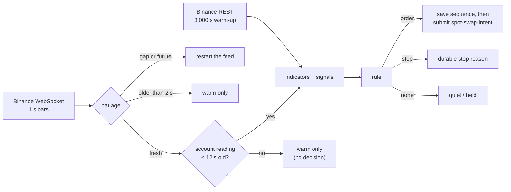

# Edge: computes indicators and proposes decisions

The live driver turns Binance one-second SOLUSDT bars into stochastic signals and proposes at most one swap
intent at a time, as the strategy caller. It can't sign, can't see keys other than its own caller key, and
can't send anything the kernel wouldn't accept from that role.

Source: [`live_swap_driver.py`](../../model/src/velocita_model/shadow/live_swap_driver.py),
[`live_swap.py`](../../model/src/velocita_model/shadow/live_swap.py),
[`stochastic_second.py`](../../model/src/velocita_model/shadow/stochastic_second.py). Decisions:
[ADR 0016](../adr/0016-strategy-and-operator-callers-are-separate.md),
[edge design](../V2_MODEL_AND_MARKET_DATA_EDGE_DESIGN.md).

## Pipeline

## The rule

| | |
|---|---|
| Stochastic | 900 s high/low window (monotonic deques); %K smoothed over 10 bars, %D over 30 |
| Trend filter | EMA 300 s above EMA 1,200 s; 1,200-bar warm-up |
| Entry | %K crosses above %D with %K ≥ 60 and the trend up, held 3 bars; not within 60 s of an exit |
| Exit | %K below %D and %K ≤ 40, held 3 bars |
| Size | 0.12 SOL per buy; sell everything held |
| Floors | buy must receive ≥ 92% of the clip; sell ≥ 94% of expected USDC |

It decides on the previous bar's flags, so a decision only uses information that existed before the bar that
prices the order. That costs one second and rules out look-ahead.

## Stops (all durable)

| Reason | When |
|---|---|
| drawdown | realized P&L ≤ −$10: exit, then stop |
| capacity | 240 effects used |
| insufficient_balance | the next buy exceeds cash |
| review_drained | 7 minutes before the review window ends, while flat |
| submission_unconfirmed | no clear commit line, or an intent unseen for 20 s |

## Why it saves its sequence before submitting

The kernel tracks sequences per caller. If the driver sent sequence 9, crashed, and came back thinking it was
at 8, it would send a different command as 9. Saving first (temp file, fsync, rename) means a crash can only
skip a number, which is harmless.

## How it learns the account

The driver never reads Raft. It reads `strategy-settlements.json`, which the live observer publishes every
5 s from the gateway's validated snapshot, and accepts it only with the right schema and incarnation and an
age of at most 12 s. Otherwise a bar only warms the indicators. This is why the driver stopped deciding while
the gateway was blocked on effect 25 ([RESULTS.md](../../RESULTS.md)).
