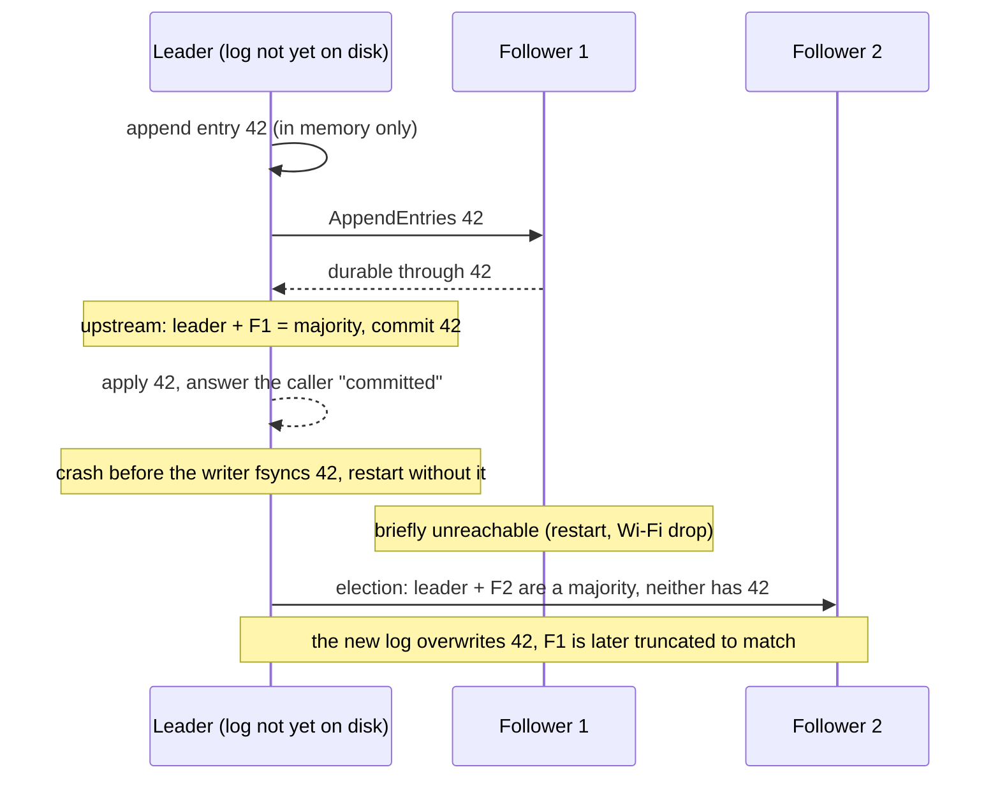
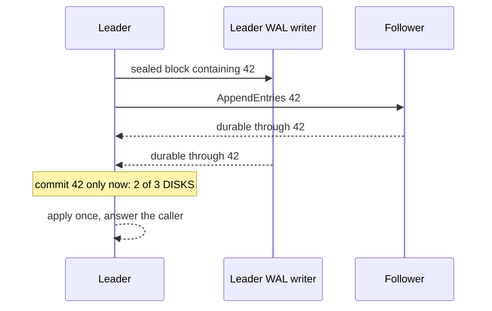

# Fix: a committed entry must be on a majority of disks

## The defect

Velocita writes its Raft log asynchronously: the consensus thread stages entries into memory blocks and a
separate writer thread `fsync`s them, so the thread that runs Raft never waits on the disk
([memory.md](memory.md#wal-blocks)). Upstream [willemt/raft](https://github.com/willemt/raft) assumes a
synchronous log. It counts the leader's own vote for an entry as soon as the entry is appended.

Put together, that is wrong:

"Committed" is supposed to mean "on a majority of disks". Here it meant "on one disk and in one process's
memory". A leader crash at the wrong moment, plus one follower being briefly unreachable, loses an entry the
caller was told is permanent, without any disk failing. For a trading kernel that entry can be a fill or a
settlement.

## The fix

A small patch to a pinned upstream commit, applied at configure time and verified by hash
([`deploy/patches/0001-raft-durable-quorum.patch`](../../deploy/patches/0001-raft-durable-quorum.patch)):

- **`durable_idx` callback.** Raft asks the application how far its own log is durable. The leader's vote
  counts only up to that index. Followers already report durability in their acknowledgements, and those are
  clamped to the follower's durable index as well.
- **`before_apply` hook.** The node checks its dependencies (the execution catalog) before the applied index
  advances, so it stops rather than applying without them.
- **Persist-pending error.** A save that hasn't completed propagates as an error instead of being treated as
  done.

An implementation that is unsure must report the lower index, so the only way to get it wrong is to be slow.

## Other upstream fixes in the same patch

| Problem found on the cluster | Fix |
|---|---|
| One failing peer stopped AppendEntries to the remaining peers | send to every peer; a peer behind the snapshot gets an empty append at the snapshot point |
| After compaction, a candidate advertised log term 0 and could never be elected | fall back to the snapshot term |
| A voter that dropped off Wi-Fi came back with a higher term and deposed a healthy leader | pre-vote (Raft thesis §9.6): ask first, change nothing until a majority agrees |

## Why a pinned fork and not a vendored copy

The upstream commit stays the source of truth and the delta stays a reviewable diff. CMake refuses to build
if the patch doesn't apply or the patched files' hashes differ, because silently building unpatched Raft
would silently bring the defect back.

Tests: [`tests/v2_durable_quorum_tests.cpp`](../../tests/v2_durable_quorum_tests.cpp),
[`tests/v2_raft_persistence_tests.cpp`](../../tests/v2_raft_persistence_tests.cpp). Decision:
[ADR 0006](../adr/0006-asynchronous-durability-and-the-pinned-raft-fork.md).
