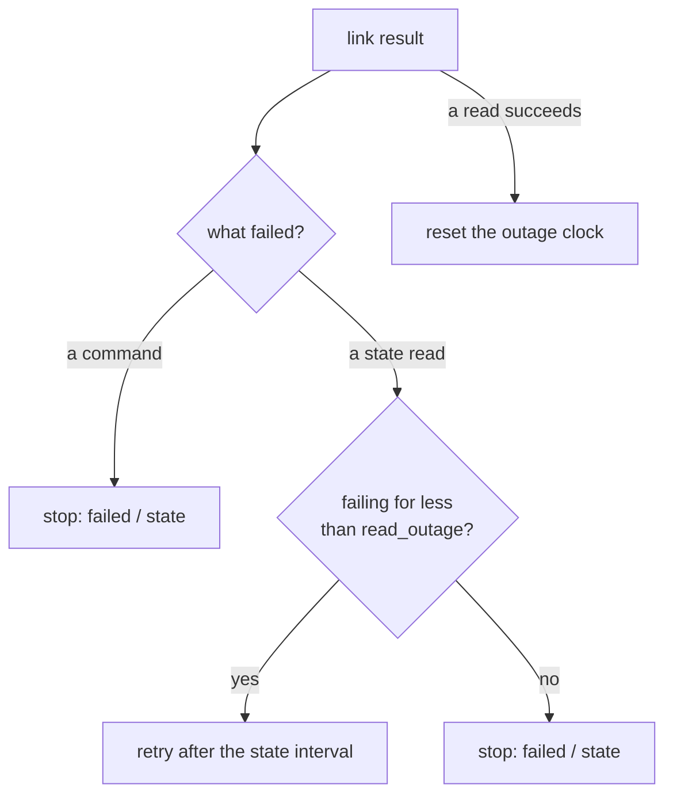

# Fix: ride out a short Raft outage instead of stopping

## The defect

At 18:35:55 UTC on 2026-10-15, hours before the live run, the gateway stopped for good. During a leader
election one state read failed, and the gateway treated any failed read as fatal. Its unit has `Restart=no`
on purpose (a stop may hide an unknown outcome), so one election ended trading until a person intervened.

Elections are normal: a voter restarts, a link drops for a few seconds. The gateway has to survive them
without weakening the cases where stopping is right.

## The fix

[`a835deb`](https://github.com/vishaljha2121/Velocita/commit/a835deb) separates the two kinds of failure on
the gateway's link to the cluster:

| Failure | Risk | Behaviour |
|---|---|---|
| A **state read** fails | none: a read changes nothing | retry every state interval; stop only after `read_outage` (120 s in production) of continuous failure |
| A **command** fails | the command may have committed anyway | stop, as before |

The rule lives in a few lines of [`SwapGatewayRuntime::step`](../../src/v2_swap_gateway_runtime.cpp): a
failed state read records when the outage began and schedules the next read; a successful read resets the
clock. Recovery-only runs keep the old strict behaviour.

## Why bounded

An unbounded retry would hide a cluster that is really gone, with an effect possibly in flight. 120 s covers
several election timeouts and a voter restart, and a longer outage still stops the gateway with a clear
cause.

## Tests

Two drills in [`tests/v2_swap_gateway_runtime_tests.cpp`](../../tests/v2_swap_gateway_runtime_tests.cpp)
cut the gateway's link to the voters:

- **Short outage**: the gateway keeps running; after the link returns, a second outage starts a fresh window,
  and the pending trade completes exactly once (one create, one signature, one execute).
- **Long outage**: past the window the gateway stops with `failed / state` and has made no venue call.

The live run then crossed a leader change (term 6 → 8) without stopping.

## The related stale-read fence

A different read problem was found in paper trading on 2026-10-09. The gateway read state one entry old from
a leader whose disk lagged its followers, re-reported a finished order, and stopped. The fix: the leader
defers reads until its own apply catches up, and the gateway discards any reading older than results it has
already seen. Write-up: [`gateway_stop_2026-10-09`](../../archive/evidence/gateway_stop_2026-10-09/README.md).
