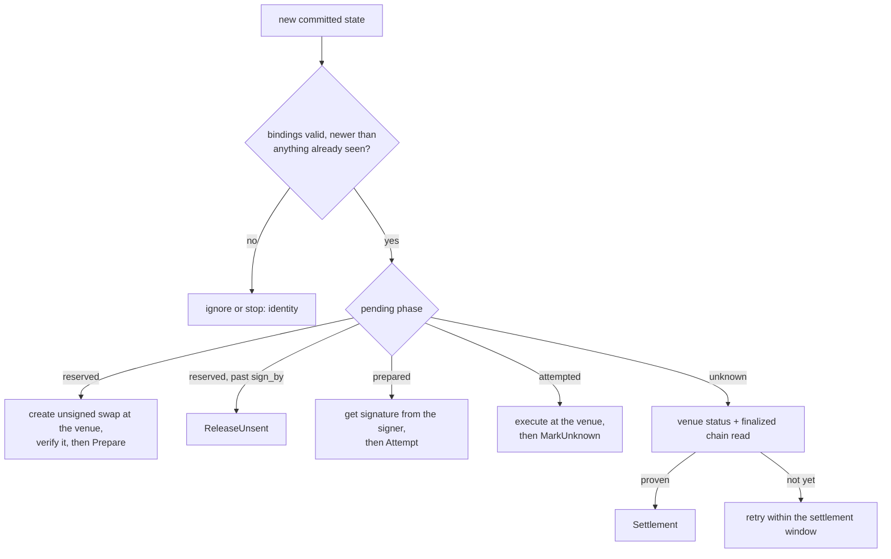

# Gateway: execution lifecycle and reconciliation

The gateway is a single-threaded loop. It reads committed state, picks the one next step for the pending
effect, journals it, performs it, and writes the outcome back to Raft as a command. It cannot sign and it
cannot invent a trade.

Source: [`src/v2_swap_gateway_runtime.cpp`](../../src/v2_swap_gateway_runtime.cpp),
[`src/v2_swap_runtime_production.cpp`](../../src/v2_swap_runtime_production.cpp). Decisions:
[ADR 0013](../adr/0013-request-correlated-execution-authority.md), [0017](../adr/0017-the-gateway-is-a-separate-process-reading-committed-state.md),
[0025](../adr/0025-bounded-swap-verification-and-policy-bound-recovery.md), [0027](../adr/0027-unsent-effect-release-and-reviewed-baseline.md).

## What it does for each committed phase

## Journal before every external act

| Journal | Phases | Prevents |
|---|---|---|
| Prepare | idle → create_intent → prepared / released | A crash after the venue request causing a second create for the same effect |
| Submission | idle → execute_intent → resolved | Re-sending an execute whose reply was lost; the only way forward is reconciling that exact order |
| Reconcile | highest committed index and digest it caused | Acting on a state read older than its own last command |

Acting first and journaling second would let a crash hide that the act happened, so a restart would repeat
it. Journal-first makes the worst case "we may have acted", which is safe because the next step is always a
status query, never a resend.

## Verify before Prepare

The venue's unsigned transaction is decoded and checked by the same verifier the signer uses *before*
`Prepare` commits. A route outside the allowlist is refused there (`unsupported_route`), the effect stays
`reserved`, and after `sign_by` it is released. Before this check existed, a refused route was found after
`Prepare` and the effect could never be released.

## Settlement

A swap settles only from a finalized `getTransaction` for the journaled signature, checked against the
prepared payload, then replayed: the owner's SOL and USDC deltas and the route's fee event must map exactly
onto the intent. When the venue reports a failure without a transaction id, a separate proof is required
before the effect can be marked never executed: the blockhash has expired at a finalized slot, and no
transaction in the owner's history matches the payload. In the recorded recovery that proof returned `chain_unproven`, without naming the failed check.
Later wallet history showed a candidate failed transaction, but the published records do not establish
its exact prepared-payload match or the cause of the refusal. See [RESULTS.md](../../RESULTS.md#live-run-1516-october-2026).

## Stopping

| Status / cause | Meaning |
|---|---|
| failed / identity | Something doesn't match its binding (incarnation, payload digest, effect) |
| failed / state | A command couldn't be submitted, or state reads failed for longer than the outage window |
| failed / storage | A journal couldn't be written or read back |
| blocked / signer_refused | The signer refused to sign |
| blocked / settlement_unproven | An unknown outcome couldn't be proven within the window |

The unit has `Restart=no`: a stop may mean an unknown outcome, so a person looks before it runs again. A
short Raft outage is not a stop: see [the read-outage retry](fix-read-outage-retry.md).

## Continuous mode

After a settlement is proven and its journal resolved, the next intent may start. Before touching effect
N+1, both the gateway and the signer prove from committed state that effect N settled with the journaled
payload and transaction. Their durable fences advance only then.
