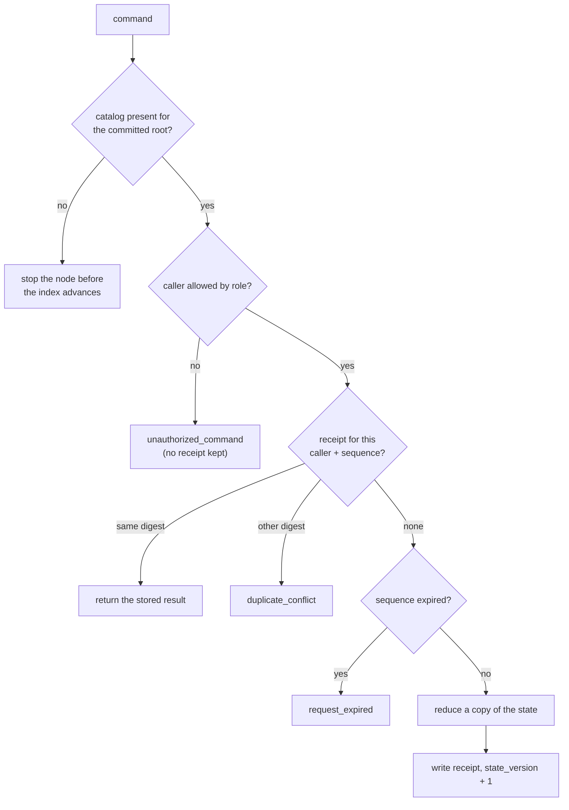
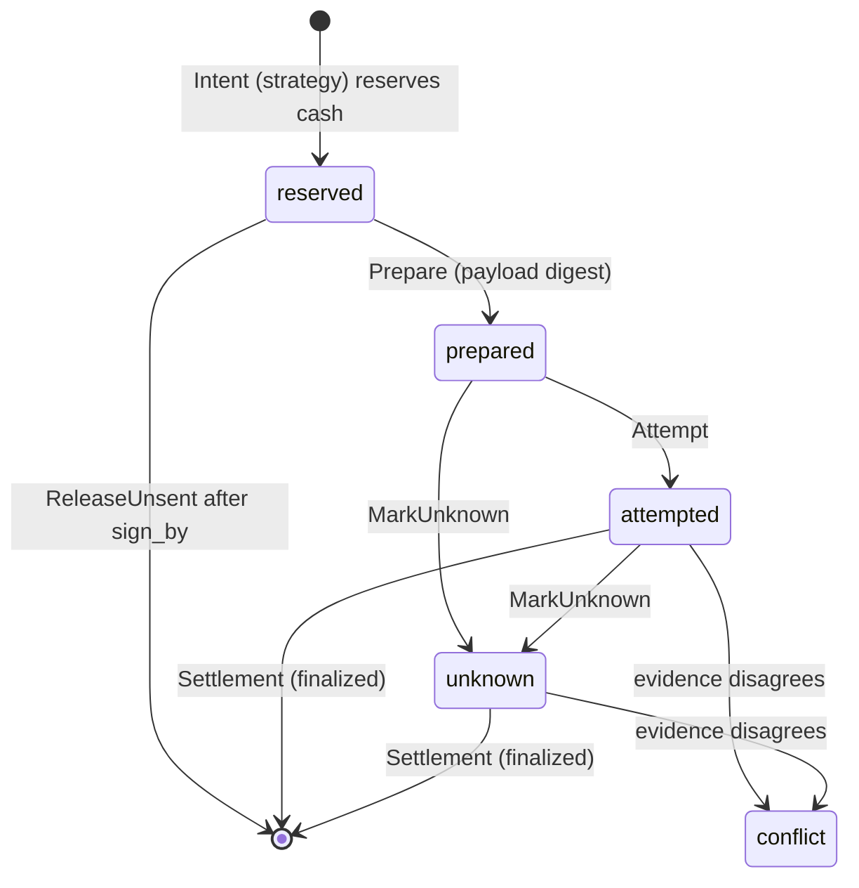

# Kernel: deterministic integer accounting

The kernel is a pure function `apply(state, command) → result` over one fixed-size struct
(`TradingState`, 78,512 bytes). It is the only place money is counted, and it knows nothing about Raft,
sockets, files or clocks. Every voter runs it on the same committed log and must reach the same bytes.

Source: [`src/v2_kernel.cpp`](../../src/v2_kernel.cpp), [`src/v2_swap.cpp`](../../src/v2_swap.cpp),
[`include/velocita/v2/swap.hpp`](../../include/velocita/v2/swap.hpp). Decisions:
[ADR 0005](../adr/0005-reducer-behind-consensus.md), [0020](../adr/0020-commands-are-authorized-by-caller-role.md),
[0021](../adr/0021-the-kernel-owns-cash-pnl-and-the-loss-limit.md), [0028](../adr/0028-a-recent-settlement-window-with-lifetime-count.md).

## Rules and why

| Rule | How | Why |
|---|---|---|
| No clock reads | Time arrives inside the command; an event older than the last one is refused | Three clocks would disagree; time as data replays |
| No floating point | Lamports (1e-9 SOL) and USDC micros (1e-6); `unsigned __int128` for products | One rounding difference between CPUs forks the replicas |
| No heap, no hash maps | `std::array<T,N>` plus a count, linear scans | Allocator state and hash order are nondeterministic |
| Copy, then commit | `auto next = state; reduce(next); if applied: state = next` | A refusal can never leave a half-changed state |
| Apply exactly once | `apply()` is called only from the Raft commit callback | A command that never commits has no economic effect |
| Every outcome typed | 19 reducer codes mapped to `ApplyCode` | "Why didn't it buy?" is answerable from the log forever |

## The order of checks in `apply()`



Refusing on role before the receipt lookup means a refusal is always re-evaluated against current roles,
and a probe can't learn which sequences exist.

## Who may send what

| Command | Operator | Strategy | Gateway |
|---|---|---|---|
| Kill epoch, executor generation, mode, catalog, roles, limits | yes | – | – |
| Swap `Initialize`, `GrantStrategy`, `AmendBuyPrice` | yes | – | – |
| Swap `Intent` | yes | only with the grant | – |
| `Prepare`, `Attempt`, `MarkUnknown`, `ReleaseUnsent`, `Settlement` | – | – | yes |

The operator can't forge evidence: even the owner's key is refused on `Settlement`. The role table is a
`std::visit` ending in a `static_assert`, so a new command kind doesn't compile until its roles are decided.

## One effect's life



There's no release from `prepared`: once the venue has handed over a signable transaction, "nothing
happened" can only be proven by chain evidence. A settlement's outcome is `succeeded`,
`failed_without_charge`, or `expired_unexecuted` (a proven never-landed transaction, the only outcome with no
transaction id). Only one effect is in flight at a time, so a reservation is exactly that effect's worst case
and a settlement can belong to only one intent.

`Intent` is checked in order: nothing pending; effect number newer than every previous one; binding equal to
the funding record; epochs current; source time fresh and `sign_by` within its lifetime; mode allows the side
and realized P&L is above −$10 for a buy; fee within cap; the debit within cash, the lifetime cap and the
reviewed price bounds ($200 per SOL to buy, $20 to sell). The driver has its own tighter floors; the kernel's
are a second, independent bound.

## Settlement arithmetic (effects 1 and 3 of the live run)

```text
buy   quote_debit 12,690,000  fee 25,380  base_credit 119,507,269
      base += 119,507,269; quote -= 12,690,000; cost += 12,664,620; pnl -= 25,380
sell  base_debit 119,507,269  quote_credit 12,557,694  fee 25,165
      removed = cost × base_debit / base = 12,664,620   (__int128, rounds down)
      pnl += 12,557,694 − 12,664,620                    → total −132,306 (−$0.132306)
```

Fees are realized immediately, so for a flat account `cash − funding = realized P&L` exactly; the live
review checked that to the micro. Any mismatch with the intent (receipt below the floor, wrong payload or
custody, a transaction already seen) is a conflict: the account stops and keeps the evidence.

## Snapshots prove themselves

Decoding a snapshot isn't trusted. `valid_state()` re-applies the funding record to an empty state and replays
every retained settlement through the real reducer, requiring identical totals. A checksum proves the bytes
weren't damaged; replay proves they are a state the reducer could have produced.

## C++ techniques

Strong ids (`StrongId<BaseAtomTag>` can't be added to quote atoms), a closed `std::variant` of commands,
defaulted `operator==` on every record, `static_assert` size budgets, `__int128` intermediates and `noexcept`
throughout. See [memory.md](memory.md) for the budgets.
