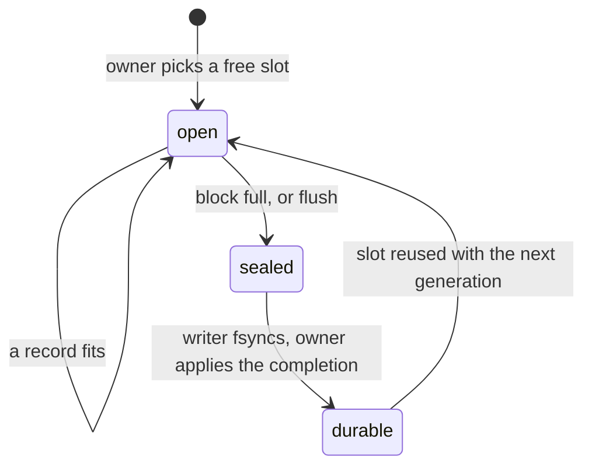

# Memory: budgets, the atlas and arenas

The deterministic kernel uses fixed-size state and tables, with compile-time budgets. The retained log
and WAL also use fixed arenas allocated at startup. A full arena causes refusal or backpressure.
This does not make the entire voter allocation-free: `ReplicatedKernel::propose` creates a payload vector,
peer decoding uses entry vectors, and persistence/compaction use dynamically allocated jobs. See
[`v2_replication.cpp`](../../src/v2_replication.cpp) and [`v2_node.cpp`](../../src/v2_node.cpp).
The full field-by-field inventory is the
[message and memory atlas](../V2_MESSAGE_MEMORY_ATLAS.md); this page is the shape of it.

Source: [`include/velocita/v2/layout.hpp`](../../include/velocita/v2/layout.hpp),
[`wal_arena.hpp`](../../include/velocita/v2/wal_arena.hpp),
[`retained_log.hpp`](../../include/velocita/v2/retained_log.hpp),
[`result_ledger.hpp`](../../include/velocita/v2/result_ledger.hpp),
[`spsc_ring.hpp`](../../include/velocita/v2/spsc_ring.hpp). Decision:
[ADR 0022](../adr/0022-a-state-snapshot-size-budget-with-headroom.md).

## Budgets are compile errors

| Object | Size / budget | Used |
|---|---|---|
| `TradingState` (the whole replicated state) | 78,512 / 81,920 B | 96% |
| Canonical snapshot (fits one 64 KiB wire envelope) | 61,586 / 65,536 B | 94% |
| Swap account `swap::State` | 4,160 / 4,160 B | 100% |
| Swap command | 296 / 512 B | 58% |
| Kernel result | 112 / 128 B | 88% |
| Hot decision record (one cache line) | 64 / 64 B | 100% |

Each is a `static_assert(sizeof(T) <= budget)` plus `is_trivially_copyable_v`. As a runtime check, a size
regression would surface in production as a snapshot that no longer fits its envelope. As a compile error, the
build fails on both architectures the moment a field is added, and whoever adds it decides what to give up.

## The atlas: where the state's bytes go

| Part of `TradingState` | Bytes | Share |
|---|---|---|
| Request receipts, 256 × 160 | 40,960 | 52% |
| Decision records (cold 16 × 584, hot 16 × 64) | 10,368 | 13% |
| Policies, 8 × 920 | 7,360 | 9% |
| Source event receipts, 128 × 56 | 7,168 | 9% |
| Executable bundles, 2 × 2,088 | 4,176 | 5% |
| Swap account | 4,160 | 5% |
| Risk, orders, outbox, cursors, counters | 4,320 | 6% |

Receipts are half the state because each one stores the full answer to a command, so a retry gets the
original answer instead of a second effect. The snapshot is a canonical encoding, not a `memcpy`: struct
padding, byte order and the ABI differ between x86_64 and aarch64, and identical states must produce
identical bytes and digests on every voter.

## Arenas: allocate once, then hand out slots

| Arena | Slot × count | Total | When full |
|---|---|---|---|
| State tables | 24–2,088 B × 4–256 | 78,512 B | typed `…_capacity_exceeded` |
| Retained Raft log | 2,048 B cell + 40 B descriptor × 8,192 | 16.3 MiB | proposals refused until compaction |
| WAL blocks | 4,096 B × 64 | 256 KiB | backpressure |
| Result ledger | one committed result × 1,024 | – | admission refused; a ready result is never dropped |

Fixed arrays with a count replace `std::vector` (which reallocates and invalidates references) and hash maps
(whose iteration order depends on allocator state, so two voters could walk the same table differently). At
these sizes a linear scan is also faster.

**Hot and cold.** A decision's 64-byte hot part fits one cache line; its 584-byte cold part (the full frame) is
read only to authorize or audit. Finding a decision touches 1 KiB instead of 10 KiB.

**Retained log.** Two allocations, ever. Entry *i* lives in cell *i* mod 8,192; only the ends of the ring move
(compaction at the front, truncation at the back), so the lookup stays valid. 64 cells are reserved for
control commands: when the system is overloaded, the operator can still halt it.

## WAL blocks

The consensus thread copies entries into 4 KiB blocks; a writer thread `pwrite`s and `fsync`s sealed blocks.
They share only fixed-size tickets on two lock-free queues.



| Decision | Why |
|---|---|
| A record never straddles two blocks | block checksums cover each complete record and detect incomplete or damaged block writes |
| 4 KiB blocks, not 64 KiB | a quiet system flushes one block per command; 64 KiB cost 64 KiB of SD-card writes for a 200-byte command |
| 64 blocks, not 8 | with 8, the benchmark refused 4 commands in 5 |
| A generation counter per slot | a late completion for an earlier use of a slot must not mark new bytes durable |
| File preallocated 32 blocks ahead | overwriting existing space avoids filesystem-metadata journaling |
| Separate staged and durable indexes | only the durable index counts toward quorum ([the durable-quorum fix](fix-durable-quorum.md)) |

In the [2026-10-27 Apple M5 Pro storage microbenchmark](../../archive/evidence/benchmarks_2026-10-27/v2-storage-benchmark.txt),
the measured owner-loop median was 20.584 µs with inline sync versus 0.042 µs with the writer off-thread.
The corresponding p99 values were 111.375 and 160.166 µs; maxima were 1,123.58 and 236.417 µs.
The off-thread measurement includes staging/submission and any arena backpressure, not the time until that
record becomes durable. Its 488,361 backpressure-loop iterations show that bounded capacity can still mean
waiting under load. The ratio of medians does not measure disk speed or end-to-end Raft commit latency.

The older 21.6 µs / 0.042 µs medians and 109 / 208 µs p99 values in
[ADR 0006](../adr/0006-asynchronous-durability-and-the-pinned-raft-fork.md) came from an earlier development-host
run. They are retained as historical evidence, not mixed with the October 27 measurements.

## The lock-free queue between the threads

```cpp
bool push(const T& value) noexcept {
    const auto head = head_.load(std::memory_order_relaxed);   // only the producer writes head
    const auto tail = tail_.load(std::memory_order_acquire);   // see the consumer's progress
    if (head - tail >= Capacity) return false;                 // full: refuse, never overwrite
    slots_[head & (Capacity - 1)] = value;
    head_.store(head + 1, std::memory_order_release);          // publish the slot and the block it names
    return true;
}
```

The release store on `head` makes everything written before it visible to a reader that loads `head` with
acquire; that one pairing is the whole synchronization. `head` and `tail` are `alignas(64)` so they don't share
a cache line (false sharing), and 64-bit counters never wrap in practice.

## Process memory

A voter's largest object is the retained log (16 MiB of cells plus 320 KiB of descriptors), then Aeron's
1 MiB term buffers, the 256 KiB WAL arena, the 77 KiB state and one 60 KiB snapshot buffer. Containers are
capped (voter 1 GiB and 128 processes), and buffers that held secrets are wiped with `OPENSSL_cleanse` or
through a `volatile` pointer so the compiler can't remove the wipe as a dead store.
