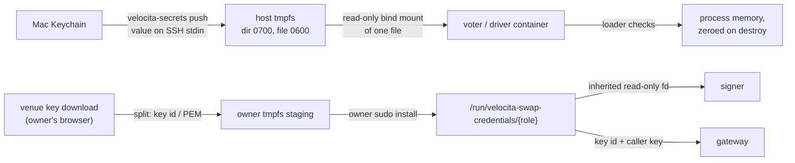
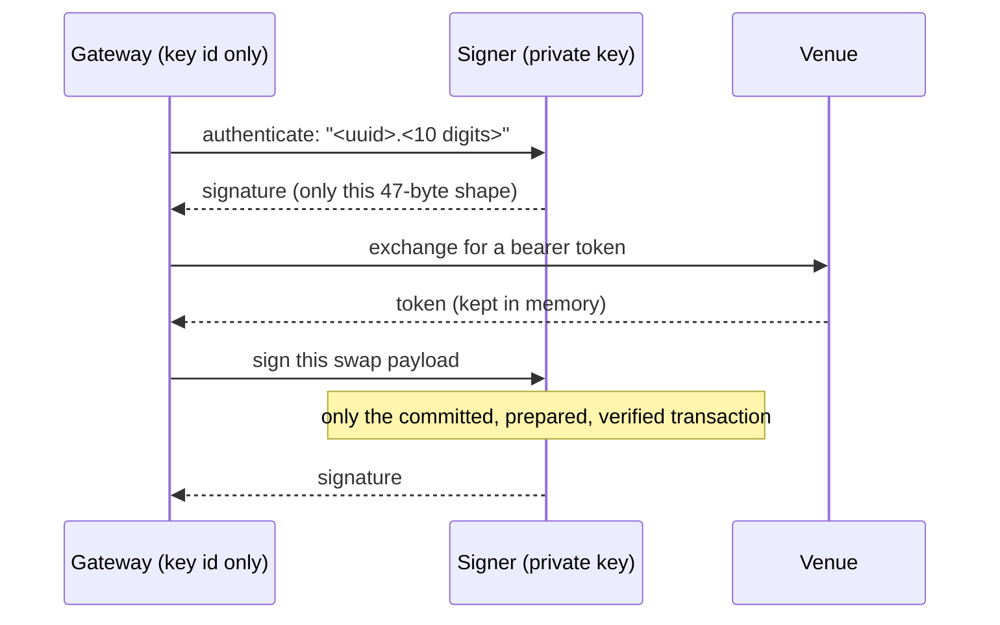

# Secrets: what exists, who holds it, how it travels

Source: [`tools/velocita-secrets`](../../tools/velocita-secrets),
[`src/v2_auth_envelope.cpp`](../../src/v2_auth_envelope.cpp),
[`src/v2_session_fence.cpp`](../../src/v2_session_fence.cpp),
[`deploy/v2/swap-runtime/credential_handoff.py`](../../deploy/v2/swap-runtime/credential_handoff.py),
[`fd_handoff.py`](../../deploy/v2/swap-runtime/fd_handoff.py). Decisions:
[ADR 0010](../adr/0010-the-operator-holds-the-key-collectors-hold-tokens.md),
[0019](../adr/0019-live-execution-and-key-custody.md), [0029](../adr/0029-the-signer-authenticates-the-gateway-for-a-day.md),
[secrets rotation review](../M2_SECRETS_ROTATION_REVIEW.md).

## Inventory

| Secret | Kind | Shared between | Allows |
|---|---|---|---|
| `link-1-2`, `link-1-3`, `link-2-3` | 32-byte HMAC key | one pair of voters | "this Raft message came from voter N" |
| `caller-9` | HMAC | operator client (Mac), every voter | operator commands |
| `caller-12` | HMAC | strategy driver, every voter | strategy intents |
| `caller-13` | HMAC | gateway, every voter | gateway evidence (Prepare … Settlement) |
| `caller-14` | HMAC | signer, every voter | state reads and authority barriers only |
| Venue API private key | EC P-256 | **signer only** | signing swaps; minting session tokens |
| Venue API key id | public id | gateway | naming the key when asking for a token |
| Venue bearer token | short-lived token | gateway, memory only | calling the venue's REST API |

**Why symmetric keys for messages and an asymmetric key for money.** HMAC is cheap enough to tag every Raft
frame, and both ends are machines we own. Money is different: the venue verifies a P-256 signature with the
public key it registered, so only the private key's holder can authorize a swap. That key gets the strongest
custody in the system: one process, one Unix user, no network except the voters.

## How keys travel



- **Created in the Keychain.** `velocita-secrets init` writes 32 random bytes straight into the macOS
  Keychain. A value never appears on a command line, in an environment variable or in output.
- **Pushed over SSH stdin.** The host writes a temporary 0600 file and renames it into place, so a reader sees
  the old file or the whole new one.
- **RAM only.** Secrets live on tmpfs. A stolen disk, SD card or backup contains none.
- **Mounted narrowly.** Each unit or container binds exactly the files it needs, read-only.
- **Loaded with suspicion.** The loader refuses symlinks, files not owned by the process's user, files
  readable by others, and anything that isn't exactly the right length.
- **Wiped.** Key objects are move-only and zero themselves when destroyed.

The price of RAM-only: a reboot empties tmpfs, and that host can't start until the owner pushes again. It
fails closed, and an alert names the missing files (by name only).

## Authenticated messages

```text
per-direction key = HMAC-SHA256(secret, "velocita.auth.v1" ‖ role ‖ sender ‖ recipient ‖ cluster incarnation)

frame: magic | version | role | sender | recipient | session epoch | sequence | length | body | HMAC-SHA256 (32 B)
```

- The **role** (peer, ingress, response) and direction are in the key, so a captured "caller → voter" frame
  can't be reflected back as "voter → caller".
- The **cluster incarnation** is in the key, so frames from an old cluster verify under no current key, even
  if the secret was never rotated.
- **Replay**: the sequence strictly increases within one process's life; the session epoch, a counter in a
  small file, increases durably at every start. The tag is verified *before* the fence moves, so an
  unauthenticated frame can never advance it.
- Above transport, the kernel's receipts make each command idempotent: transport protection stops old frames,
  and receipts stop honest retries from executing twice.

## Rotation without downtime

| Step | Command | Sends with | Accepts |
|---|---|---|---|
| 1 | `rotate-begin NAME` | old | old and new |
| 2 | `rotate-promote NAME` | new | new and old |
| 3 | `rotate-finish NAME` | new | new only |

After each step the key is pushed and every host reloads with SIGHUP. A reload that finds a bad or missing
file keeps the keys it had.

## The money key



On this venue the key that mints session tokens is the same key that signs swaps, so a process holding it
could authorize any transaction from the wallet. The gateway parses JSON and RPC replies from the internet;
it is the most exposed process. So the signer holds the key and exposes exactly two narrow operations, and
the gateway asks. The PEM reaches the signer as an inherited read-only file descriptor; the signer never opens
a path, and refuses a key that isn't mode 0600, owned by its user, a clean P-256 key, and equal to the pinned
public key.

## Process isolation

The gateway and signer run as different Unix users with no capabilities, read-only pinned root filesystems,
each other's directories made inaccessible, no core dumps, and `Restart=no`. The signer can reach only the
three voters. Its socket checks the peer's UID with `SO_PEERCRED` on every connection.

## What this doesn't protect

- Every voter holds every caller key (verifying an HMAC needs the same bytes as creating it). Anyone who can
  read a running voter's tmpfs can impersonate any caller. Per-command asymmetric signatures would fix that at
  a CPU cost per message.
- The Mac is the root of trust: its Keychain, SSH key and venue browser session.
- The venue key can withdraw funds. Until the venue offers a trade-only key, the remaining bound is the
  balance: fund the wallet only with what you are willing to lose.
