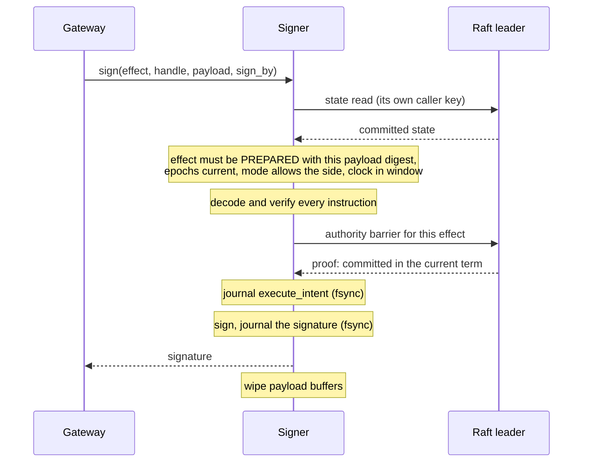

# Signer: checks that the exact transaction is authorized

The signer is the only process that holds the venue's API private key. It trusts nothing the gateway says:
it reads Raft itself, verifies the transaction itself, gets its own authority proof, journals before it
signs, and wipes its buffers afterwards.

Source: [`src/v2_swap_signer_session.cpp`](../../src/v2_swap_signer_session.cpp),
[`src/v2_swap_transaction_verifier.cpp`](../../src/v2_swap_transaction_verifier.cpp). Decisions:
[ADR 0010](../adr/0010-the-operator-holds-the-key-collectors-hold-tokens.md),
[0019](../adr/0019-live-execution-and-key-custody.md), [0029](../adr/0029-the-signer-authenticates-the-gateway-for-a-day.md).
Key custody and isolation are in [secrets.md](secrets.md).

## One signing

If the gateway could say "the cluster approved this", a compromised gateway would say it about anything. The
signer has its own key, reads committed state directly, and requires a barrier that commits in the leader's
current term after its own read. The gateway only carries bytes.

## What the verifier accepts for a buy

A swap is a Solana version-0 transaction with two signers: the venue's fee payer and our wallet. The verifier
decodes every instruction and accepts exactly this shape:

| # | Instruction | Must be |
|---|---|---|
| 0 | Compute unit limit | within policy (≤ 1,400,000) |
| (1) | Compute unit price | within policy |
| +1 | Create token account (idempotent) | owner's wrapped-SOL account, funded by the fee payer |
| +2 | Jupiter route | fixed accounts; one 100% step through an allowlisted DEX |
| +3 | Close token account | back to the owner |
| +4 | Transfer lamports | owner → fee payer (rent repayment) |

From the decoded route it checks the economics: the 20 bp platform fee equals the fee cap, the input equals
the committed debit, and the worst-case SOL received after rent repayment is at least the committed minimum.
Five DEX programs are allowlisted; any other route is refused with `unsupported_route`.

Simulating the transaction would prove what it would do against today's chain state, not what it will do
when it executes later. Decoding proves what the signature authorizes: which accounts can be debited, by at
most how much, and the minimum that must arrive.

## Journal before using the key

If the signer signed and then crashed before journaling, a signature could be in the world while the
restarted signer believes nothing was signed, and it could sign a second transaction for the same effect.
Journal-first leaves a durable fence: after a restart it will only return the same signature for that effect.

## The second operation: authenticate

The venue mints session tokens with the same key that signs swaps. Rather than give the gateway that key,
the signer signs one more message shape: exactly `<uuid>.<10 digits>` (47 bytes), with a timestamp within
60 s of its clock and only before the review window ends. No transaction can have that shape. The gateway
exchanges the signature for a bearer token and re-mints it before it expires.

## Sandbox

The signer runs as its own Unix user with no capabilities, a pinned read-only runtime image as its root
filesystem, network access to the three voters only, no core dumps, `MemoryDenyWriteExecute`, the gateway's
directories made inaccessible, and `Restart=no`. Its socket checks the peer's UID with `SO_PEERCRED` on
every connection.
