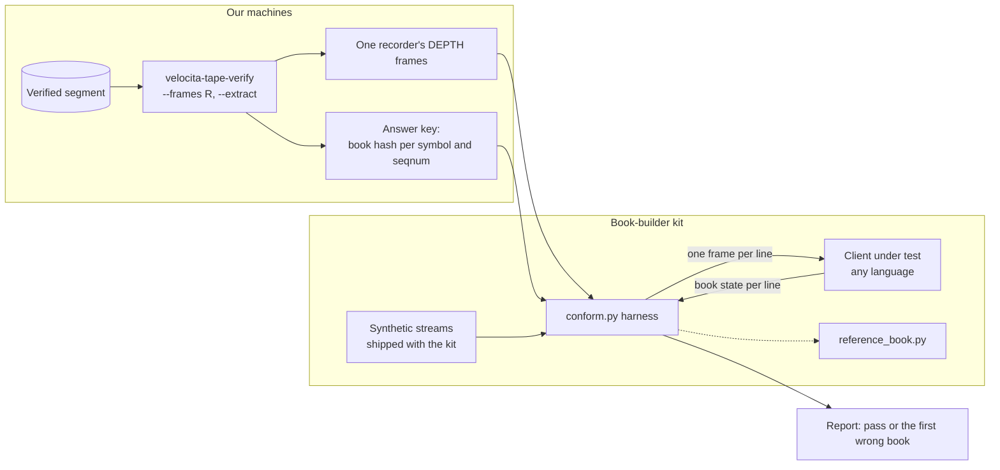
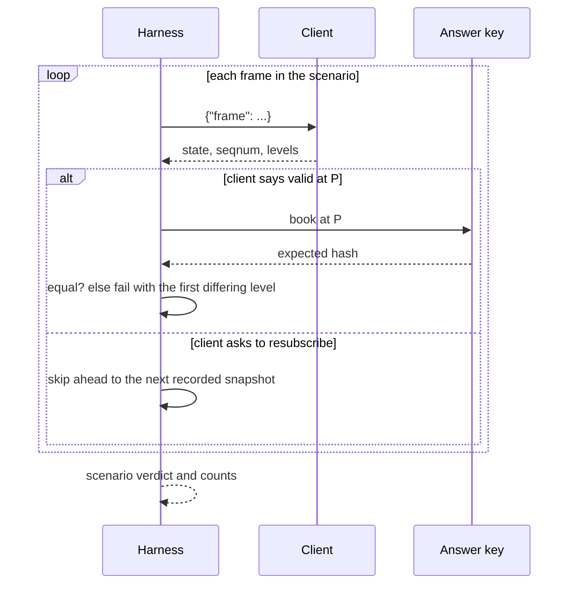
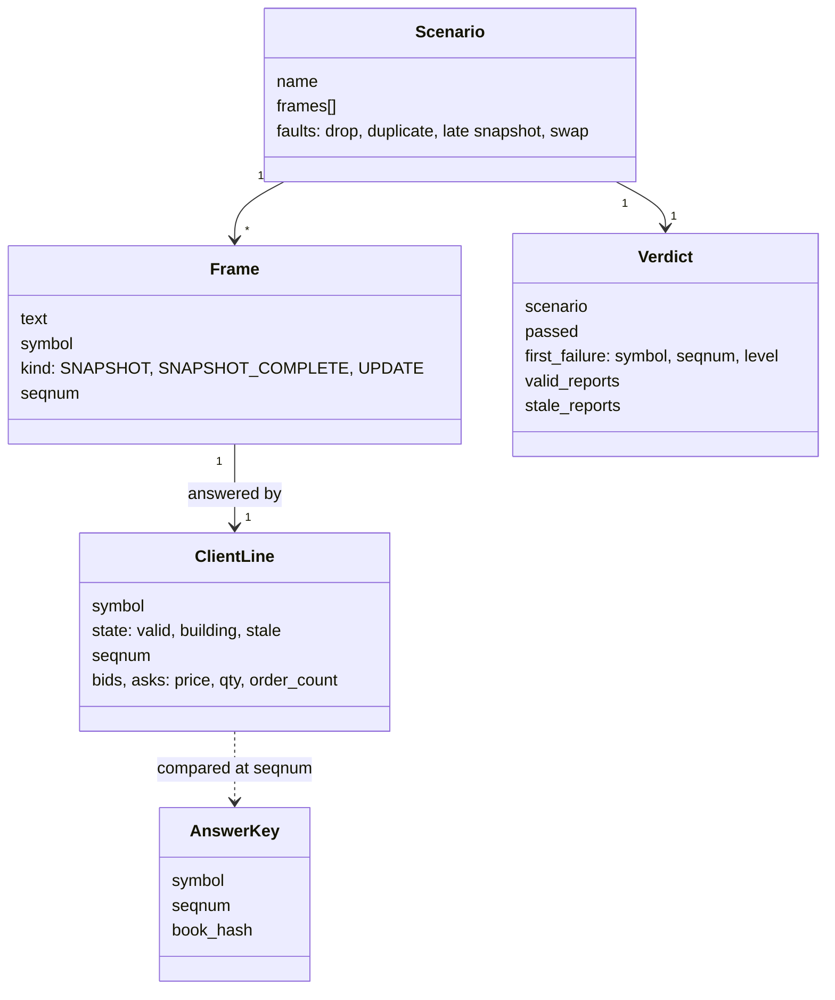

# Book-Builder Conformance Kit Plan

Status: approved and built 2026-11-13. Test cases map to `tests/test_book_kit.py` (ctest `book-kit-tests`).

## 1. The problem

Every program that trades or quotes on True Markets keeps its own copy of the order book, built from the public
DEPTH channel: take a snapshot, apply updates, notice when something was missed, recover. If that copy is wrong,
everything downstream is wrong too: quotes, risk checks, fills the program thinks it can get. And it is wrong
silently: a book with one stale level looks like a valid book.

The feed's documentation describes the messages, but it does not include a reference book builder or a stated
rule for recovering from a gap. Each integrator works the rules out alone. The tape had to work them out too, and
found that several are easy to get wrong:

| Trap | What the feed actually does | What a plausible client does wrong |
|---|---|---|
| Snapshot numbering | A snapshot carries the `seqnum` of the **next** update (36 of 36 snapshots, D-15) | Treats it as the last applied update and drops the first real update as a duplicate, or sees a false gap |
| Update meaning | An update gives each changed level's **new total**; `qty` "0" removes the level (D-03) | Adds the quantity as a change, so levels drift upward |
| Field names | The live field is `order_count`; the spec says `depth`; levels also carry an undocumented `last_update` (D-03) | Reads a field that is never there and treats every count as zero |
| Gaps | Numbers step by exactly one, so any jump is a real gap (1,808 of 1,808 steps, D-15) | Keeps applying updates after a jump and serves a book that is quietly wrong |
| Multi-part snapshots | SNAPSHOT messages, then SNAPSHOT_COMPLETE; the book is not usable until the end | Serves a half-built book |
| Decimals | Prices and sizes are decimal strings with up to 9 places | Parses to floating point; totals stop matching after rounding |
| Quiet books | Books can go 31 minutes without an update off-hours (report, D-62) | Treats book silence as a dead connection and reconnects in a loop |

Why it matters:

- **A wrong book costs real money.** A level that should have been removed is a price you cannot get.
- **Nobody can currently test against the truth.** A client can only be compared with itself or with the live
  feed, which moves on before you can check anything.
- **The tape is the truth.** It holds every update for twelve books, recorded three times, with each book's exact
  state at every `seqnum` under a signed head. That is a ready-made answer key.

## 2. How we solve it

Three pieces, all small.

1. **A reference book builder** (`tools/book-kit/reference_book.py`, Python standard library only, about 150
   lines). Written to be read: one state machine per book, integers at 10^-9, the gap and snapshot rules spelled
   out. It is a third independent implementation of the book after the C++ reducer and the test oracle.
2. **A harness** (`tools/book-kit/conform.py`) that plays a recorded stream to any client and compares the client's
   book with the tape's book **at the same `seqnum`**. A client in any language takes part through a line
   protocol on stdin and stdout.
3. **Scenarios.** Clean replay of real recorded streams, plus faults made from them: a dropped update (gap), a
   duplicate, an old snapshot delivered late, two updates swapped. For each fault the harness knows what a correct
   client must do, because the rules are the tape's.

### The rule the harness checks

The book after update `seqnum` P is a single, known thing: the tape verified it across three recorders, with no
divergent copies in the archive. So:

- If a client says its book is **valid at P**, its book must equal the tape's book at P, level for level.
- After a gap, a client must **not** say valid again until it has applied a complete snapshot at or after the gap.
- Saying "stale" when it did not need to is allowed but counted, so a client that gives up too easily shows up.

A wrong book while claiming to be valid is the one failure that is never acceptable.

### Line protocol

The harness writes one JSON object per line; the client answers each with one line.

| Direction | Line |
|---|---|
| Harness to client | `{"frame": "<the DEPTH frame's exact text>"}` |
| Client to harness | `{"symbol": "NVDAC-USDC", "state": "valid", "next_seqnum": "173922", "bids": [["163.53","0.089","3"], ...], "asks": [...]}`, where `next_seqnum` is the update the book expects next (the tape keys its books the same way), or `{"symbol": ..., "state": "building"}` / `{"state": "stale", "resubscribe": true}` |
| Harness to client | after a client asks to resubscribe, the next frames come from the stream's next recorded snapshot onward |

Values stay decimal strings, so the harness, not the client, converts them to integers. The harness sets a time
limit per line, so a client that hangs or crashes fails the scenario rather than stalling the run.

### Where the streams come from

Two small additions to `velocita-tape-verify`, both only after a segment verifies:

- `--frames RECORDER FILE`: one recorder's DEPTH frames, exactly as that connection received them, including its
  own gaps and resubscription snapshots. This is a realistic single-client stream.
- `--extract` writes a new `K` row (book, `seqnum` position, book hash) each time a valid book changes, which becomes
  the answer key. It is a new row type, so the feed report, which reads the other rows, is unaffected.

Real feed frames stay on our machines (terms of service). The kit ships with **synthetic** streams generated by
the test encoder for anyone else to use; the real-tape run is how we prove the kit and the reference builder
against the truth.

Out of scope: a TypeScript reference client, EBBO and TRADE, live use against the feed, connection handling
(heartbeats and reconnects), publishing the kit.

## 3. Guarantees (new group KIT; existing groups unchanged)

| ID | Guarantee |
|---|---|
| KIT-1 | **The reference builder matches the tape.** Replaying a verified segment, its book at every `seqnum` where it says valid equals the tape's book at that `seqnum` |
| KIT-2 | **A wrong valid book always fails.** If a client reports valid at P with any level different from the tape's book at P, the scenario fails and names the book, P and the first differing level |
| KIT-3 | **Gaps are judged by the rules.** After a missing update, any valid report before the client has applied a complete snapshot at or after the gap fails |
| KIT-4 | **Answer key only from verified segments.** Expected books come from a segment whose log verified under a signed head, never from the client or the harness |
| KIT-5 | **Any client, bounded run.** Clients take part only through the line protocol; a hang, crash or malformed line fails that scenario within the time limit and the harness carries on |
| KIT-6 | **Reproducible.** The same streams and client give a byte-identical report |
| KIT-7 | **Data stays private.** Shipped fixtures are synthetic; real frames are used only locally and never appear in a report, which holds book names, `seqnum`s and counts |

## 4. Test cases

Expected values come from the tape's verified books and hand-built cases, never from the harness or the reference
builder under test. Each known trap is a deliberately broken client the harness must catch. The last column is
filled in after the build.

| Case | Guarantee | Test | Expected | Test name |
|---|---|---|---|---|
| KIT-1.1 | KIT-1 | Reference builder on a scripted stream with snapshots, updates, removals and a multi-part snapshot | Valid books equal the Python oracle's at every `seqnum` || `test_reference_builder_matches_the_oracle_everywhere` (25 messages, two books, a two-part snapshot, removals, 9-decimal sizes; every valid book checked) |
| KIT-1.2 | KIT-1 | Reference builder on one recorder's real stream from segment 1794499200, all twelve books | Zero differences from the tape's answer key || Run by hand: NUC1's stream from segment 1794499200, all twelve books, 23,818 messages: 23,723 valid books checked, 0 differences, 0 unchecked |
| KIT-2.1 | KIT-2 | Broken client: adds update quantities instead of setting totals | Fails at the first changed level, naming book, `seqnum` and level || `test_each_known_trap_is_caught` [add-deltas], `test_a_wrong_book_names_the_first_differing_level`; on real data: NVDAC bid 165.516 shows 0.266 where the tape has 0.133 |
| KIT-2.2 | KIT-2 | Broken client: treats a snapshot's `seqnum` as the last applied update | Fails (drops the first update, or reports a wrong book) || `test_each_known_trap_is_caught` [snapshot-is-last]; on real data: caught at TSLAC on the second check |
| KIT-2.3 | KIT-2 | Broken client: parses decimals as floats | Fails where rounding changes a total || `test_each_known_trap_is_caught` [floats] (size 1.001 parses to 1.000999999); on real data: 2.142999999 where the tape has 2.143 |
| KIT-2.4 | KIT-2 | Broken client: reads `depth` instead of `order_count` | Fails on order counts || `test_each_known_trap_is_caught` [depth-field]; on real data: order count 0 where the tape has 2 |
| KIT-2.5 | KIT-2 | Broken client: serves the book before SNAPSHOT_COMPLETE | Fails on a multi-part snapshot || `test_each_known_trap_is_caught` [serve-before-complete]. On this real segment the trap does no harm: every snapshot arrived as one message |
| KIT-3.1 | KIT-3 | Drop one update; client keeps applying | Fails at the first valid report after the gap || `test_a_client_that_ignores_a_gap_fails` |
| KIT-3.2 | KIT-3 | Drop one update; reference builder | Goes stale, asks to resubscribe, valid again from the next snapshot, then matches || `test_reference_builder_recovers_from_a_gap` (drop and swap); on real data the drop scenario recovers with one resubscribe |
| KIT-3.3 | KIT-3 | Duplicate update and an old snapshot delivered late | Reference builder ignores both; book unchanged || `test_duplicates_and_late_snapshots_change_nothing`, `test_a_client_that_applies_a_late_snapshot_fails` |
| KIT-4.1 | KIT-4 | Segment whose log has one flipped byte | No answer key, run refused with the reason || `test_the_answer_key_comes_only_from_a_verified_segment` (`--tape` mode runs the verifier; a flipped byte refuses the run) |
| KIT-5.1 | KIT-5 | Clients that hang, exit, or print a non-JSON line | Each scenario fails within the time limit; the run finishes || `test_hanging_exiting_and_garbled_clients_fail_in_time` |
| KIT-6.1 | KIT-6 | Same run twice | Byte-identical report || `test_reports_are_reproducible` |
| KIT-7.1 | KIT-7 | Frames carrying a unique marker | Marker absent from the report || `test_no_frame_text_reaches_the_report` |

## 5. Diagrams

### Where it runs

### One scenario

### The reference builder's book states

```mermaid
stateDiagram-v2
  [*] --> Empty
  Empty --> Building: SNAPSHOT
  Building --> Building: more SNAPSHOT parts
  Building --> Valid: SNAPSHOT_COMPLETE, position = snapshot seqnum
  Valid --> Valid: UPDATE at position applies (position + 1); older seqnum ignored
  Valid --> Stale: seqnum above position (gap)
  Stale --> Building: SNAPSHOT at or after the gap
  Valid --> Building: newer SNAPSHOT
```

### Data model

## 6. Build plan (1 hour)

Already in place: the verifier's verified replay and `--extract`; the test encoder that writes DEPTH frames; the
Python oracle that computes the book hash independently; a verified real segment on the Mac.

| Time | Work | Done when |
|---|---|---|
| 0:00–0:08 | Verifier: `--frames R FILE` writes recorder R's DEPTH frames, one per line, in its log order; `--extract` adds `K` rows. Both only from a run that verified | Builds; a scripted log gives frames and `K` rows |
| 0:08–0:20 | `tools/book-kit/reference_book.py`: one state machine per book (empty, building, valid, stale), decimal strings to integers at 10^-9, levels set to new totals, gap and snapshot rules; runs as a client on stdin and stdout | Answers a scripted stream line by line |
| 0:20–0:35 | `tools/book-kit/conform.py`: reads frames and an answer key (`K` rows, or one computed by the oracle for synthetic streams), starts the client, time limit per line, compares books by hash and names the first differing level, scenarios clean and dropped update, JSON report | Reference builder passes clean and dropped-update on a scripted stream |
| 0:35–0:52 | `tests/test_book_kit.py` with the five broken clients (`tests/book_kit_traps.py`), the duplicate and late-snapshot scenario, bounded-run and reproducibility cases; ctest `book-kit-tests` | KIT-1.1, 2.1 to 2.5, 3.1 to 3.3, 4.1, 5.1, 6.1 and 7.1 pass |
| 0:52–1:00 | Real run: NUC1 recorder's stream from segment 1794499200, all twelve books, against the tape's `K` rows; fill the test mapping; commit locally, no push | KIT-1.2: zero differences, or each one explained |

**Cut line, in order:** the swapped-updates scenario; then the shipped synthetic fixture file (the tests still
generate synthetic streams); then the real run (KIT-1.2) moves to straight after the hour.

**Left out of the hour:** a TypeScript client, EBBO and TRADE, connection handling, a README section, publishing
the kit.

## 7. Risks

| Risk | Response |
|---|---|
| A recorder's stream includes its 15-minute refresh snapshots mid-stream | The builder treats a newer snapshot as a rebuild (state diagram), so these are part of the clean scenario |
| One recorder's stream has its own gaps, so a clean replay is not perfectly clean | That is realistic; the answer key covers every `seqnum` the tape knows, and the client's own gap handling is judged by KIT-3 |
| A client may be valid at a `seqnum` the tape held as unknown (a feed-side gap) | No answer key there: counted as unchecked, never as a pass |
| Snapshots arrive only every 15 minutes (recorder refresh), so recovery after a gap waits for one | Scenarios are cut so that a snapshot follows each injected fault |
| Real frames are True Markets data | Kept local; shipped fixtures are synthetic; reports hold no frame text (KIT-7) |
