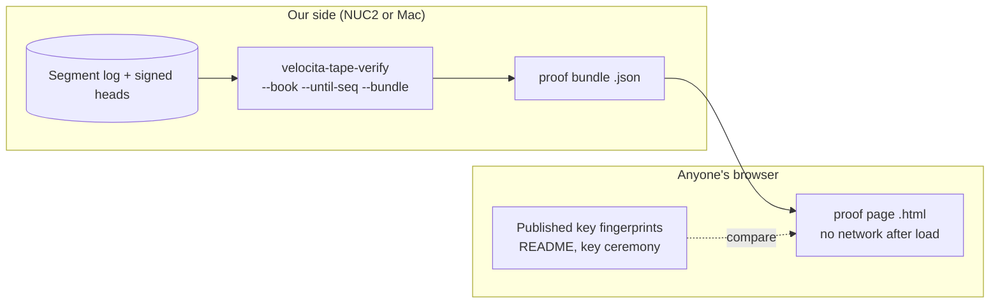
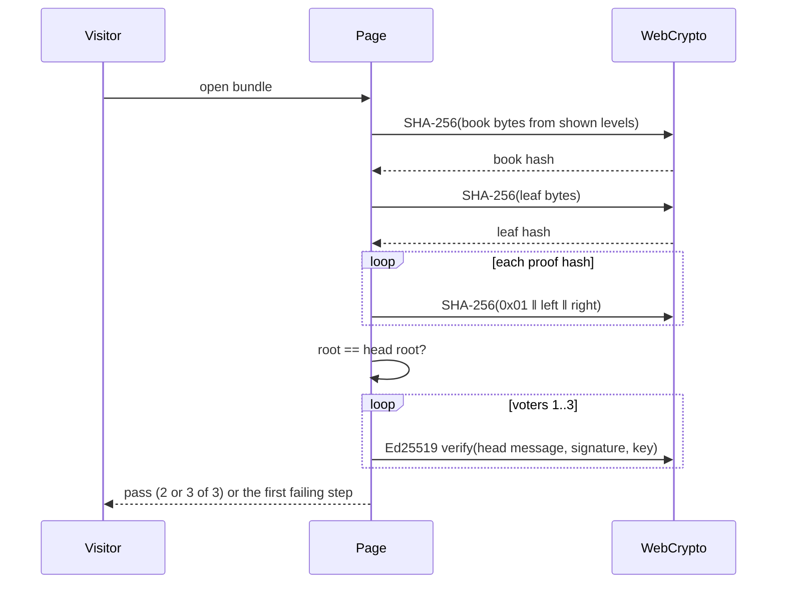
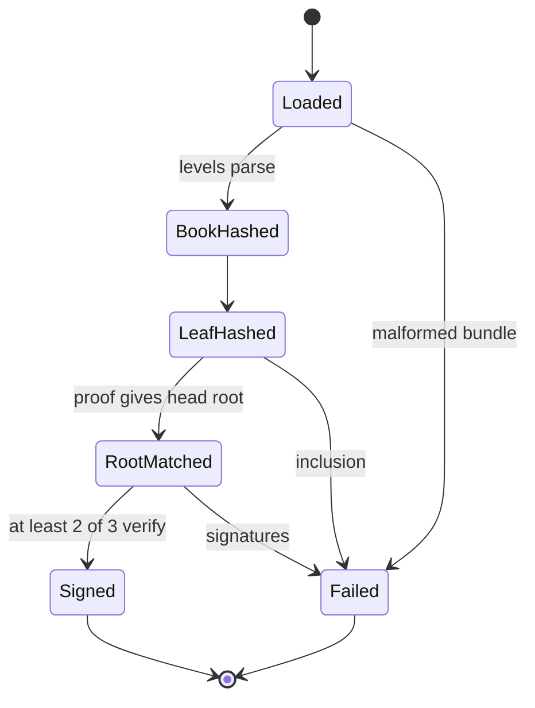
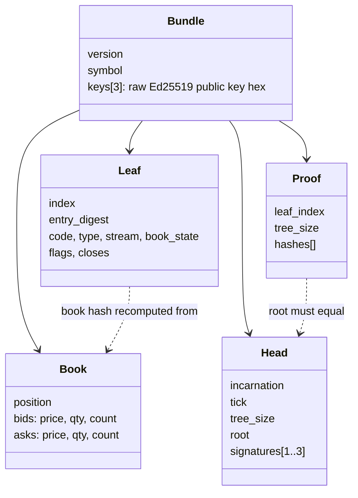

# "Check It Yourself" Proof Page Plan

Status: approved and built 2026-11-13. Test cases map to `tests/test_tape_proof.py` (ctest `tape-proof-tests`).

## 1. The problem

The tape's claim is "this is what True Markets' public book looked like at time t, three independent machines
agreed on it, and nobody can change it afterwards." Today, checking that claim means building C++20, installing
OpenSSL, copying a multi-gigabyte log and running `velocita-tape-verify`. Nobody outside this project will do that,
so in practice the claim rests on trusting us.

That is the gap: **the proof exists, but only we can check it.** A CTO reading the README sees signed heads and
Merkle roots but has no way to check one in under a minute.

Why it matters:

- **Trust you can check is the whole point of the tape.** A tamper-evident record that only its author can verify is
  just a log.
- **Disputes need a small, portable piece of evidence.** "What was the book when my order filled?" should be
  answerable with one file and a browser, not an archive.
- **It demonstrates the design.** Certificate Transparency made Merkle proofs and signed tree heads ordinary;
  this shows the same idea working on market data.

## 2. How we solve it

One small JSON file (a **proof bundle**) and one static web page.

1. `velocita-tape-verify --book SYMBOL --until-seq N --bundle OUT.json` writes, after the log fully verifies: the
   book's levels, the leaf's fields, the inclusion proof hashes, the signed head and the three public keys.
2. The page loads the bundle (file picker or drag-and-drop) and recomputes everything itself, in the browser,
   with built-in WebCrypto (SHA-256 and Ed25519).
3. Each step shows a tick or names the step that failed. A "tamper" button changes one level's size and re-runs,
   so a visitor sees the proof break.

The page's checks, in order:

1. Book hash from the displayed levels.
2. Leaf hash from the book hash and the leaf fields.
3. Root from the leaf hash and the inclusion proof (RFC 9162).
4. That root equals the head's root.
5. At least two of three Ed25519 signatures verify over the head message.
6. Each key's fingerprint is shown, to compare with the published fingerprints.

What the page trusts: only the three public key fingerprints, which are published in the README and the key
ceremony record. Everything else is recomputed.

### Exact bytes (from the C++ code)

| Item | Bytes |
|---|---|
| Book hash | SHA-256(`velocita-tape/v1/book` ‖ u8 symbol length ‖ symbol ‖ u64 position ‖ for bids then asks: u16 count, then per level i64 price, i64 qty, u32 order count) |
| Leaf hash | SHA-256(0x00 ‖ `velocita-tape/v1/leaf` ‖ u64 index ‖ entry digest(32) ‖ 0xE0 ‖ u8 code ‖ u8 type ‖ u8 stream ‖ u8 book state ‖ book hash(32) ‖ u16 flags ‖ u16 closes) |
| Node hash | SHA-256(0x01 ‖ left ‖ right) |
| Head message (72 bytes) | `velocita-tape/v1` ‖ u64 incarnation ‖ u64 tick ‖ u64 tree size ‖ root(32), integers little-endian |
| Head file | `{"incarnation","tick","tree_size","root","signatures":{"1":hex,"2":hex,"3":hex}}` |

Every integer in every hash is little-endian (`put_u16`, `put_u32`, `put_u64` and `put_i64` in
`src/tape_reducer.cpp`, and `head_message`); signed prices and sizes are their two's-complement 64-bit values.
PRF-2.1 keeps this pinned on every build.

Out of scope: hosting on a public URL, consistency proofs between heads, proving a whole segment, segment links,
anything that needs the server after the page loads.

## 3. Guarantees (new group PRF; existing groups unchanged)

| ID | Guarantee |
|---|---|
| PRF-1 | **Nothing taken on trust but the keys.** The page recomputes the book hash, leaf hash and root from the displayed levels; it never reads a precomputed hash for any of them |
| PRF-2 | **Same bytes as the cluster.** For any bundle, the page's book hash, leaf hash, root and head message equal the C++ verifier's, byte for byte |
| PRF-3 | **Two of three.** The page passes only if at least two distinct voters' signatures verify against the bundle's keys, and it shows each key's fingerprint |
| PRF-4 | **Any change fails, and says where.** Changing any level, the position, index, entry digest, a proof hash, the tree size, the root, the incarnation, the tick or a signature makes the page fail and name the first failing step |
| PRF-5 | **Self-contained.** One HTML file, no external scripts, no network request after it loads |
| PRF-6 | **Aggregates only.** A bundle holds book levels and hashes, never raw frames or payload bytes |
| PRF-7 | **Only verified bundles.** `--bundle` writes nothing unless the whole log, the head and the inclusion proof verified first |

## 4. Test cases

Expected values come from the independent Python reference (`tests/tape_oracles/reference.py`) and hand-built
cases, never from the page itself. The page's check logic lives in one JS module that Node runs directly in tests.
The last column is filled in after the build.

| Case | Guarantee | Test | Expected | Test name |
|---|---|---|---|---|
| PRF-1.1 | PRF-1 | Bundle whose stored book hash field is wrong but levels are right | Passes (field ignored), or field absent by design || `test_stored_hashes_are_never_trusted` |
| PRF-2.1 | PRF-2 | Scripted log → `--bundle`; Python reference recomputes book hash, leaf hash, root, head message | All four equal the page's || `test_hashes_match_the_reference_and_the_cluster` (book hash against the reference replay; leaf hash against the cluster's own leaf from `tape-log-apply`; head message against an independent Python layout) |
| PRF-2.2 | PRF-2 | Real bundle from a live segment (NVDAC-USDC, head 4500) | Page passes; root equals the head file's || Run by hand: NVDAC-USDC at update 173922, segment 1794499200, head 4500; passes in Node and Chrome against the published fingerprints, 3 of 3 signatures |
| PRF-3.1 | PRF-3 | Signatures from voters 1 and 2 valid, 3 missing | Pass, shows 2 of 3 || `test_two_of_three_signatures_pass` |
| PRF-3.2 | PRF-3 | Only one valid signature; or the same signature listed twice under two voters | Fail at "signatures" || `test_one_signature_or_a_repeated_one_fails` (also: the same key listed twice fails at signatures, and at keys when pinned) |
| PRF-4.1 | PRF-4 | Mutate each field listed in PRF-4, one at a time | Every one fails, at the expected step || `test_every_field_change_fails_at_the_right_step` (14 changes; a larger tree size can leave the proof path unchanged, so it may fail at signatures instead, since the tree size is signed) |
| PRF-4.2 | PRF-4 | Proof with one hash dropped or one extra | Fail at "inclusion" || `test_a_proof_with_a_hash_dropped_or_added_fails` |
| PRF-5.1 | PRF-5 | Scan the built page for `src=`, `href=http`, `fetch(`, `XMLHttpRequest`, `import(` | None || `test_the_page_makes_no_network_requests`; Chrome showed no requests beyond the file itself |
| PRF-6.1 | PRF-6 | Scripted payloads carrying a unique marker | Marker not in the bundle || `test_no_payload_bytes_reach_the_bundle` |
| PRF-7.1 | PRF-7 | Log with one flipped byte; head with one signature | No bundle file written, exit non-zero || `test_no_bundle_without_a_verified_log_and_head` (damaged log, one signature, book not found) |
| PRF-M | All | Mutation run over the JS module (swap byte order, skip a step, accept one signature, ignore proof direction) | Every mutant killed || `test_mutants_of_the_check_are_caught` (4 mutants: byte order, one signature accepted, proof sides swapped, root not compared; all killed) |

## 5. Diagrams

### Where it runs

### One check

### Steps and failures

### Bundle data model

## 6. Implementation plan (40 minutes)

Everything this needs is already in place: the verifier's `--book --until-seq` path finds the book and builds the
inclusion proof; the report tests have a log writer and signing keys; the Python reference has the book hash;
Node 26 on the Mac verifies Ed25519 through the same WebCrypto call browsers use; archived segments are on the Mac.

| Time | Work | Done when |
|---|---|---|
| 0:00–0:10 | `velocita-tape-verify --bundle FILE` beside `--book --until-seq`: keep the book entry's apply result; write book levels with order counts, leaf fields, proof hashes, the head (incarnation, tick, tree size, root, signatures) and the three raw public keys. Written to a temporary file and renamed only after the log, heads and proof all verified | Builds on the Mac; a scripted log gives a bundle |
| 0:10–0:20 | `tools/tape-proof/check.js`: one dependency-free module (book hash, leaf hash, RFC 9162 root from proof, head message, two-of-three signatures) returning a list of steps. `tools/tape-proof/page.html` plus a small script that inlines `check.js` into `proof.html`: file picker, step list with pass or the failing step, key fingerprints, tamper button | Node prints a pass for the scripted bundle |
| 0:20–0:34 | `tests/test_tape_proof.py`, registered as ctest `tape-proof-tests`. Scripted log from the report tests' helpers; expected hashes from the Python reference; Node runs `check.js` on the good bundle and on each altered copy | PRF-1.1, 2.1, 3.1, 3.2, 4.1, 4.2, 5.1, 6.1, 7.1 pass |
| 0:34–0:40 | Real bundle from the Mac's copy of segment 1794499200 (NVDAC-USDC); open `proof.html` once in Chrome; fill the test mapping; commit locally, no push | PRF-2.2 passes |

**Cut line, in order:** the tamper button; then PRF-M shrinks to four hand-made mutants (byte order, one
signature accepted, proof sides swapped, root check skipped), run once rather than kept in ctest; then PRF-2.2
moves to straight after the 40 minutes.

**Left out of the 40 minutes:** the Linux image rebuild and a run on the hosts (the page needs neither), a README
section, Safari and Firefox checks, drag-and-drop, and adding the page's module to the mutation suite.

## 7. Risks

| Risk | Response |
|---|---|
| Verifier rebuild on the Mac takes longer than expected | Only the verifier target is rebuilt; the native build directory is already configured |
| Browser Ed25519 support (Chrome 137+, Firefox 129+, Safari 17+) | Detect and say "this browser cannot check Ed25519" rather than skip the step |
| Book levels are derived from True Markets data | Bundles stay private like the rest of the tape output; one book at one time, no raw frames |
| Byte order or field layout drift between C++ and JS | PRF-2.1 runs on every build against the Python reference |
