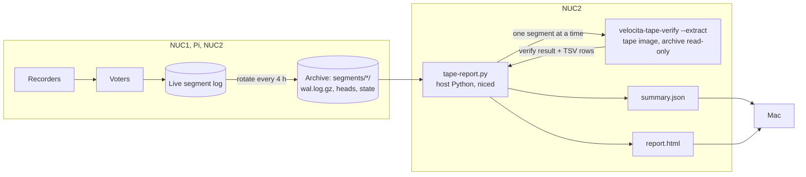
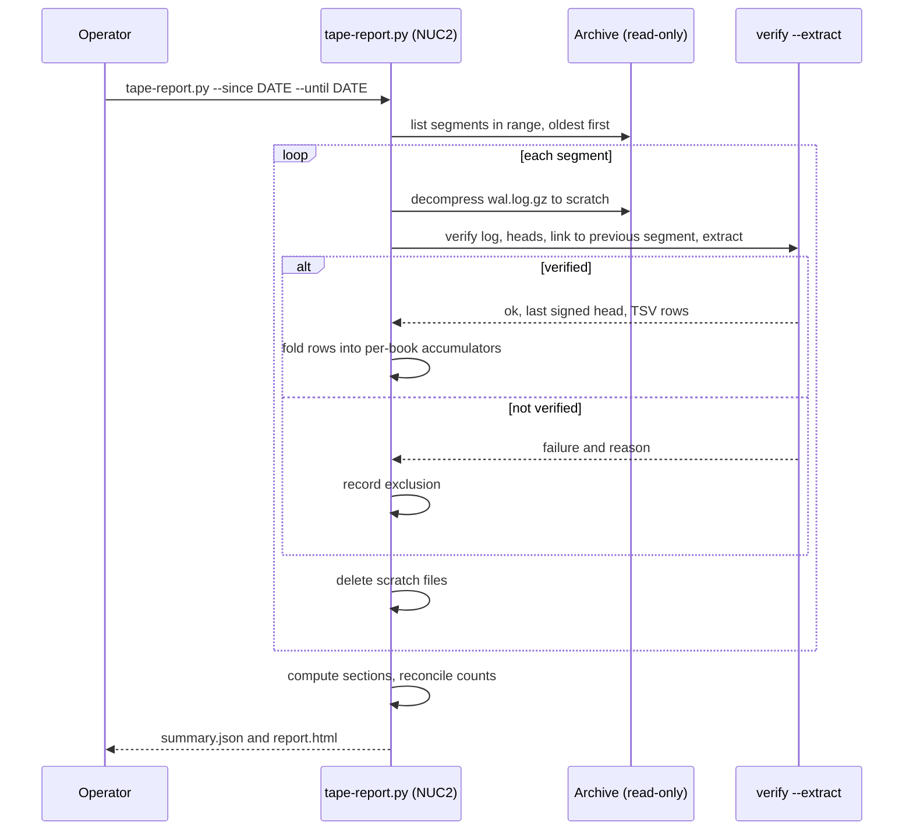
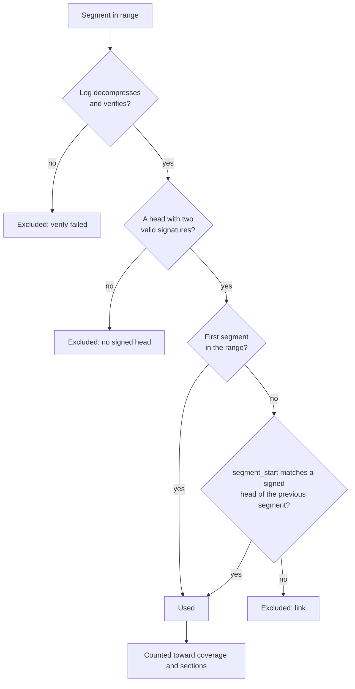
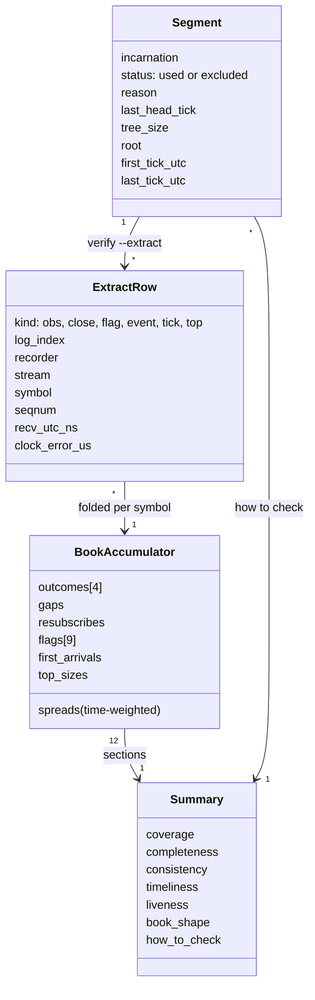
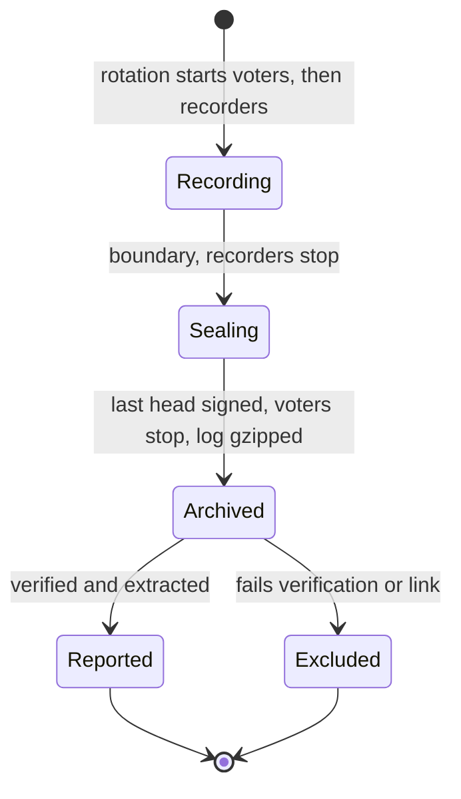

# Feed-Quality Report Plan

Status: approved 2026-11-12 and built (commit 339b1e4). All test cases map to `tests/test_tape_report.py` (ctest `tape-report-tests`).

## 1. What gets built

The report answers five questions about True Markets' public feed (complete, correct, timely, live, fair) from
the tape's archived segments, with every number traceable to a signed tree head.

| Piece | Where | What it does |
|---|---|---|
| `velocita-tape-verify --extract FILE` | C++, in the tape image | After a segment verifies, replays it through the same reducer the voters run and writes one row per event to a TSV file: observations, verdict closes, integrity flags, recorder events, ticks, and the top of each book after every DEPTH change |
| `tools/tape-report.py` | Python, standard library only | For each archived segment: decompress to a scratch file, verify, extract, aggregate, delete the scratch file. Writes `summary.json` (every number) and `report.html` (one static page) |
| Run | NUC2 | NUC2 keeps every segment; the report runs there at low priority, one segment at a time. Only the two small output files leave the host |

Out of scope for this build: a live or continuous report, exchange-side latency, other measurement locations,
authenticated feeds, publishing anything.

### What the report contains

| Section | Numbers | Source |
|---|---|---|
| Coverage | Time covered, segments used and excluded (with reasons), gaps when the tape was stopped | Ticks, segment list, verifier results |
| Completeness | Updates seen by 3, 2, 1 recorders; sequence gaps and resubscriptions per book | Verdict closes, recorder events |
| Consistency | Divergent copies, crossed and locked books, trades outside the book, snapshots that disagree with the next update | Integrity flags |
| Timeliness | Time between consecutive updates per book (against the documented ~1 s batching); arrival spread across recorders (median, p90, p99) with the clock-error bound | Observation receive times |
| Liveness | Silence lengths per book; how often a quiet book would trip the docs' 30 s "dead" rule | First-arrival times per book |
| Book shape | Spread (bp) and top-of-book size per book, US market hours against off-hours | Book tops after each DEPTH change |
| How to check | Each segment's incarnation, last signed head (tick, tree size, root) and the verifier command | Verifier output |

## 2. Guarantees

### Existing subsystems

The locked guarantees (REC, ING, RAFT, ATT, TICK, BOOK, PROOF, MET, VER, with amendments 1 and 2) are unchanged.
Segment rotation (D-55 to D-58) added behaviour that GUARANTEES.md does not yet state; the report depends on it,
so it is written down here as a new group.

| ID | Guarantee |
|---|---|
| SEG-1 | **Linked segments.** Every segment after the first has exactly one `segment_start` entry naming a signed head (at least two valid signatures) of the previous segment, and the verifier checks that link |
| SEG-2 | **One incarnation per boundary.** All hosts start a segment with the same incarnation, derived from the boundary time, without talking to each other |
| SEG-3 | **Final coverage.** Recorders stop at least one head interval before voters, so the last signed head of a segment covers every observation in it |
| SEG-4 | **Archive.** NUC2 keeps every finished segment (gzipped log, signed heads, final state) and nothing modifies it after rotation |

### New subsystem: the report (RPT)

| ID | Guarantee |
|---|---|
| RPT-1 | **Verified input only.** A segment is used only if its log verifies, at least one head verifies with two signatures, and its link (SEG-1) matches the previous segment; otherwise it is listed as excluded with the reason, never used silently |
| RPT-2 | **Same computation as the cluster.** Verdict outcomes, flags and book state come from replaying the log through the voters' own reducer, so the report's counts equal what the voters computed |
| RPT-3 | **Counts reconcile.** For every book and in total, 3-of-3 + 2-of-3 + 1-of-3 + divergent equals the number of update verdicts closed |
| RPT-4 | **Reproducible.** The same segments give a byte-identical `summary.json`, and the report cites each segment's incarnation and last signed head |
| RPT-5 | **Honest timing.** Arrival spread uses only updates seen by at least two recorders and is shown with the clocks' error bound; cadence and silence use each update's first arrival |
| RPT-6 | **Honest coverage.** Rates divide by time the tape was actually recording; gaps (stopped tape, rotation pauses, excluded segments) are listed, never filled in |
| RPT-7 | **Aggregates only.** No raw frame or payload bytes appear in either output |
| RPT-8 | **Read-only and bounded.** The archive is mounted read-only and never changes; one segment is processed at a time, so memory does not grow with the number of segments |

## 3. Test cases

Expected values come from hand-built scenarios and from the independent Python reference reducer, never from the
code under test. The last column is filled in after the build.

| Case | Guarantee | Test | Expected | Test name (after build) |
|---|---|---|---|---|
| RPT-1.1 | RPT-1 | A segment whose log has one flipped byte | Excluded, reason "verify failed"; other segments still reported || `test_a_damaged_log_is_excluded_and_others_still_count` |
| RPT-1.2 | RPT-1 | A segment whose `segment_start` names a head that is not the previous segment's | Excluded, reason "link" || `test_link_to_the_wrong_head_excludes_the_segment` |
| RPT-1.3 | RPT-1 | A segment with no signed head | Excluded, reason "no signed head" || `test_a_segment_without_a_signed_head_is_excluded`, `test_a_head_with_one_signature_is_not_enough` |
| RPT-2.1 | RPT-2 | A scripted log from three recorders (agreements, a late copy, a divergence, a gap) | Verdict counts equal the Python reference's on the same entries || `test_counts_are_the_verdicts_and_reconcile`, `test_divergent_copies_are_counted` (scenario counts; the reducer is the voters' own, and reducer-to-reference agreement is covered by `tape-core-tests`) |
| RPT-3.1 | RPT-3 | Same log | Per book and total, the four outcomes sum to the closed update verdicts || `test_counts_are_the_verdicts_and_reconcile` |
| RPT-4.1 | RPT-4 | Run the report twice on the same segments | `summary.json` byte-identical || `test_the_summary_is_reproducible_and_cites_each_head` |
| RPT-4.2 | RPT-4 | Two linked segments | Each listed with incarnation, last head tick, tree size and root, as the verifier prints them || `test_the_summary_is_reproducible_and_cites_each_head` |
| RPT-5.1 | RPT-5 | One update received at 100, 130 and 160 ms; another seen by one recorder only | Spread 60 ms from the first; the second not counted || `test_spread_uses_only_updates_seen_twice` |
| RPT-5.2 | RPT-5 | Clock errors 2 ms, 5 ms, unknown | Bound shown as 5 ms with "unknown on some hosts" || `test_clock_bound_and_unknown_hosts` |
| RPT-5.3 | RPT-5 | Updates of one book first received at 0, 1.0, 2.1, 35 s | Gaps 1.0, 1.1, 32.9 s; one silence over 30 s || `test_cadence_and_silences` |
| RPT-6.1 | RPT-6 | Two segments with a 10-minute gap between them | Covered time excludes the gap; the gap is listed; rates use covered time || `test_gap_between_segments_is_not_counted_as_recorded` |
| RPT-7.1 | RPT-7 | Payloads carrying a unique marker string | Marker appears in neither output || `test_no_payload_bytes_leave_the_report` |
| RPT-8.1 | RPT-8 | Hash every archive file before and after a run | Unchanged || `test_the_archive_is_not_modified` |
| RPT-8.2 | RPT-8 | Run over one segment, then over three copies of it | Peak memory about the same || `test_memory_does_not_grow_with_segments` (four segments against one, peak under 1.3 times) |
| RPT-M.1 | Consistency | Scripted crossed book and a trade outside the book | Counted once each, under the right book || `test_inconsistent_books_are_flagged` |
| RPT-M.2 | Book shape | Book with bid 100.00 × 2 and ask 100.10 × 3 for 10 s, then ask 100.20 for 10 s | Spreads 9.995 bp then 19.980 bp (spread ÷ mid); time-weighted mean 14.99 bp; top bid size 2 || `test_spread_is_time_weighted_and_split_by_market_hours` |
| RPT-M.3 | Book shape | Observations at 14:00 and 15:00 UTC on a weekday | Split into off-hours and US market hours (14:30 to 21:00 UTC) || `test_spread_is_time_weighted_and_split_by_market_hours` (15:00 UTC weekday counted as market hours) |
| RPT-I.1 | All | Local three-voter run on the live feed with one rotation | Both segments used, link verified, sections populated, counts reconcile || Run by hand on NUC2 against the real archive (see section 7) |

## 4. Diagrams

### Where it runs

### One report run

### Accepting a segment

### Data model

### A segment's life

## 5. Implementation plan (2 hours)

| Time | Work | Done when |
|---|---|---|
| 0:00–0:35 | `--extract` mode in the verifier: rows for observations, closes, flags, events, ticks and book tops | Builds; rows for a scripted log match the reference reducer's outcomes (RPT-2.1) |
| 0:35–1:10 | `tools/tape-report.py`: segment discovery, decompress, verify, extract, accumulate, sections, `summary.json`, `report.html` | Runs on a local two-segment run |
| 1:10–1:40 | `tests/test_tape_report.py`: the RPT cases above, using a small WAL writer for scripted logs; register with ctest | All cases pass on the Mac and in the image build |
| 1:40–2:00 | Build images, run on NUC2 over the archived segments, fill the test mapping, write up | First real report on the Mac |

**Cut line if time runs short:** drop the book-shape section (RPT-M.2 and RPT-M.3) first, then the market-hours
split. Coverage, completeness, consistency and timeliness are the core and stay.

## 6. Risks

| Risk | Effect | Response |
|---|---|---|
| A week is about 15 million log entries | Python aggregation takes minutes per segment | One segment at a time, rows as compact TSV; a week finishing in under an hour is fine for a weekly report |
| Host clocks drift | Arrival spread across recorders is only as good as the clocks | Show the recorded clock-error bound; flag spreads below it as within noise |
| Clock error may be "unknown" inside containers | No bound to show | Say so in the report rather than guess |
| NUC2 also runs a voter and recorder | Report competes for CPU | `nice`, one segment at a time, no network use |
| Segments from before rotation (the 417 MB legacy one) | Large single segment | Same path; it is the first segment, so it has no link to check |
