# Verifiable tape: system design

UML views of the tape, reviewed before any code was written. Status: **locked 2026-11-11**. Changes need an
ADR 0030 amendment.
Decisions and paths are in [ADR 0030](../adr/0030-the-verifiable-tape-is-a-separate-raft-group.md); the
locked guarantees are in [GUARANTEES.md](GUARANTEES.md). Where a diagram shows behaviour, the guarantee
that requires it is named.

## 1. Context

Who and what the tape talks to.

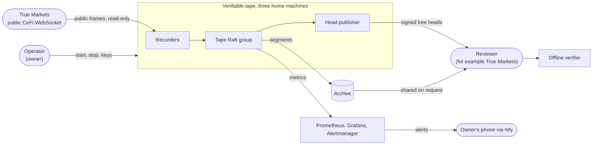

The only outside system the tape reads from is True Markets' public feed, and it never writes to it.
Reviewers get tree heads and, on request, archive segments; nothing is published without the owner's
approval.

## 2. Deployment

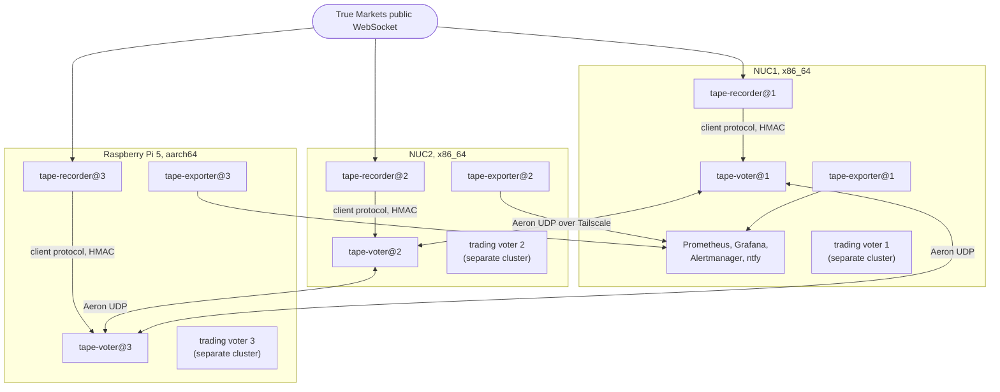

| Process | One per | Runs as | Talks to | Keys it holds |
|---|---|---|---|---|
| `tape-recorder@N` | machine | its own Unix user, rootless container | the venue (WebSocket out), its local voter (client protocol, routed to the leader) | its recorder HMAC key |
| `tape-voter@N` | machine | its own Unix user | the other two voters (Aeron UDP), recorders, the exporter's state page | peer HMAC keys, its ticker key, its tape signing key (public-key) |
| `tape-exporter@N` | machine | its own Unix user | the local voter's state page (read), Prometheus (scraped) | none |
| Head publisher | voter | inside `tape-voter` | committed signatures (read), the heads directory (write) | none, it only verifies |
| Offline verifier | anywhere | the reviewer | archive files and heads only | voters' public keys |

The tape group uses its own incarnation, key domain, Aeron ports and data directories, separate from the
trading cluster's (X-2). The trading cluster stays halted and unchanged.

## 3. Components

### 3.1 Tape voter

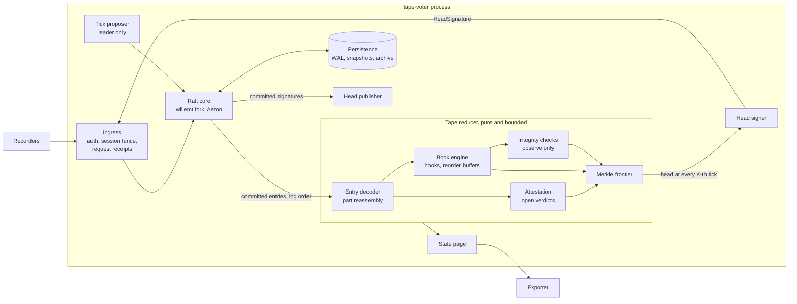

The reducer is a pure library: no clock, file, socket, thread or heap after start-up (ATT-6, BOOK-8). Every
other component does I/O. Only the leader's tick proposer is active at a time; a deposed leader's tick is
refused by number (TICK-1).

### 3.2 Recorder

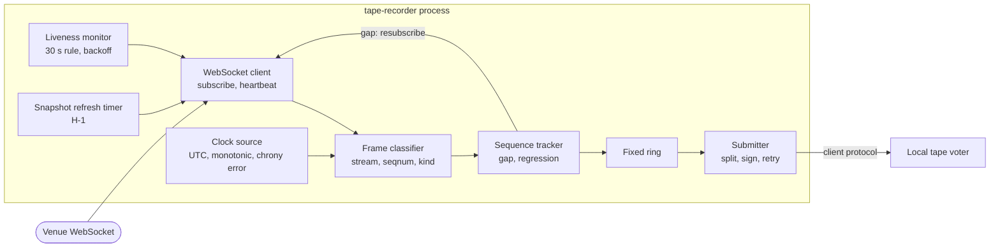

The classifier reads only the stream, `seqnum` and update kind; the bytes that go into the ring are the
frame as received (REC-1). The ring is allocated once and never grows (REC-5).

### 3.3 Offline verifier

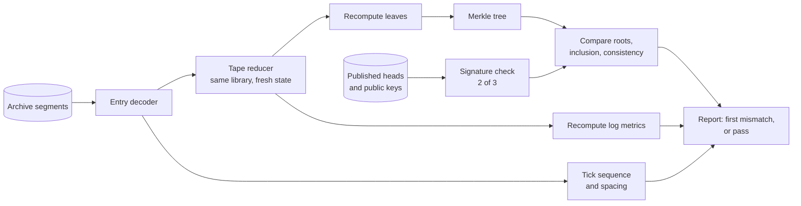

The verifier reuses the reducer library, so it proves the log and the heads were not altered. Whether the
reducer itself is correct is proven separately by the tests' independent reference book builder (BOOK-1).

## 4. Data model

### 4.1 Raft log entries

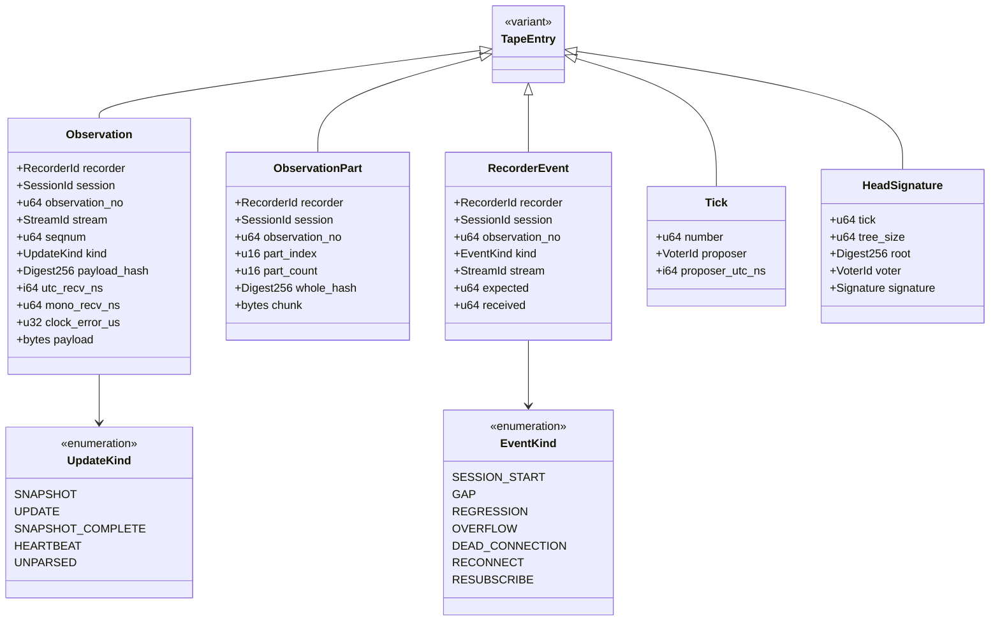

- `StreamId` is a channel plus a symbol index into a fixed table of at most 16 symbols.
- Prices and sizes stay inside `payload` as the venue's decimal strings; they become integers only in the
  book (BOOK-2).
- An observation whose payload exceeds the entry limit is sent as `ObservationPart`s with the hash of the
  whole payload (ING-4).
- For an OVERFLOW event, `expected` and `received` hold the first and last lost `seqnum`.
- HEARTBEAT and UNPARSED observations carry no usable `seqnum`, so they open no verdict.

### 4.2 Reducer state

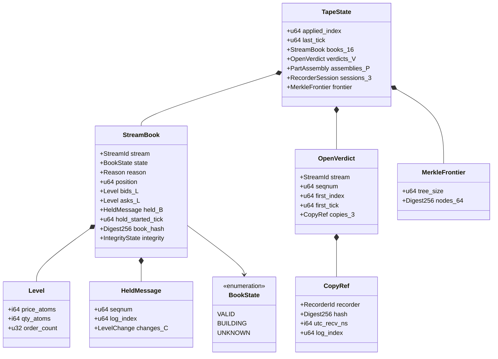

Suffixes such as `_16` and `_L` are fixed array sizes: L levels per side, B held messages per stream, C level
changes per held message, V open verdicts, P part assemblies. All are set from the day-one measurements. The
reducer cannot read the log, so a held message stores its parsed level changes, not a pointer to bytes.

### 4.3 Leaf and tree head

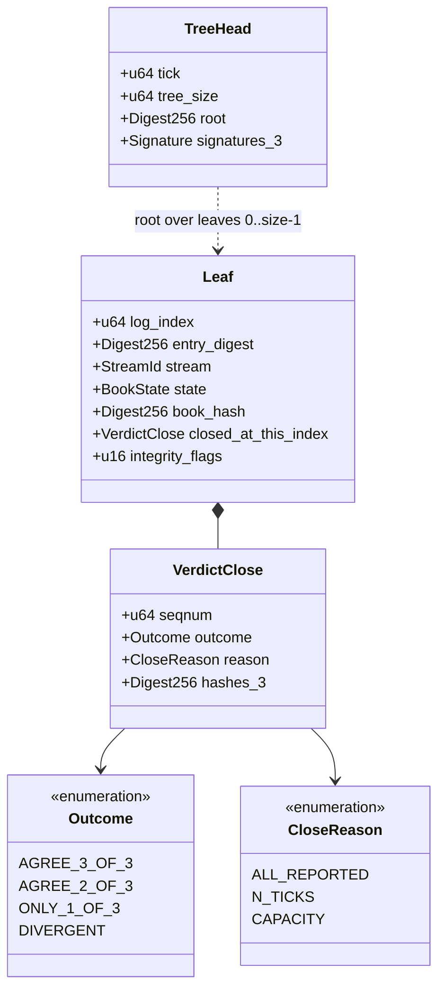

Every committed entry produces exactly one leaf. Leaves are hashed with RFC 9162's 0x00 prefix and inner
nodes with 0x01 (PROOF-1).

## 5. State machines

### 5.1 Book state, per stream

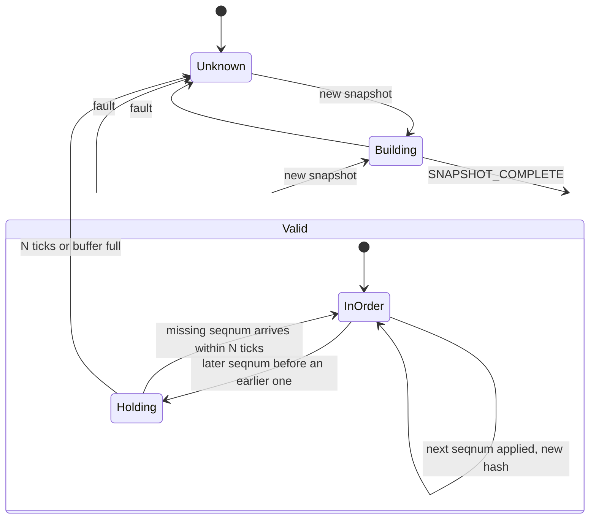

"New snapshot" means a SNAPSHOT at or after the book's position. "Fault" means a divergent copy (BOOK-4), a
malformed, too-precise or out-of-range value (BOOK-2), or a capacity limit (BOOK-8). Only `Valid` has a book
hash (BOOK-7). `Holding` is part of `Valid`: the hash stays at the last applied
message while later ones wait (BOOK-5). A snapshot behind the book's position is recorded and ignored
(BOOK-6). Recovery from `Unknown` always goes through `Building`, so no book becomes valid without a complete
snapshot.

### 5.2 Verdict, per message

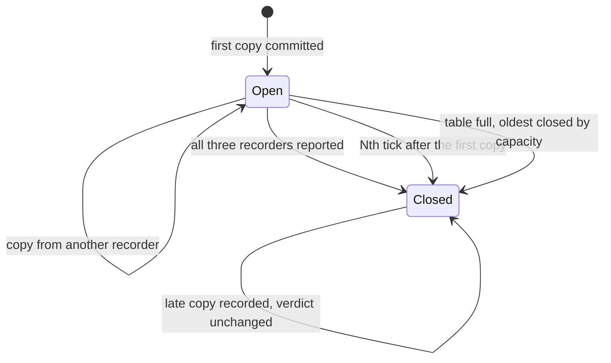

The outcome is fixed at close: 3/3, 2/3, 1/3, or divergent if the copies hold more than one distinct hash
(ATT-1, ATT-2, ATT-4, ATT-5). A late copy never changes it (ATT-3); a late divergent copy still makes the
book unknown (BOOK-4).

### 5.3 Recorder connection

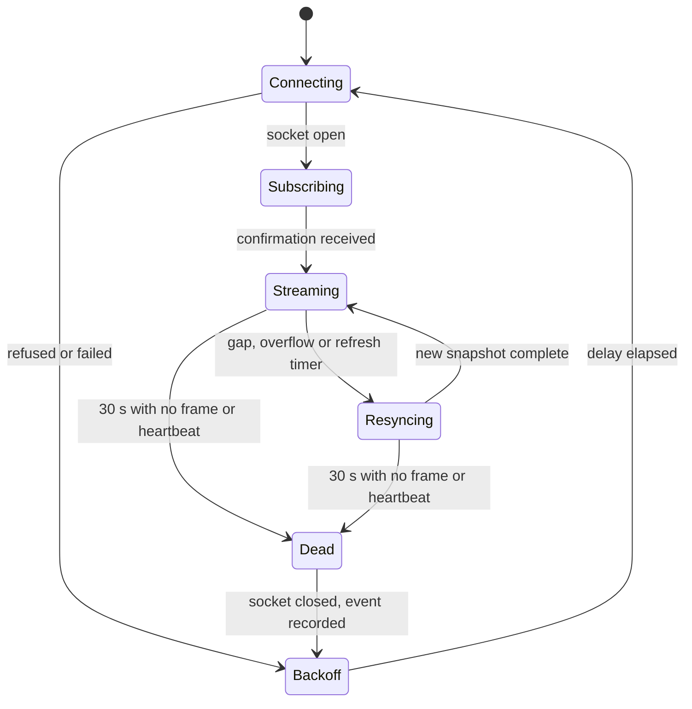

Resyncing applies to one stream while the others keep streaming (REC-3). Backoff doubles up to its cap
(REC-4). Every transition except Connecting to Subscribing is also written to the tape as a recorder event.

## 6. Behaviour

### 6.1 Applying one committed entry

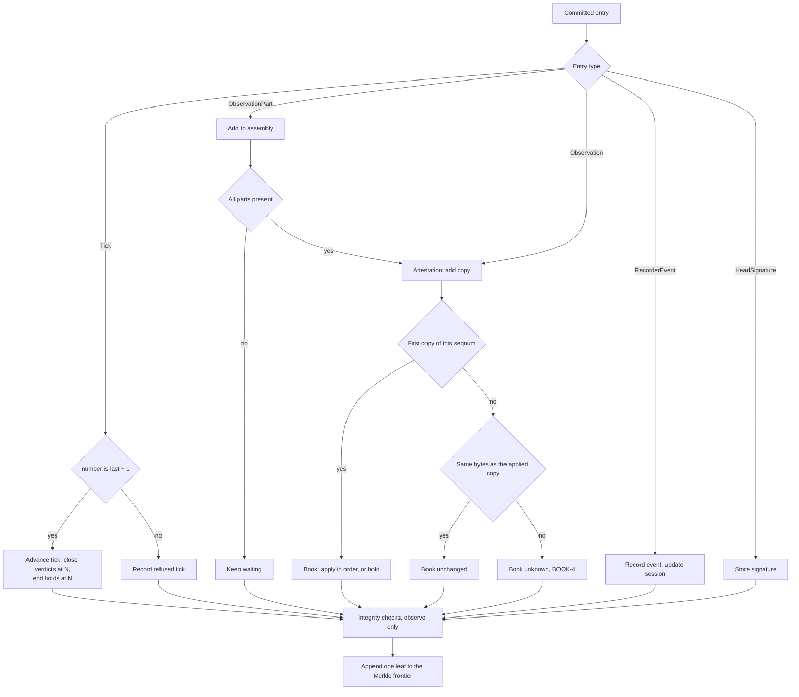

### 6.2 Tree head signing

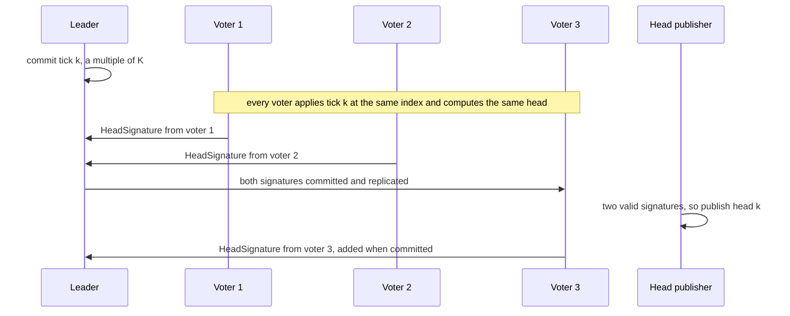

### 6.3 Leader failover

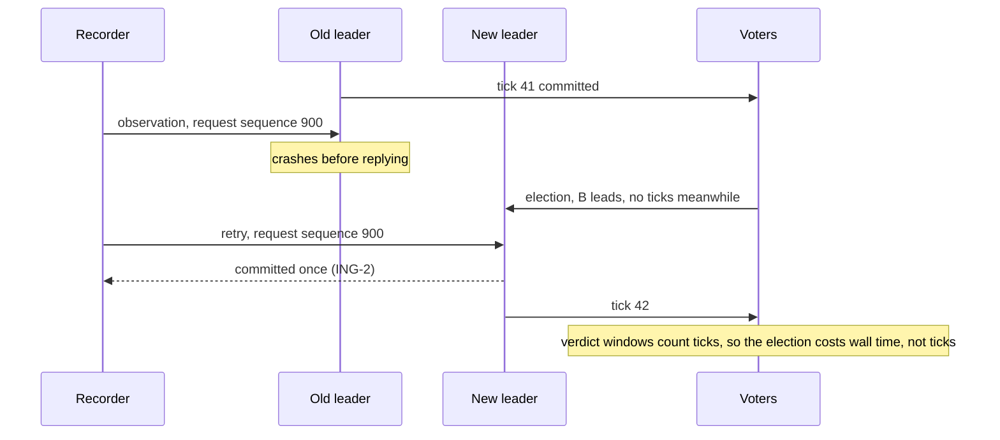

The ADR has sequence diagrams for an agreed update (HP-2) and for one recorder missing a message (FP-1).

## 7. Interfaces

| From | To | Protocol | Authentication | Carries |
|---|---|---|---|---|
| Venue | Recorder | WebSocket over TLS | none (no-login channels) | frames on DEPTH, EBBO, TRADE, INSTRUMENT, HEARTBEAT |
| Recorder | Venue | WebSocket | none | `SUBSCRIBE_NO_AUTH`, `UNSUBSCRIBE_NO_AUTH` only (REC-6) |
| Recorder | Voter | Velocita client protocol over Aeron | per-direction HMAC, session fence, request sequence | `Observation`, `ObservationPart`, `RecorderEvent` |
| Voter | Voter | Raft over Aeron UDP, Tailscale | per-direction HMAC, tape domain | Raft messages carrying `TapeEntry`s |
| Voter | Exporter | state page file | file permissions | committed state summary |
| Exporter | Prometheus | HTTP scrape | network allowlist | metrics with a `source` label |
| Head publisher | Reviewer | files | public-key signatures | tree heads |
| Archive | Verifier | files | public-key signatures on heads | log segments |

## 8. Guarantees by component

| Component | Guarantees |
|---|---|
| Recorder | REC-1 to REC-7, X-1, X-3 |
| Ingress | ING-1 to ING-4, X-2 |
| Raft core and persistence | RAFT-1 to RAFT-5 |
| Tick proposer | TICK-1 to TICK-3 |
| Attestation | ATT-1 to ATT-6 |
| Book engine and integrity checks | BOOK-1 to BOOK-9 |
| Merkle frontier, head signer, head publisher | PROOF-1 to PROOF-4 |
| Exporter | MET-1 to MET-4 |
| Offline verifier | VER-1 to VER-3 |

## 9. Review points, accepted

These came up while drawing the diagrams and were accepted with the design.

1. **A held message stores parsed level changes.** The reducer can't read the log, so the reorder buffer
   keeps each held message's parsed changes, bounded by C per message.
2. **The head publisher runs inside each voter.** Any voter can publish once two signatures are committed;
   the heads are identical, so duplicates are harmless.
3. **The verifier reuses the reducer library.** It proves the log and heads were not changed. The reducer's
   own correctness rests on the tests' independent reference builder.
4. **Heartbeats and unparsed frames open no verdict**, since they carry no usable `seqnum`. They are still
   recorded and still produce leaves.
5. **Recorders submit through their local voter**, which routes to the leader, so the deployment has no
   separate ingress process.
6. **Amendment 1** (ING-3 contiguity per recorder session) was approved and applied on 2026-11-11.
